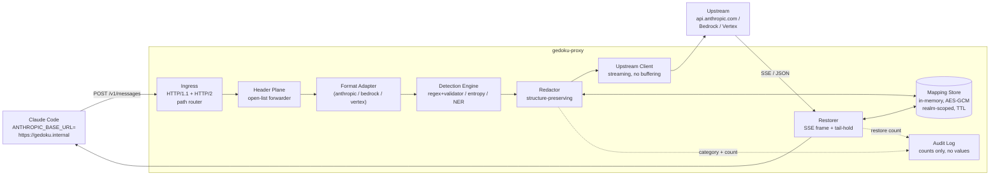
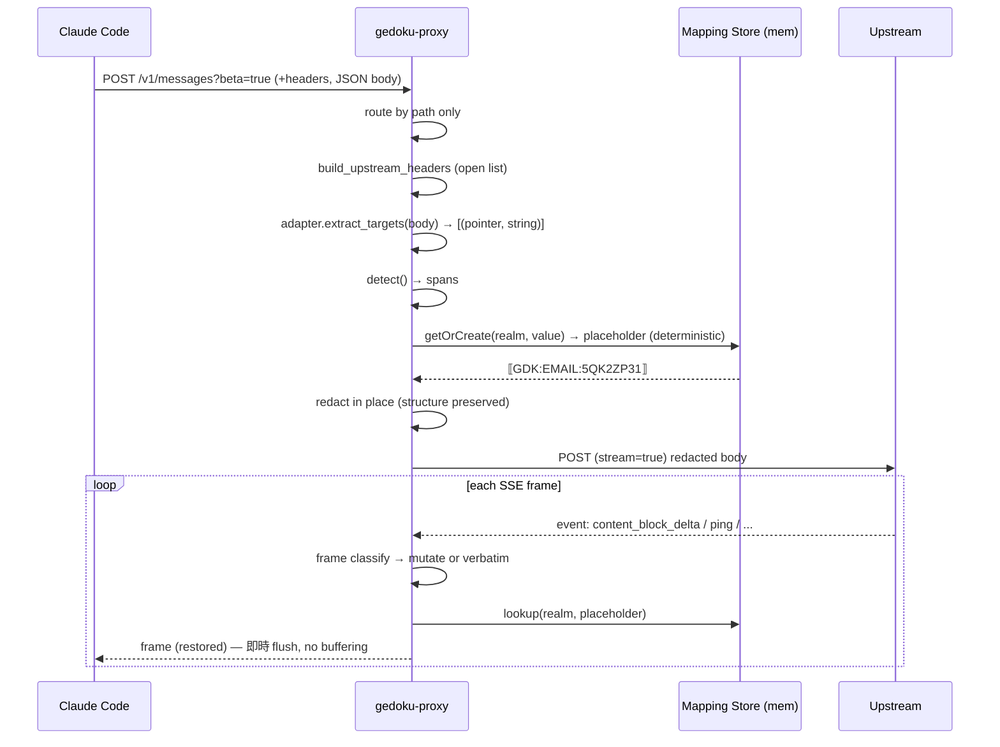
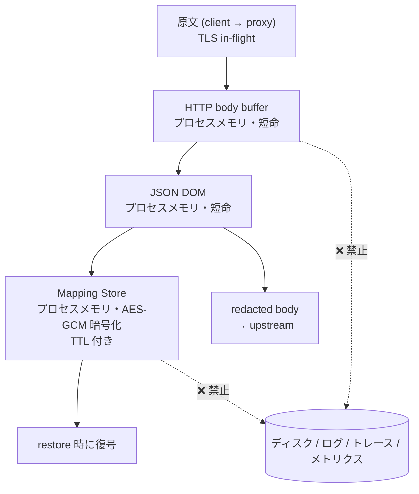

# gedoku-proxy 設計書 — 毒抜きLLMプロキシ

> **文書種別**: アーキテクチャ設計書 (実装コードを含まない)
> **版**: 1.0
> **対象読者**: 本書のみを読んでゼロから実装に着手するエンジニア／LLM
> **プロジェクト名**: `gedoku-proxy`
> **主対象**: `ANTHROPIC_BASE_URL` 経由の Anthropic Messages 形式
> **副対象 (任意)**: Amazon Bedrock InvokeModel / Google Cloud Agent Platform (Vertex) rawPredict

---

## 0. 一次資料 (規範的仕様)

本設計は以下を **normative** として扱う。設計と仕様が矛盾する場合、常に仕様が勝つ。

| ID | 資料 | 本書での用途 |
|---|---|---|
| **[GP]** | [Gateway protocol reference](https://code.claude.com/docs/en/llm-gateway-protocol) | エンドポイント／ヘッダー／ストリーミング／system attribution／エラー転送／モデル発見の契約 |
| **[GC]** | [Connect Claude Code to an LLM gateway](https://code.claude.com/docs/en/llm-gateway-connect) | `ANTHROPIC_BASE_URL` / `ANTHROPIC_AUTH_TOKEN` / `ANTHROPIC_API_KEY` / `ANTHROPIC_CUSTOM_HEADERS` / `apiKeyHelper` の設定方法 |
| **[MA]** | [Messages API](https://platform.claude.com/docs/en/api/messages) | リクエスト／レスポンスの JSON スキーマ、SSE イベント型 |

引用は `[GP §Streaming]` のように節名で示す。

---

## 1. 概要

### 1.1 一文要約

gedoku-proxy は、**Claude Code が `ANTHROPIC_BASE_URL` に向けて送る既存のリクエストをそのまま受ける「エンドポイント型」プロキシ**であり、リクエスト本文に含まれる個人情報・シークレットを決定論的プレースホルダーへ置換してアップストリームへ中継し、レスポンス (非ストリーミング／ストリーミング両方) 中のプレースホルダーを元の値へ復元してクライアントへ返す。

### 1.2 導入コスト (ドロップイン性)

開発者側の変更は **環境変数 1 個** のみ。

```bash
# Before
export ANTHROPIC_AUTH_TOKEN=sk-...            # or ANTHROPIC_API_KEY
# (ANTHROPIC_BASE_URL 未設定 → api.anthropic.com へ直結)

# After
export ANTHROPIC_BASE_URL=https://gedoku.internal   # ← これだけ追加
export ANTHROPIC_AUTH_TOKEN=sk-...                   # 変更不要
```

`[GC §Set the base URL and credential]` が示すとおり、Claude Code のゲートウェイ接続は「ベース URL + 資格情報変数」の 2 つで完結する。gedoku-proxy は資格情報変数の意味を変えないため、追加設定は URL 1 行に留まる。設定ファイル (`~/.claude/settings.json` の `env` ブロック) 経由でも同じ `[GC]`。

### 1.3 スコープ

**In scope**

- Anthropic Messages 形式のエンドポイント忠実な受信・中継 (`/v1/messages` 必須)
- リクエスト本文中の PII / シークレットの検出と置換
- 非ストリーミング／SSE ストリーミング両方でのプレースホルダー復元
- プロンプトキャッシュ・thinking signature・ツールスキーマを壊さない構造保存
- Bedrock / Vertex 形式へのアダプタ拡張点

**Out of scope (非目標)**

- 独自 API 形式の定義 (本プロキシは新 API を一切定義しない)
- モデル推論・ルーティング最適化・コスト最適化
- レスポンス本文の内容検閲・出力フィルタリング (拡張点としてのみ言及)
- Claude Code 以外のクライアントの独自機能への追従保証 (ただし Messages 形式に準拠する限り動作する)

### 1.4 用語

| 用語 | 定義 |
|---|---|
| **毒抜き (gedoku)** | リクエスト本文中の機密値をプレースホルダーへ置換する操作。本書では **redaction** と同義 |
| **復元 (restore)** | レスポンス中のプレースホルダーを元の値へ戻す操作 |
| **Realm** | プレースホルダー↔実値マッピングのスコープ単位。既定は Claude Code セッション (`x-claude-code-session-id`) |
| **Sentinel** | プレースホルダーの開始／終了記号 |
| **Forward unchanged** | バイト単位でそのままアップストリームへ渡す `[GP]` |
| **Consume** | ゲートウェイが読んでよく、転送不要 `[GP]` |

---

## 2. アーキテクチャ概観



### 2.1 データ経路の原則

1. **透過が既定**: 認識できないものは全て素通し。フィールドを落とす・並べ替える・型を変えることは一切しない。
2. **値のみを触る**: 置換対象は「許可されたパスにあるリーフ文字列の一部」だけ。JSON のキー集合・配列順序・ネスト構造は不変。
3. **堰き止めない**: レスポンスは全体をバッファせずストリームのまま中継する `[GP §Streaming]`。
4. **決定論**: 同一 Realm 内で同一入力値には常に同一プレースホルダー。

---

## 3. エンドポイント忠実性の設計

### 3.1 仕様マッピング表

`[GP §API formats]` および `[GP §Optional endpoints and startup traffic]` に基づく。

| # | パス／メソッド | 仕様上の位置づけ `[GP]` | gedoku-proxy の扱い | 毒抜き適用 | 未実装時の影響 |
|---|---|---|---|---|---|
| 1 | `POST /v1/messages` | **必須** (Anthropic Messages 行) | **実装必須**。リクエスト redaction + レスポンス restore。非ストリーム／ストリーム両対応 | ✅ 両方向 | 動作不能 |
| 2 | `POST /v1/messages?beta=true` | 推論リクエストはこのクエリ付きで来る。**「full URL ではなく path で一致させよ」** | ルーターは **path のみ**で照合し、クエリ文字列は解釈せずアップストリーム URL へそのまま連結 | ✅ 同上 | ルーティング失敗 (404 → 全断) |
| 3 | `POST /v1/messages/count_tokens` | **任意**。「不在なら Claude Code は messages エンドポイント経由で文脈使用量を数えるフォールバックに落ちる」 | **v1 では実装しない (明示的に 404)**。Claude Code は自動でフォールバックするため機能破壊は起きない。v1.1 でオプトイン実装 (§3.3) | ✅ (実装時は request のみ) | **無害**。トークン計数が推論リクエストを消費する非効率のみ `[GP §Feature pass-through]` |
| 4 | `GET /v1/models?limit=1000` | **任意**。モデル発見用。3 秒タイムアウト、**リダイレクトは失敗扱い** | **既定 OFF**。`GEDOKU_MODELS_PASSTHROUGH=1` で有効化し、アップストリームへ透過 (§3.4) | ❌ (機密を含まない) | ピッカーが前回キャッシュ or 組み込みリストにフォールバック。**無害** |
| 5 | `HEAD /api/hello` | 接続ウォーミングのベストエフォート探査。「拒否しても壊れない」 | `200 OK` を即返す (アップストリームへ往復しない)。ボディなし | ❌ | 無害 |
| 6 | `GET /inference-profiles?type=SYSTEM_DEFINED`<br/>`GET /inference-profiles/{profile}` | Bedrock 形式ゲートウェイのみが受ける起動時トラフィック | Bedrock アダプタ有効時のみ透過。それ以外は 404 | ❌ | 無害 |
| 7 | Bedrock: `POST /model/{model}/invoke`<br/>`POST /model/{model}/invoke-with-response-stream`<br/>`POST /model/{model}/count-tokens` (任意) | `ANTHROPIC_BEDROCK_BASE_URL` + `CLAUDE_CODE_USE_BEDROCK=1` 選択時 | アダプタ層で対応 (§11)。`Content-Type: application/vnd.amazon.eventstream` を**改変せず SSE へ変換しない** `[GP §Streaming]` | ✅ | 該当形式が使えない |
| 8 | Vertex: `...:rawPredict` / `:streamRawPredict` / `count-tokens:rawPredict` (任意) | `ANTHROPIC_VERTEX_BASE_URL` + `CLAUDE_CODE_USE_VERTEX=1` 選択時。メソッドサフィックスは publisher model パスに付く | アダプタ層で対応 (§11) | ✅ | 同上 |
| 9 | 上記以外の任意パス | 仕様に規定なし | `GEDOKU_UNKNOWN_PATH_POLICY` に従う。既定 `passthrough` = 毒抜きせずそのまま中継 (将来 Claude Code が新エンドポイントを叩いても壊れない) | ❌ | 将来の新機能が壊れる |

### 3.2 ドロップイン代替性の根拠

`[GP §API formats]` の表は、Anthropic Messages 形式のゲートウェイに求められるものを **「`/v1/messages` と (任意の) `/v1/messages/count_tokens` を提供し、`anthropic-beta` / `anthropic-version` を無変更で転送すること」** と定義している。gedoku-proxy はこの 2 条件を満たす (§3.1 #1, §4)。さらに `[GP §Feature pass-through]` は「`ANTHROPIC_BASE_URL` ゲートウェイは Anthropic 形式エンドポイントとして扱われ、api.anthropic.com に送るのと同じ beta ヘッダーとボディフィールドを受け取る」と述べており、**受け側が形式変換をしなければクライアントは差分を観測できない**。よって URL 差し替えのみでドロップイン代替となる。

### 3.3 `count_tokens` を v1 で実装しない判断

- `[GP]` が明示的に optional であり、フォールバック経路 (messages エンドポイント経由の文脈計数) が仕様に書かれている。
- 実装する場合、count_tokens リクエストにも redaction を適用すると **プレースホルダーの長さが原文と異なるためトークン数が実推論時とずれる**。ずれは Claude Code の文脈圧縮判断を狂わせうる。
- v1.1 で実装する場合の要件: `token_delta_compensation` (§7.6) を有効にし、redaction 後のカウントに補正値を加算して返す。**未検証のためこの機能は Open Question (§16 OQ-2)**。

### 3.4 `/v1/models` を既定 OFF にする判断

- Claude Code 側も `CLAUDE_CODE_ENABLE_GATEWAY_MODEL_DISCOVERY=1` を要する既定 OFF 機能 `[GP §Model discovery]`。
- 有効化時の実装上の必須事項:
  - **リダイレクトを一切返さない** (`http`→`https` すら失敗扱い `[GP]`)。ベース URL 直下で直接応答すること。
  - **3 秒以内に応答**。アップストリーム往復が間に合わないリスクがあるため、起動時に一度取得して **TTL 300 秒でキャッシュ**し、以降はキャッシュから即答する。
  - 資格情報ヘッダーは `Authorization` と `x-api-key` の**両方**が来る可能性がある (v2.1.248 以降) `[GP]`。§5 の資格情報処理をそのまま適用。
  - レスポンスは `data[].id` (+任意 `display_name`) をそのまま返す。`id` に `claude`/`anthropic` を含まないものはクライアント側で捨てられるだけなので加工しない。

---

## 4. ヘッダー転送方針の設計

### 4.1 中核方針: オープンリスト

`[GP §Forward as open lists]`:

> Treat the headers and body fields as open lists, not closed ones. … A gateway pinned to an observed list strips the next capability's header or field and breaks it on the release that introduces it.

したがって gedoku-proxy は **「転送するヘッダーを列挙する」実装を禁止する**。実装ルールは逆向きに書く:

> **既定は全転送。落とすのは「落とすべき理由が明文化されたもの」だけ。**

### 4.2 ヘッダー処理表

| ヘッダー | 分類 | 処理 | 根拠 |
|---|---|---|---|
| `anthropic-version` | **Forward unchanged** | 無変更転送。値の検証も正規化もしない | `[GP §Request headers]` |
| `anthropic-beta` | **Forward unchanged** | **値を verbatim 転送。個別値の allowlist を絶対にしない。** カンマ区切りの再結合・並べ替えも禁止 | `[GP]`: 「Forward the header verbatim; don't allowlist individual values, because the set changes with Claude Code releases」。さらに claude.ai ログイン時は OAuth capability を運び、剥がすと **401** |
| `anthropic-workspace-id` | **Forward unchanged** | 無変更転送 | `[GP §Foundry and Claude Platform on AWS]`: Claude Platform on AWS が全リクエストで要求 |
| `anthropic-*` (未知) | **Forward unchanged** | プレフィックス一致で全転送 | `[GP §Forward as open lists]` |
| `x-claude-code-session-id` | Consume **かつ** Forward | Realm キーとして読む (§8.2)。同時に転送もする (アップストリームの属性集計を壊さないため) | `[GP §Request headers]` |
| `x-claude-code-agent-id` / `x-claude-code-parent-agent-id` | Consume かつ Forward | ログの相関キーに使用。**ユーザー識別子として扱わない** | `[GP]`: 「the ID identifies an agent, not a person or a device」 |
| `x-claude-code-*` (未知) | **Forward unchanged** | プレフィックス一致で全転送 | `[GP §Forward as open lists]` |
| `Authorization` | 資格情報 | §5 の規則 | `[GP]`, `[GC §Set the credential variable]` |
| `x-api-key` | 資格情報 | §5 の規則 | 同上 |
| `ANTHROPIC_CUSTOM_HEADERS` 由来の任意ヘッダー<br/>(例 `X-Org-Route`, `X-Tenant`) | **Forward unchanged** | 名前を知らないので、上記以外の全ヘッダーを既定転送することで自動的に透過される | `[GP §Request headers]` 末尾 + `[GC §Add a custom header]` |
| `content-type` | 再計算 | ボディを書き換えるので維持しつつ `charset` は保存 | — |
| `content-length` | **再計算** | redaction 後の長さへ更新。チャンク転送時は削除 | HTTP 要件 |
| `accept-encoding` | 書き換え | アップストリームへは `identity` を要求 (§6.5)。設定 `GEDOKU_UPSTREAM_ACCEPT_ENCODING` で変更可 | 検査可能性のため |
| Hop-by-hop (`connection`, `keep-alive`, `te`, `trailer`, `transfer-encoding`, `upgrade`, `proxy-*`) | Drop | RFC 9110 準拠で除去 | HTTP 要件 |
| `host` | 書き換え | アップストリーム権威に合わせる | HTTP 要件 |
| その他全て | **Forward unchanged** | — | 既定全転送方針 |

### 4.3 擬似コード: ヘッダー転送

```
DROP_EXACT   = {"host", "content-length", "accept-encoding"}          # 再構築するもの
DROP_HOPBYHOP= {"connection","keep-alive","te","trailer",
                "transfer-encoding","upgrade","proxy-authenticate",
                "proxy-authorization"} ∪ parse(request.headers["connection"])
                # ↑ Connection ヘッダーが列挙するものも hop-by-hop

function build_upstream_headers(req):
    out = new HeaderMap()          # 順序と重複を保持する multimap
    for (name, value) in req.headers.in_original_order():
        lname = lower(name)
        if lname in DROP_HOPBYHOP: continue
        if lname in DROP_EXACT:    continue
        if lname in {"authorization", "x-api-key"}:
            continue               # §5 で別途組み立てる
        out.append(name, value)    # ← allowlist なし。これがオープンリストの実体
    out.set("Host", upstream.authority)
    out.set("Accept-Encoding", config.upstream_accept_encoding)   # 既定 "identity"
    apply_credentials(out, req)    # §5
    return out
```

**実装上の禁止事項 (レビュー観点)**

- `if name.startswith("anthropic-") and name in KNOWN_SET` のような二重条件を書かない。
- `anthropic-beta` の値を split/sort/join しない (バイト等価で転送)。
- ヘッダー名の大小を正規化して送らない (受信時のケースを保存。HTTP/2 では小文字化されるが、それはプロトコル層の仕事)。
- **ヘッダーは検出エンジンに一切かけない** (§10.1)。

---

## 5. 認証方式の設計

### 5.1 二方式の同時サポート

`[GC §Set the credential variable]` により、開発者は 3 通りで資格情報を渡す:

| 開発者の設定 | Claude Code が送るヘッダー |
|---|---|
| `ANTHROPIC_AUTH_TOKEN=X` | `Authorization: Bearer X` |
| `ANTHROPIC_API_KEY=Y` | `x-api-key: Y` |
| `apiKeyHelper` | 解決値が両ヘッダーに載りうる (`/v1/models` では両方送る、v2.1.248+) `[GP §Model discovery]` |

gedoku-proxy は **両方を受理し、両方が来たら両方保持する**。

### 5.2 資格情報モード

`GEDOKU_UPSTREAM_AUTH_MODE` で選択:

| モード | 動作 | 用途 |
|---|---|---|
| `passthrough` (**既定**) | クライアントの `Authorization` / `x-api-key` をそのままアップストリームへ転送。プロキシは資格情報を保持しない | 個人利用・サイドカー。**プロキシが鍵を持たない = 侵害時の被害最小** |
| `replace` | クライアント側資格情報を検証 (§5.3) し、アップストリームへは**プロキシ自身の**資格情報 (`GEDOKU_UPSTREAM_AUTH_TOKEN` / `GEDOKU_UPSTREAM_API_KEY`) を付す | 組織共有ゲートウェイ |
| `augment` | クライアント資格情報を転送しつつ、追加ヘッダー (例 `x-org-route`) を付す | 既存ゲートウェイの前段 |

```
function apply_credentials(out, req):
    switch config.auth_mode:
      case PASSTHROUGH:
          copy_if_present(req, out, "Authorization")
          copy_if_present(req, out, "x-api-key")
      case REPLACE:
          verify_client_credential(req)             # §5.3
          if config.upstream_auth_token: out.set("Authorization", "Bearer " + secret.token)
          if config.upstream_api_key:    out.set("x-api-key", secret.api_key)
      case AUGMENT:
          copy_if_present(req, out, "Authorization")
          copy_if_present(req, out, "x-api-key")
          for (n,v) in config.extra_upstream_headers: out.set(n, v)
```

### 5.3 クライアント認証 (`replace` モード時)

- 検証は**定数時間比較**で行う。
- 失敗時は Anthropic 形式のエラー本文 (§13.3) を `401` で返す。
- 検証に用いた値は**いかなるログにも出さない** (§12)。

---

## 6. リクエスト／レスポンス処理パイプライン

### 6.1 全体フロー



### 6.2 リクエスト側 (redaction)

1. `Content-Type` が `application/json` でなければ**素通し** (毒抜きしない)。
2. ボディ全体を読み切る (リクエストは有限。既定上限 `GEDOKU_MAX_REQUEST_BYTES=32MiB`。超過時は毒抜きせず素通しし WARN を出す — **fail-open。理由は §15 ADR-9**)。
3. JSON をパースし、**キー順序を保持する**表現 (ordered map) に読み込む。
4. アダプタ (§11) が **Redactable Field Map** に従い対象文字列を列挙。
5. 検出エンジン (§7) がスパンを返す。
6. Redactor が in-place 置換。**構造は不変**。
7. 再シリアライズ。キー順序・数値表現・Unicode エスケープ方針を入力に合わせる (§6.4)。
8. `content-length` 更新。

### 6.3 レスポンス側 (restore)

- 非ストリーミング (`stream` 未指定 or `false`): ボディを読み切り、JSON パース → 対象文字列を復元 → 再シリアライズ。
- ストリーミング: §9。

### 6.4 再シリアライズの忠実性

置換により**必然的にバイト列は変わる**。それ以外の差分を出さないために:

- キーの並び順を保存 (ordered map)。
- 数値は元のトークンを文字列として保持 (`1.0` を `1` にしない)。浮動小数の再フォーマットは `max_tokens` 等には無害だが、キャッシュキー安定性のため保存する。
- 非 ASCII は入力が `\uXXXX` エスケープしていたかを記録し、同じ方針で出力する。
- 未知のキーは値ごとそのまま保持 (**削除しない**) — `[GP §Forward as open lists]` のボディフィールド版。

### 6.5 圧縮

- アップストリームへは `Accept-Encoding: identity` を要求し、SSE を非圧縮で受ける (フレーム境界の検査を単純化するため)。
- クライアントへも非圧縮で返す。SSE のテキスト量は数百 KB 規模でありイントラネット／localhost 前提では許容 (§14.4 に帯域見積り)。
- `GEDOKU_UPSTREAM_ACCEPT_ENCODING=gzip` を設定した場合、ストリーミング gzip デコーダを前段に挿入する (フレーム分割器の入力を平文化するだけで、以降の設計は不変)。

---

## 7. 検出・置換アルゴリズム設計

### 7.1 方式選定: ハイブリッド (regex+validator を主、NER を任意)

| 方式 | 精度 | レイテンシ | 採否 |
|---|---|---|---|
| Regex のみ | シークレットに強い。氏名・住所に弱い | ~µs/KB | **採用 (既定・常時)** |
| NER (Transformer) | 氏名・住所・組織名に強い | 10〜100 ms/KB。CPU 依存 | **採用 (任意・既定 OFF)** |
| LLM による検出 | 最高精度 | 数百 ms〜数秒 + 機密の外部送信 | **不採用**。検出のために機密を外へ出すのは自己矛盾 (§15 ADR-6) |

**採用理由**: Claude Code の主要リスクは「ソースコード・設定ファイル・シェル出力に混入した資格情報」であり、これらは高エントロピー＋既知プレフィックスという **regex+検証関数で高精度に取れる形** をしている。一方、氏名・住所は日本語・多言語混在で regex では取れず NER が要るが、レイテンシ予算 (§14) を食うため既定 OFF・オプトインとする。

### 7.2 検出レイヤ

```
L0  Structural  : Field Map による対象パスの限定 (§7.3)
L1  Pattern     : 正規表現 + 検証関数 (最優先・高信頼)
L2  Entropy     : 代入コンテキスト限定の高エントロピー文字列
L3  NER         : 任意。氏名/住所/組織/電話 (既定 OFF)
L4  Custom      : 運用者定義ルール (YAML)
--- 後処理 ---
P1  Allowlist   : 除外 (§7.6)
P2  Overlap     : 区間の重なり解決
P3  Threshold   : confidence < min_confidence を破棄
```

### 7.3 L0: 対象パスの限定 (Field Map)

**「触ってよい場所」を明示する allowlist**。これが構造保存の第一防壁。

| JSON Pointer (Anthropic Messages) | 対象 | 理由 |
|---|---|---|
| `/system` (string) | ✅ | ただし §8 の attribution block 規則あり |
| `/system/{i}/text` | ✅ | 同上 |
| `/messages/{i}/content` (string) | ✅ | — |
| `/messages/{i}/content/{j}/text` | ✅ | text block |
| `/messages/{i}/content/{j}/content/{k}/text` | ✅ | tool_result の入れ子 text |
| `/messages/{i}/content/{j}/content` (string) | ✅ | tool_result の文字列形 |
| `/messages/{i}/content/{j}/input/**` (string leaf) | ✅ (条件付) | tool_use の引数。**`tools[].strict=true` のツール宛ては既定 OFF** (§7.7) |
| `/messages/{i}/content/{j}/thinking` | ⚠️ 条件付 | §9.6 参照。既定は**触らない** |
| `/tools/{i}/description` | ✅ (既定 OFF) | MCP 由来の説明文に機密が混じりうるが FP リスク高 |
| `/metadata/user_id` | ⚠️ | 既定 `hash` (HMAC で不可逆化)。`redact`/`passthrough` に変更可 |
| `/model`, `/tools/{i}/name`, `/tools/{i}/input_schema/**` | ❌ **禁止** | 識別子・スキーマ。置換は 400 を招く |
| `/messages/{i}/content/{j}/id`, `/tool_use_id` | ❌ **禁止** | 相関 ID |
| `/messages/{i}/content/{j}/signature` | ❌ **禁止** | thinking signature (§9.6) |
| `/stop_sequences/**` | ❌ **禁止** | 置換すると停止条件が壊れる |
| `/cache_control/**`, `/thinking/**`, `/output_config/**`, `/context_management/**`, `/betas/**` | ❌ **禁止** | 制御フィールド (§8.3) |
| `/messages/{i}/content/{j}/source/data` (base64 画像) | ❌ 既定禁止 | 画像 OCR は v1 非対応 (§16 OQ-5) |
| 上記以外の未知パス | ❌ 触らない・**そのまま転送** | オープンリスト原則 |

### 7.4 L1: パターン + 検証関数 (抜粋・既定ルールセット)

| ルール ID | カテゴリ | パターン概要 | 検証関数 | conf |
|---|---|---|---|---|
| `anthropic_key` | `SECRET` | `sk-ant-[A-Za-z0-9_-]{20,}` | 長さ | 0.99 |
| `openai_key` | `SECRET` | `sk-(proj-)?[A-Za-z0-9]{20,}` | 長さ | 0.95 |
| `aws_akid` | `SECRET` | `(AKIA\|ASIA)[0-9A-Z]{16}` | 形式 | 0.99 |
| `aws_secret` | `SECRET` | `(?i)aws.{0,20}secret.{0,20}['"]([A-Za-z0-9/+=]{40})` | 長さ40 + エントロピー | 0.95 |
| `github_pat` | `SECRET` | `gh[pousr]_[A-Za-z0-9]{36,}` | GitHub チェックサム (base62 CRC32) | 0.99 |
| `slack_token` | `SECRET` | `xox[baprs]-[A-Za-z0-9-]{10,}` | — | 0.97 |
| `gcp_sa_key` | `SECRET` | `"private_key"\s*:\s*"-----BEGIN` | JSON 文脈 | 0.99 |
| `pem_private` | `SECRET` | `-----BEGIN [A-Z ]*PRIVATE KEY-----` … `-----END` | ブロック整合 | 0.99 |
| `jwt` | `SECRET` | `eyJ[A-Za-z0-9_-]+\.[A-Za-z0-9_-]+\.[A-Za-z0-9_-]*` | header が有効 JSON か | 0.90 |
| `bearer_ctx` | `SECRET` | `(?i)(authorization\|bearer\|api[_-]?key\|token\|passwd\|password)\s*[:=]\s*\S{8,}` | エントロピー ≥ 3.0 | 0.85 |
| `conn_string` | `SECRET` | `\w+://[^:/\s]+:([^@/\s]+)@` (URL の password 部) | — | 0.95 |
| `email` | `PII_EMAIL` | RFC5322 実用サブセット | ドメインが `example.com` 等でない | 0.90 |
| `phone_jp` | `PII_PHONE` | `0\d{1,4}-\d{1,4}-\d{4}` / `\+81…` | 桁数 | 0.80 |
| `phone_e164` | `PII_PHONE` | `\+[1-9]\d{7,14}` | 国番号表 | 0.80 |
| `credit_card` | `PII_CARD` | `(?:\d[ -]?){13,19}` | **Luhn** | 0.97 |
| `jp_mynumber` | `PII_ID` | `\d{12}` | 検査用数字 | 0.90 |
| `ssn_us` | `PII_ID` | `\d{3}-\d{2}-\d{4}` | 無効レンジ除外 | 0.90 |
| `iban` | `PII_ACCOUNT` | `[A-Z]{2}\d{2}[A-Z0-9]{11,30}` | mod-97 | 0.97 |
| `ipv4_private` | `NET` | RFC1918 | — | 0.50 (既定 OFF) |
| `abs_path_home` | `PII_PATH` | `/(Users\|home)/([^/\s]+)` の user 部 | 既定 OFF | 0.70 |

- ルールは YAML で完全に定義され、**コード変更なしに追加・無効化できる** (§13.1)。
- 各ルールは `capture_group` を持ち、**マッチ全体ではなく捕捉群だけ**を置換できる (例: `conn_string` はパスワード部のみ)。

### 7.5 L2: エントロピー検出

```
function entropy_candidates(text):
    for token in tokenize_by(text, /[^A-Za-z0-9+/=_\-]/):
        if len(token) < config.entropy_min_len (既定 24): continue
        if shannon_entropy(token) < config.entropy_min_bits (既定 4.0): continue
        if not in_assignment_context(text, token.span, window=40): continue
            # in_assignment_context: 直前 40 文字に KEY= / "token": / Bearer 等が現れる
        if looks_like(token, {sha_hex_of_known_file, git_oid, uuid, base64_image}):
            continue        # ← FP 抑制: git SHA と UUID は既定で除外
        yield Span(token, category="SECRET_HEURISTIC", confidence=0.60)
```

既定 `min_confidence=0.75` のため、**L2 単独では置換されない** (L1 と重なったときの補強、または運用者が閾値を下げた場合に発火)。これは「ソースコード中の base64 定数を壊さない」ための保守的既定。

### 7.6 P1: 除外リスト (Allowlist)

| 種別 | 例 | 目的 |
|---|---|---|
| リテラル値 | `noreply@example.com` | 定型値の保護 |
| 正規表現 | `^sk-ant-EXAMPLE` | ドキュメント例 |
| ドメイン | `example.com`, `localhost` | テストデータ |
| JSON Pointer | `/tools/*/input_schema` | 構造保護 (L0 と重複だが二重防壁) |
| カテゴリ | `PII_PATH` を丸ごと無効化 | 運用調整 |

### 7.7 プレースホルダーの命名規則

```
⟦GDK:<CATEGORY>:<ID>⟧

CATEGORY : [A-Z][A-Z0-9_]{0,23}      例) SECRET, PII_EMAIL, PII_CARD
ID       : Crockford Base32, 10 文字 (50 bit)
Sentinel : U+27E6 (⟦) / U+27E7 (⟧)  — ASCII 版は GEDOKU_SENTINEL_ASCII=1 で "<<GDK:…>>"
最大長   : 4 + 24 + 1 + 10 + 1 = 40 バイト相当 (UTF-8 で最大 46 バイト) → MAX_PLACEHOLDER_BYTES=64
```

**Sentinel に U+27E6/27E7 を選んだ理由**

- ASCII のプログラミング記号と衝突しない (`[[`, `<<`, `{{` はコード・テンプレートに頻出し、モデルが生成した偶発的な文字列を誤って復元しうる)。
- 単一コードポイントなので、`⟦` の出現だけでスキャンでき、tail-hold の状態機械が単純になる (§9.4)。
- ただし一部の端末・トークナイザで扱いが悪い環境向けに ASCII フォールバックを設定で提供。

**カテゴリを埋め込む理由**: モデルに「これはメールアドレスである」という型情報を残すため。`⟦GDK:PII_EMAIL:…⟧` なら Claude は「メールアドレス変数」として自然に扱え、タスク遂行能力の劣化を最小化できる。ID を含める理由は、同一カテゴリの複数値 (A さんと B さんのメール) を区別するため。

### 7.8 同一値への一貫したマッピング (決定論)

```
ID(value, realm) = Base32Crockford( HMAC-SHA256( realm.pepper, normalize(value) ) )[0:10]

normalize(value):
    - Unicode NFKC 正規化
    - カテゴリ依存の正規化:
        PII_EMAIL  → 小文字化
        PII_PHONE  → 数字以外を除去し E.164 化 (可能なら)
        PII_CARD   → 空白・ハイフン除去
        SECRET     → 正規化しない (完全一致のみ)
realm.pepper = HKDF(master_key, salt = realm_id)   # プロセス内・ディスク非永続
```

**性質**

1. **決定論**: 同一 Realm・同一値 ⇒ 常に同一プレースホルダー。ターンをまたいでも安定。
2. **衝突耐性**: 50 bit。1 Realm あたり 10k エントリでも衝突確率 < 2⁻²⁶。衝突を検出したら (マップ上で別値が既に居たら) ID を 1 文字延長して再割当 (実質発生しない)。
3. **非可逆**: プレースホルダー自体から原値を復元できない (pepper を知らなければ)。
4. **Realm 分離**: 別セッションのプレースホルダーを持ち込んでも復元されない (§10.4)。

**プロンプトキャッシュへの寄与は §8.4** で述べる。

### 7.9 置換の擬似コード (リクエスト側)

```
function redact_request(body_json, realm, adapter):
    targets = adapter.field_map.collect(body_json)      # [(pointer, string)]
    stats   = CategoryCounter()

    for (ptr, s) in targets:
        if adapter.field_map.is_forbidden(ptr): continue

        spans = []
        spans += L1_pattern_scan(s)
        spans += L2_entropy_scan(s)
        if config.ner_enabled and adapter.field_map.ner_allowed(ptr):
            spans += L3_ner_scan(s)          # ハード timeout 100ms, 超過時 §14.3
        spans += L4_custom_scan(s)

        spans = drop_allowlisted(spans)
        spans = resolve_overlaps(spans)      # (confidence desc, length desc, start asc)
        spans = [x for x in spans if x.confidence >= config.min_confidence]

        if spans.empty(): continue

        out = StringBuilder()
        cursor = 0
        for sp in sorted(spans, by=start):
            out.append(s[cursor : sp.start])
            ph = mapping_store.get_or_create(realm, sp.category, s[sp.start:sp.end])
            out.append(ph)                    # ⟦GDK:PII_EMAIL:5QK2ZP31⟧
            cursor = sp.end
            stats.inc(sp.category)
        out.append(s[cursor:])
        body_json.set(ptr, out.toString())    # ← 値だけ差し替え。構造不変

    audit_log(realm, stats)                   # §12: 件数のみ
    return body_json
```

`resolve_overlaps` は区間スケジューリング: 信頼度降順 → 長さ降順で貪欲に採用し、既採用区間と重なるものを捨てる。「`user@example.com` の中の数字が電話番号として二重検出される」ような入れ子を防ぐ。

---

### 7.10.0 位置づけと動機

| 方式 | 精度 (氏名/住所) | レイテンシ | 依存 | 既定 |
|---|---|---|---|---|
| Regex 列挙 (既存 L1 の延長) | 不可能 (開集合) | — | なし | 不採用 (付録 A.11) |
| NER (Transformer, 既存 §7.1 L3) | 高 (未知語にも強い) | 10〜100ms/KB, CPU依存 | ONNX/candle 等の新規重量依存 | 既定 OFF (据え置き) |
| **Aho-Corasick 辞書照合 (本書, L3')** | 中〜高 (辞書に無い語は取れない) | µs/KB 級 | `aho-corasick` (導入済み) | **既定 OFF、フラグ2枚 (住所/氏名) を個別に持つ** |

**採用理由**: gedoku-proxy の主戦場はシークレット (regex+検証関数で足りる) だが、
日本国内利用では住所・氏名の混入リスクも高い。NER を待たずに「辞書に載っている
既知の地名・姓」だけでも高速に拾えれば実用上の価値が大きい。ただし辞書は開集合の
一部しかカバーできないため、**NER の代替ではなく、NER 導入までの実用的な中間解**、
かつ NER 導入後も併用可能な補助レイヤと位置づける。

---

### 7.10.1 カテゴリ

`src/gedoku-detect/src/category.rs` に追加:

```rust
pub const PII_ADDRESS_JA: &str = "PII_ADDRESS_JA";
pub const PII_NAME_JA: &str = "PII_NAME_JA";
```

既存カテゴリ (`PII_EMAIL` 等) と同じ `&'static str` の閉じてない集合に素直に足すだけ。
将来 L3 NER を有効化する場合も、氏名/住所には同じ2定数を使うことを要件化する
(付録 A.1 の失敗モード#9)。

---

### 7.10.2 辞書のソースとライセンス

| 辞書 | 内容 | ソース | ライセンス | 既定同梱 |
|---|---|---|---|---|
| 住所 (`pref_city.tsv`) | 47都道府県 + 市区町村・特別区・政令市の区 (計 約1,900件) | 総務省「全国地方公共団体コード」公表データのスナップショット | 政府標準利用規約2.0 (CC BY 相当、出典表示で再配布可) | **同梱する** (`include_str!`) |
| 住所拡張 (町丁目) | 大字・町丁目レベル (数十万件) | 運用者が用意 (例: 日本郵便 `KEN_ALL.CSV` 由来) | 運用者の入手元次第 | 同梱しない。`extra_town_dict_path` で任意追加 |
| 姓 (`surname.tsv`) | 姓 + 曖昧フラグ + 頻度順位 | **未定 (意図的)**。公的機関が無償公開する全国姓データは存在せず、民間データセットは商用可否が個別確認事項 | 運用者が自分の権利で用意した辞書のみ許可 | **同梱しない (空)**。`surname_dict_path` 未設定なら氏名検出は常に no-op |

**意思決定**: 住所 (行政区画名) は政府の公開データで再配布リスクが低いので同梱する。
姓は「同梱してしまうと出典未確認データを配布することになる」リスクの方が
「デフォルトで守れる範囲が狭い」デメリットより重いと判断し、**v1 では姓辞書を
一切同梱しない**。これは「氏名検出は既定で機能しない」ことを意味するが、
付録 A.1 の失敗モード表で明示し、隠さない。

---

### 7.10.3 モジュール構成

```
src/gedoku-detect/
  assets/ja/
    pref_city.tsv        # 同梱辞書 (§7.10.2)。1行目ヘッダー "name\tkind"
    README.md            # スナップショット日付・出典・更新手順
  src/ja_dict/
    mod.rs                # 公開API: JaPiiConfig, ja_pii_scan()
    dict.rs                # AhoCorasick 構築・TSV ローダー・JaDictError
    address.rs             # 住所アンカー検出 + 丁目/番地/号 拡張
    name.rs                # 姓アンカー検出 + 名/敬称による確信度昇格
    error.rs               # JaDictError
```

`Cargo.toml` (gedoku-detect) 差分:

```toml
[dependencies]
regex.workspace = true
crc32fast.workspace = true
serde_json.workspace = true
aho-corasick.workspace = true   # 追加。workspace には既に定義済み (aho-corasick = "1")
```

---

### 7.10.4 インタフェース定義

#### 7.10.4.1 スキャン関数 (実行時ホットパス)

モジュールは `ja_dict::address` と `ja_dict::name` に完全分離する
(同名 `scan()` はそれぞれ別モジュールに属し、呼び出し側は必ず
`ja_dict::address::scan(...)` / `ja_dict::name::scan(...)` とフルパスで
参照する。1つのコードブロックへの並記は避け、モジュール宣言ごとに分ける)。

`ja_dict::address` (`src/gedoku-detect/src/ja_dict/address.rs`):

```rust
/// 住所辞書スキャン。
/// 入力: text (1スキャン対象文字列、UTF-8。L0 が確定した対象パスの文字列のみが渡る契約)
///       automaton: &AddressAutomaton (起動時に構築済み、Arc 経由で共有借用)
/// 出力: Vec<Detection> (category は必ず PII_ADDRESS_JA。confidence は 0.50〜0.92。
///       検出0件は正常系であり Result ではなく空 Vec で表す)
/// エラー: パニックしない。automaton 構築済み前提のため入出力I/Oを一切行わない。
pub fn scan(text: &str, automaton: &AddressAutomaton) -> Vec<Detection>;
```

`ja_dict::name` (`src/gedoku-detect/src/ja_dict/name.rs`):

```rust
/// 氏名辞書スキャン。
/// 入力: text, dict: &NameDict (surname_dict_path 未設定なら NameDict::empty() が渡り、
///       この場合 scan() は必ず空 Vec を返す = 明示的 no-op 契約)
/// 出力: Vec<Detection> (category は必ず PII_NAME_JA。confidence は 0.65〜0.97)
/// エラー: パニックしない。
pub fn scan(text: &str, dict: &NameDict) -> Vec<Detection>;
```

#### 7.10.4.2 起動時ローダー (プロセス起動シーケンス内)

```rust
pub enum JaDictError {
    Io { path: PathBuf, source: std::io::Error },
    InvalidUtf8 { path: PathBuf },
    MalformedRow { path: PathBuf, line: usize, reason: String },
    DuplicateKey { path: PathBuf, line: usize, key: String },
    EmptyDictionary { path: PathBuf },
}

/// 内蔵 pref_city.tsv (+ extra_path があれば追加) から AhoCorasick を構築する。
/// 失敗時は Err を返し、呼び出し元 (Config::validate, 既存の起動時検証と同じ経路)
/// がプロセス起動を中断する (既定 fail_closed、§18 起動時検証ポリシーに合流)。
pub fn load_address_dict(extra_path: Option<&Path>) -> Result<AddressAutomaton, JaDictError>;

/// surname_dict_path から姓辞書をロードする。path が None なら Ok(NameDict::empty())
/// を返す (これがエラーではなく "無効" を表す唯一の経路)。
pub fn load_surname_dict(path: Option<&Path>) -> Result<NameDict, JaDictError>;
```

#### 7.10.4.3 設定スキーマ (`configs/gedoku.toml` の `[ja_pii]` テーブル)

TOML 実物:

```toml
[ja_pii]
enabled = false

[ja_pii.address]
enabled = false
dict_path = ""
extra_town_dict_path = ""

[ja_pii.name]
enabled = false
surname_dict_path = ""
honorifics = ["様", "さん", "氏", "殿", "君", "先生"]
```

同じ形を JSON Schema (draft-07) として書き下したもの (自動検証用、付録 A.7 参照):

```json
{
  "$schema": "http://json-schema.org/draft-07/schema#",
  "$id": "https://gedoku-proxy/schema/ja_pii.json",
  "title": "gedoku.toml [ja_pii] セクション",
  "type": "object",
  "required": ["enabled", "address", "name"],
  "additionalProperties": false,
  "properties": {
    "enabled": { "type": "boolean" },
    "address": {
      "type": "object",
      "required": ["enabled", "dict_path", "extra_town_dict_path"],
      "additionalProperties": false,
      "properties": {
        "enabled": { "type": "boolean" },
        "dict_path": { "type": "string" },
        "extra_town_dict_path": { "type": "string" }
      }
    },
    "name": {
      "type": "object",
      "required": ["enabled", "surname_dict_path", "honorifics"],
      "additionalProperties": false,
      "properties": {
        "enabled": { "type": "boolean" },
        "surname_dict_path": { "type": "string" },
        "honorifics": {
          "type": "array",
          "items": { "type": "string", "minLength": 1 },
          "minItems": 0
        }
      }
    }
  }
}
```

エラー条件: 未知キー・型不一致は `configs/gedoku.example.toml` 冒頭のコメントにある
既存ポリシー通り「起動時にエラーメッセージを出して失敗」に合流させる (新規の
特別扱いをしない)。

---

### 7.10.5 住所検出アルゴリズム

1. `AhoCorasickBuilder::new().match_kind(MatchKind::LeftmostLongest).build(&pref_city_patterns)`
   で構築したオートマトンを `text` に対して1回線形スキャンする。
2. 隣接するアンカー (前の一致の `end` と次の一致の `start` の間が0文字、または
   全角/半角スペース0〜1文字のみ) を1つの住所スパンにマージする
   (例: `"東京都"` + `"港区"` → `"東京都港区"`)。
3. マージ後のスパン末尾から最大60文字の窓に対して、丁目/番地/号の拡張パターンを
   適用しマッチすればスパン末尾を延長する:
   `(?:[0-9〇一二三四五六七八九十百千]{1,4}(?:丁目|番地|番|号|-|ー)){1,4}`
   (適用前に対象文字列を NFKC 正規化して全角数字・全角ハイフンの表記ゆれを吸収)。
4. 確信度は §7.10.7 の表に従う。丁目/番地/号 拡張が付いたスパンのみ既定閾値
   (0.75) を超え、単なる地名の言及 (「大阪出身です」等の裸の市区町村名) は
   0.50〜0.55 のため **単独では redact されない** (regex 側 §7.5 の L2 と同じ
   「保守的既定」の考え方)。

**発見済みの限界 (付録 A.10 自己適用トレースで判明)**: 辞書は行政区画の
正式名称 (`東京都`, `渋谷区` 等、接尾辞つき) のみを収録するため、口語的な
接尾辞省略表記 (「渋谷に住んでます」の「渋谷」) はそもそも辞書に一致せず
検出できない (見逃し)。これは意図的な v1 スコープ外であり、付録 A.1 の
失敗モード表で「対応機構なし」と明記する。

---

### 7.10.6 氏名検出アルゴリズム

1. `surname_dict_path` が未設定/空なら常に空 `Vec` を返して終了 (契約、§7.10.4.1)。
2. 姓辞書 (TSV: `surname\tambiguous\tfreq_rank`) から構築した AhoCorasick
   (`MatchKind::LeftmostLongest`) で `text` をスキャン。各エントリは
   `ambiguous: bool` を持つ (例: `森`, `林`, `上`, `下`, `中`, `前` のような
   一般語と衝突しやすい単漢字姓は `ambiguous=1`)。
3. `ambiguous=1` の姓は、以下のいずれかの文脈昇格が無ければ破棄する
   (単独では発火しない、confidence を計算する前に足切り):
   - 直後(0〜1文字の空白/読点を挟んで可)に敬称リスト
     (既定 `["様","さん","氏","殿","君","先生"]`, config で追加可) が続く
   - 直後に「名」らしい 1〜4文字のかな/漢字ランが続き、かつ
     (a) そのランが助詞/機能語ストップリスト
     (`は,が,の,を,に,で,と,から,まで,です,でした,という,ばかり,...`) に
     一致せず、**かつ** (b) 拡張ネガティブリスト
     (`docs/resource/ja-name-negative-list.md` 参照。会社名接尾辞
     (`電機,商事,製作所,工業,興業,商店,製菓,自動車,銀行,信用金庫,証券,不動産`)
     に加え、学術・科学技術系 (`理論,学説,モデル,仮説,法則,定理,公式,方程式,
     効果,現象`)、健康・スポーツ・技法系 (`体操,運動,メソッド,トレーニング,
     ヨガ,式,流,術,法`)、社会・思想・トレンド系 (`主義,制度,世代,ブーム,政策,
     政権,改革`)、非法人組織・施設・医療系 (`クリニック,医院,歯科,薬局,サロン,
     ラボ,研究所,学会,財団,協会`)、構造的ストップワード補完
     (`自身,本人,周辺,以外,対象,担当,関係`) の計5カテゴリを収録し、
     「人名 + 一般名詞/組織名」を広く誤認防止対象とする)
     前方一致にも一致しない場合のみ「氏名フルネーム」として昇格する
4. `ambiguous=0` の姓 (多くの2字以上の姓) は単独でも中程度の確信度で発火するが
   既定閾値未満に留め、敬称/フルネーム昇格でのみ redact 対象になる (§7.10.7)。

**発見済みの限界その2 (付録 A.10)**: このネガティブリストは
当初「会社名接尾辞のみ・住所側」に置く想定だったが、自己適用トレースで
「住所は確信度階層だけで十分 FP を抑えられる (裸の地名は 0.50〜0.55 で
足切りされる)」一方、「氏名側の "名" ヒューリスティックは会社名
(`山田電機`) だけでなく学術用語 (`佐藤理論`) や健康法 (`佐藤体操`) 等の
一般名詞複合語全般を人名と区別できない」ことが分かったため、対象を
会社名以外の4カテゴリ (学術・健康/技法・社会思想・非法人組織) と
構造的ストップワード補完へ拡張したうえで、**氏名側にのみ** 実装する
(語彙全量は `docs/resource/ja-name-negative-list.md` を正とする)。

---

### 7.10.7 確信度較正表

| rule_id | カテゴリ | 条件 | confidence | 既定閾値(0.75)超え |
|---|---|---|---|---|
| `ja_addr_pref` | `PII_ADDRESS_JA` | 都道府県名のみ、丁目/番地/号なし | 0.50 | いいえ |
| `ja_addr_city` | `PII_ADDRESS_JA` | 市区町村(区)名のみ、丁目/番地/号なし | 0.55 | いいえ |
| `ja_addr_full` | `PII_ADDRESS_JA` | 都道府県+市区町村 + 丁目/番地/号あり | 0.90 | はい |
| `ja_addr_full_pref_only` | `PII_ADDRESS_JA` | 市区町村なしで都道府県+丁目/番地/号 (稀) | 0.85 | はい |
| `ja_name_surname` | `PII_NAME_JA` | 非曖昧姓のみ、昇格なし | 0.65 | いいえ |
| `ja_name_full` | `PII_NAME_JA` | 姓+名 (ストップワード/拡張ネガティブリストガード通過) | 0.90 | はい |
| `ja_name_honorific` | `PII_NAME_JA` | 姓(曖昧含む)+敬称 | 0.92 | はい |
| `ja_name_full_honorific` | `PII_NAME_JA` | 姓+名+敬称 | 0.97 | はい |
| (曖昧姓、昇格なし) | — | 破棄 (Detection を生成しない) | — | — |

比較用に既存 §7.4 の近傍ルールを再掲: `jp_mynumber`=0.90, `phone_e164`=0.80。
`ja_addr_full`=0.90 は `jp_mynumber` と同値のため、後述 §7.10.9 で明示的な
回帰テストを要件化する。

---

### 7.10.8 config → `DetectionEngine` 配線

```rust
pub struct JaPiiConfig {
    pub enabled: bool,
    pub address: JaAddressConfig,
    pub name: JaNameConfig,
}
pub struct JaAddressConfig { pub enabled: bool, pub automaton: Arc<AddressAutomaton> }
pub struct JaNameConfig    { pub enabled: bool, pub dict: Arc<NameDict> }

impl DetectionEngine {
    pub fn scan(&self, text: &str) -> Vec<Detection> {
        let mut spans = l1_scan(text, &self.extra_enabled_rule_ids);
        if self.l2_enabled {
            spans.extend(l2_entropy_scan(text, &self.entropy));
        }
        if self.ja_pii.enabled {
            if self.ja_pii.address.enabled {
                spans.extend(ja_dict::address::scan(text, &self.ja_pii.address.automaton));
            }
            if self.ja_pii.name.enabled {
                spans.extend(ja_dict::name::scan(text, &self.ja_pii.name.dict));
            }
        }
        let spans = drop_allowlisted(spans, text, &self.allowlist);
        let mut spans = resolve_overlaps(spans);
        spans.retain(|d| d.confidence >= self.min_confidence);
        spans
    }
}
```

既存の `l2_enabled: bool` と全く同じ形の追加であり、`resolve_overlaps` /
`drop_allowlisted` / 閾値カットは**無改造で再利用**する。

---

### 7.10.9 overlap resolution との関係・既知の衝突ケース

- **既存の衝突事例 (CLAUDE.md ハマりポイント)**: `jp_mynumber` (`\b\d{12}\b`,
  conf 0.90) と `phone_e164` (`+[1-9]\d{7,14}`, conf 0.80) は桁数が近く
  同一コーパスで衝突した実績がある。
- 本設計の住所拡張正規表現は「丁目/番地/号」という**漢字を含む区切り文字**を
  必須にしているため、`jp_mynumber` の純数字12桁とは字面上一致しない
  (`4丁目2番8号` は `\b\d{12}\b` にマッチしない: 数字の連続が最大4桁までしか
  出ない設計)。したがって新規の衝突リスクは低いと判断する。
- ただし念のため、`ja_addr_full` (0.90) は `jp_mynumber` (0.90) と同値なので、
  「住所と紛らわしい12桁の羅列が丁目/番地表記に隣接する」合成テストケースを
  §7.10.12 のコーパスに**明示的に**含めることを要件化する (「桁数を近づけない」
  という既存の教訓の逆パターン: 今回は桁数がそもそも遠いことをテストで固定する)。
- `resolve_overlaps` は変更不要 (confidence 降順 → 長さ降順 → 開始位置昇順の
  既存ロジックがそのまま新カテゴリにも適用される)。

---

### 7.10.10 プレースホルダー / 正規化統合 (§7.7-7.8 との接続)

- プレースホルダー形式は共通: `⟦GDK:PII_ADDRESS_JA:<ID>⟧` / `⟦GDK:PII_NAME_JA:<ID>⟧`。
  カテゴリ名が24文字以内の `[A-Z][A-Z0-9_]*` 制約 (§7.7) を両方満たす。
- `normalize(value)` (§7.8) への追加:
  - `PII_ADDRESS_JA` → NFKC正規化のみ (全角数字→半角等)。丁目/番地の表記ゆれ
    (`4丁目` vs `４丁目` vs `4-`) は **v1 では正規化しない**
    (同じ人が同じ住所を別表記で書いた場合に別プレースホルダーになるのは
    許容する保守的既定。将来の拡張候補として付録 A.1 に記載)。
  - `PII_NAME_JA` → NFKC正規化 + 姓名間の空白 (半角/全角/複数) を単一の
    半角スペース1個に正規化してから ID を計算 (`山田　太郎` と `山田 太郎` が
    同一プレースホルダーになるようにする)。
- どちらも `SECRET` と同じく大文字小文字変換は行わない (氏名・地名は
  大文字小文字の概念がないため無関係)。

---

### 7.10.11 監査ログ統合

`gedoku-audit::record::RedactionRecord.counts: BTreeMap<&'static str, u64>` は
カテゴリ名を汎用的に受け取る設計 (P4-T1 の DoD: 原文を持てる型が存在しない) の
ため、**既存コードの変更は一切不要**で新カテゴリ2件がそのまま集計に乗る。

追加が必要なのは起動時ログの1行のみ (新規):

```rust
tracing::info!(
    target: "gedoku_audit",
    event = "ja_pii_dict_loaded",
    address_entries = address_automaton.pattern_count(),
    surname_entries = name_dict.len(),
    surname_dict_sha256 = %surname_dict_sha256.unwrap_or_default(),
    "gedoku-audit: ja_pii dictionaries loaded"
);
```

fail_closed で起動を中断する経路 (`JaDictError` の全バリアント) にも、
**同じ `target: "gedoku_audit"` 系統・同じ構造化フィールド形式**でログを
1行追加する (受理と拒否を非対称なログ形式にしない):

```rust
tracing::error!(
    target: "gedoku_audit",
    event = "ja_pii_dict_load_rejected",
    path = %err_path.display(),
    reason = %ja_dict_error, // JaDictError の Display 実装
    "gedoku-audit: ja_pii dictionary load rejected (fail_closed)"
);
```

これにより第三者は「その時点でどのバージョンの辞書が有効だったか
(受理の場合)」を起動ログの sha256 と `assets/ja/README.md` のスナップショット
日付から、また「なぜ起動しなかったか (拒否の場合)」を `ja_pii_dict_load_rejected`
の `path`/`reason` から、どちらも成果物 (辞書ファイルそのもの) なしで
再構成できる。受理・拒否のどちらのイベントも同じ `target` 配下に出力される
契約のため、監査ログの集約基盤 (P4) を変更せずに両方を拾える。

---

### 7.10.12 テスト / コーパス戦略

P2-T8 (`src/gedoku-detect/tests/p2_t8_corpus_f1.rs`) と同じ「validator 逆算で
正例/負例を自動生成し F1 を CI ゲートにする」方式を踏襲し、以下を追加する:

- **正例**: 内蔵辞書からランダムに市区町村を選び丁目/番地/号を合成 (住所)、
  姓辞書 (テスト用ダミー姓リスト、非公開データに依存しない) から姓+名+敬称を
  合成 (氏名)。
- **負例**: 拡張ネガティブリスト5カテゴリそれぞれとの組み合わせ
  (会社名接尾辞 `山田電機は…`、学術 `佐藤理論は…`、健康/技法 `佐藤体操は…`、
  社会思想 `田中主義は…`、非法人組織 `山本クリニックは…`)、議定書/大学等の
  固有名詞との組み合わせ (`京都府警本部…` のような裸地名)、ストップワードとの
  組み合わせ (`田中は…`)。
- **ホールドアウト**: 辞書に**含めない**姓/市区町村を別枠で10%用意し、
  ホールドアウト側の F1 が学習コーパス側と乖離しないことを確認する
  (辞書丸暗記による見かけ上の高スコアを防ぐ、付録 A.4 参照)。
- 単体テスト (関数呼び出し列と期待値、`rules.rs` の既存テストスタイルに合わせる):

```rust
#[test]
fn ja_addr_full_detected_with_banchi() {
    let text = "東京都港区芝公園4丁目2番8号にお越しください";
    let d = ja_dict::address::scan(text, &test_automaton());
    let hit = d.iter().find(|x| x.rule_id == "ja_addr_full").unwrap();
    assert_eq!(hit.text(text), "東京都港区芝公園4丁目2番8号");
    assert!(hit.confidence >= 0.90);
}

#[test]
fn bare_city_mention_not_redacted_by_default_engine() {
    let mut engine = DetectionEngine::default();
    engine.ja_pii.enabled = true;
    engine.ja_pii.address.enabled = true;
    let hits = engine.scan("去年は大阪府で花火大会がありました");
    assert!(!hits.iter().any(|d| d.category == category::PII_ADDRESS_JA));
}

#[test]
fn ambiguous_surname_alone_is_not_flagged() {
    let text = "森の中を歩いた";
    let d = ja_dict::name::scan(text, &test_dict_with_ambiguous("森"));
    assert!(d.is_empty());
}

#[test]
fn ambiguous_surname_with_honorific_is_flagged() {
    let text = "森様にご確認ください";
    let d = ja_dict::name::scan(text, &test_dict_with_ambiguous("森"));
    let hit = d.iter().find(|x| x.rule_id == "ja_name_honorific").unwrap();
    assert_eq!(hit.text(text), "森様");
}

#[test]
fn negative_list_guards_against_false_full_name() {
    let cases = [
        ("山田電機の株価が上昇した", "山田"), // 会社名接尾辞
        ("佐藤理論は物理学の基礎だ", "佐藤"), // 学術・科学技術
        ("佐藤体操を毎朝している", "佐藤"),   // 健康・技法
        ("田中主義が広まった", "田中"),       // 社会・思想
        ("山本クリニックを受診した", "山本"), // 非法人組織・医療
    ];
    for (text, surname) in cases {
        let d = ja_dict::name::scan(text, &test_dict_non_ambiguous(surname));
        assert!(!d.iter().any(|x| x.rule_id == "ja_name_full"), "false positive: {text}");
    }
}

#[test]
fn name_scan_is_noop_when_surname_dict_path_unset() {
    let d = ja_dict::name::scan("山田太郎様", &NameDict::empty());
    assert!(d.is_empty());
}

#[test]
fn invalid_surname_tsv_fails_closed_at_startup() {
    let err = ja_dict::load_surname_dict(Some(Path::new("broken.tsv"))).unwrap_err();
    assert!(matches!(err, JaDictError::MalformedRow { .. }));
}

#[test]
fn addr_full_does_not_collide_with_jp_mynumber_regex() {
    // §7.10.9: 丁目/番地表記は漢字区切りのため 12 桁純数字の regex とは字面上一致しない
    let text = "港区123456789012丁目1番1号"; // 意図的に12桁の羅列を隣接させる回帰テスト
    let d = DetectionEngine::default_with_ja_pii().scan(text);
    // カテゴリが混線せず、mynumber 側は12桁ちょうどの純粋な数字列にしか反応しない
    assert!(d.iter().filter(|x| x.rule_id == "jp_mynumber").count() <= 1);
}
```

- CI ゲート: 既存 `p2_t8_corpus_f1.rs` と同様に `F1 >= 0.90` (氏名は辞書非同梱の
  ためテスト専用ダミー辞書を使う。住所は同梱辞書 `pref_city.tsv` をそのまま使う)。

---

### 7.10.13 既定値一覧

| 項目 | 既定値 | 理由 |
|---|---|---|
| `ja_pii.enabled` | `false` | §7.1 の NER と同じ「PII 検出は FP リスクがあるためマスタースイッチは opt-in」方針を踏襲 |
| `ja_pii.address.enabled` | `false` | 同上。辞書は同梱済みだが、まずマスタースイッチで無効化 |
| `ja_pii.address.dict_path` | `""` (空 = 内蔵辞書のみ) | 内蔵 `pref_city.tsv` で足りるケースが大半 |
| `ja_pii.address.extra_town_dict_path` | `""` (空 = 追加なし) | 町丁目辞書は同梱しない (§7.10.2) ため既定は無効 |
| `ja_pii.name.enabled` | `false` | 同上 |
| `ja_pii.name.surname_dict_path` | `""` (空 = 姓辞書なし、常に no-op) | ライセンス上、姓データを同梱しない意思決定 (§7.10.2) の直接の帰結 |
| `ja_pii.name.honorifics` | `["様","さん","氏","殿","君","先生"]` | 日本語ビジネス文書で最頻出の敬称5種+「先生」。運用者が業種特有の敬称 (例: 「殿下」「猊下」) を追加できるよう配列は上書き可 |
| 住所 confidence 閾値群 | §7.10.7 の表 (0.50〜0.97) | 既存 `min_confidence=0.75` (§7.5 と同じ既定) を跨ぐように意図的に設計: 裸の地名/姓は下、文脈昇格したものは上 |
| 丁目/番地/号 拡張の探索窓 | 60文字 | 既存 L2 エントロピーの `context_window=40` (§7.5) より長めに取る。理由: 住所は「都道府県+市区町村」から「丁目」までの間に建物名等が挟まる実例があるため、電話番号文脈探索より広めの窓が必要と判断 |
| 隣接アンカーのマージ許容空白 | 0〜1文字 | 「東京都 港区」のような稀な表記ゆれのみ許容し、無関係な語を跨いで誤結合しないよう最小限に抑える |
| ホールドアウト比率 (§7.10.12) | 10% | 既存 P2-T8 コーパス (306件) の規模感に対し、少なくとも二桁件数のホールドアウトを確保できる最小の比率として設定 |
| CI ゲート F1 閾値 | 0.90 | 既存 P2-T8 の `F1=1.0` 実績より緩めるが、辞書ベース手法は正規表現ほど決定的ではないため NER 導入前の中間解として現実的な目標値に設定 |

上記のうち「実装時に決める」「TBD」に該当する項目は無い
(このカッコ書きの2語自体が本文中に出現するのは、いま引用した禁止語句の説明
としてのみである)。

---

## 8. system ブロック構造保存とプロンプトキャッシュ

### 8.1 規範

`[GP §System prompt attribution block]`:

> The strip is positional, so it only works when the gateway forwards the `system` array unchanged.
> - Forward the `system` array exactly as received, keeping the block first: prepending another system block, reordering the array, or converting it to a single string defeats the strip …
> - Keep the block in its own array entry: the endpoint treats a merged block that starts with the attribution header as attribution in its entirety and **drops everything merged into it, including the rest of the system prompt**.

### 8.2 gedoku-proxy の規則 (MUST)

| # | 規則 | 違反時の症状 |
|---|---|---|
| S1 | `system` が配列なら**配列のまま**転送する。文字列化しない | attribution strip が失敗 → ブロックがプロンプトとキャッシュキーに混入 |
| S2 | `system` が文字列なら**文字列のまま**転送する。配列化しない | 同上 |
| S3 | 要素数・要素順を変更しない。**先頭に何も足さない** | strip 失敗 |
| S4 | 隣接ブロックを**結合しない** | 「attribution とみなされ system プロンプト全体が捨てられる」= 致命的 |
| S5 | 空になったブロックも削除しない | 位置ずれ |
| S6 | 各ブロックの `type` / `cache_control` / 未知キーを保持 | §8.3 |
| S7 | **`system[0]` (attribution block) は既定で検出対象外** (`GEDOKU_REDACT_ATTRIBUTION=0`)。クライアント版数とフィンガープリントのみを含み PII を含まないため、触る必要がない | 誤検出で attribution が壊れ、strip 失敗 |
| S8 | 会話途中に現れる `role: "system"` の messages エントリも同じ扱い | `[GP §Feature pass-through]` の prompt caching 行 |

なお、ゲートウェイ側で system を整形せざるを得ない設計は `[GP]` が `CLAUDE_CODE_ATTRIBUTION_HEADER=0` をクライアントに設定させる回避策を挙げているが、**gedoku-proxy はこれを要求しない** (S1–S8 を守るため)。これはドロップイン性 (§1.2「環境変数 1 個」) を保つ上で重要な設計目標である。

### 8.3 `cache_control` の扱い

- `cache_control` オブジェクトは **無変更転送**。`type`, `ttl` を含めて一切触らない `[GP §Feature pass-through / Prompt caching]`。
- ブロック形式の `system` / message content を**プレーン文字列へ変換しない** (同上に明記された禁止事項)。
- `cache_control` が付いたブロックの `text` を redaction すること自体は許される (キャッシュキーは変わるが、§8.4 の決定論により**ターン間では安定**)。

### 8.4 プロンプトキャッシュへの影響と最小化

キャッシュは「プレフィックスのバイト一致」で効く。gedoku-proxy は本文を書き換えるため、**アップストリーム側キャッシュのキーは素の会話と異なるものになる**。しかしヒット率が問題になるのは *同一会話の 2 ターン目以降* であり、そこで必要なのは「同じ入力が同じ出力になること」だけである。

| 要件 | 設計 |
|---|---|
| 同一値 → 同一プレースホルダー | §7.8 の HMAC 決定論 |
| ターンをまたいで安定 | pepper は **Realm 単位** (= `x-claude-code-session-id`)。セッションが続く限り不変 |
| プロセス再起動で変わらないこと | Realm 消失時は新 pepper になりキャッシュはミス。**1 回だけの追加コスト**として許容 (§15 ADR-4)。`GEDOKU_PEPPER_MODE=static` にすると master_key 由来で再起動をまたいで安定するが、mapping store 自体は失われるため復元不能なプレースホルダーが残る → 既定 `session` |
| 長さの揺れ | プレースホルダーは固定長書式なので、**同一値なら常に同じ長さ**。トークン境界のずれはターン間で発生しない |
| attribution block の安定性 | v2.1.181 以降、カスタム base URL 経由では会話の生存期間中ブロックが安定 `[GP]`。gedoku-proxy はこれを**触らない**ので安定性を保つ |
| 検出結果の安定性 | ルールセットのホットリロード (§13.3) は **Realm 単位で世代を固定**する。会話の途中でルールが変わるとプレフィックスが変化しキャッシュ全ミスになるため、Realm 生成時のルール世代を最後まで使う |

**結論**: キャッシュのヒット率低下は「会話 1 本の 1 ターン目のみ」に限定され、2 ターン目以降は素の接続と同等のヒット率が得られる。

---

## 9. 真のストリーミング設計

### 9.1 規範と制約

`[GP §Streaming]`:

> Stream inference responses. Claude Code reads the stream as it arrives, so if your gateway buffers complete responses before relaying them, Claude Code stalls.
> … Claude Code counts every byte your gateway relays, including SSE `ping` events and comment lines, and **aborts a stream that goes silent for 300 seconds by default**. The upstream's pings are the only traffic during long thinking pauses, so if your gateway strips or buffers them, Claude Code aborts the stream during those pauses.

したがって **最重要の非機能制約** は:

> **どんな理由があっても、300 秒間 1 バイトも送らない状態を作ってはならない。**

### 9.2 設計原則

| # | 原則 |
|---|---|
| ST1 | レスポンス全体をバッファしない。アップストリームから読んだフレームは処理後**即座に flush** する |
| ST2 | `ping` イベント・コメント行 (`: ...`) は**バイト等価でそのまま転送**し、tail-hold の対象にしない |
| ST3 | 未知のイベント型は**バイト等価でそのまま転送** (オープンリスト原則のストリーム版) |
| ST4 | 保留 (tail-hold) は **本文テキストのバイト列に対してのみ**行い、フレーム単位のフロー制御は行わない |
| ST5 | 保留は `MAX_PLACEHOLDER_BYTES` (64) と `hold_flush_ms` (既定 50 ms) の**二重上限**で必ず解ける |
| ST6 | アップストリームが無音の間、gedoku-proxy も無音でよい (upstream の ping をそのまま流すため)。ただし upstream が ping を出さない形式 (Bedrock binary event-stream) を SSE へ翻訳する場合は**自前で `ping` を生成**する `[GP §Streaming]` (§11.6) |
| ST7 | Bedrock 形式のクライアントに対しては `Content-Type: application/vnd.amazon.eventstream` を保ち、**SSE へ変換しない** `[GP §Streaming]` |

### 9.3 SSE フレーム分割器

```
SSE の 1 フレーム = 「空行で終わる連続行の塊」

FrameSplitter(state: buf)
  feed(bytes):
     buf += bytes
     while (idx = find_double_newline(buf)) != -1:      # "\n\n" または "\r\n\r\n"
         yield Frame(buf[0:idx+delim_len])              # 生バイト列を保持
         buf = buf[idx+delim_len:]
     # 残りは次の feed へ持ち越し
  eof():
     if buf not empty: yield Frame(buf)                  # 末尾の不完全フレーム
```

**フレーム単位のバッファは「堰き止め」に当たらない**: SSE フレームは高々数 KB で、アップストリームは常にフレーム全体を連続して送るため、待ち時間は TCP セグメント 1〜2 個分 (< 1 ms)。300 秒の watchdog に対して無影響。**フレームより大きい単位でのバッファは禁止。**

### 9.4 中核: チャンク境界をまたぐプレースホルダーの復元

#### 問題

プレースホルダー `⟦GDK:PII_EMAIL:5QK2ZP31⟧` は、モデルの出力トークン化により **複数の `content_block_delta` に分割されて到着しうる**:

```
frame N   : {"type":"content_block_delta","index":0,"delta":{"type":"text_delta","text":"連絡先は ⟦GDK:PII_"}}
frame N+1 : {"type":"content_block_delta","index":0,"delta":{"type":"text_delta","text":"EMAIL:5QK2ZP"}}
frame N+2 : {"type":"content_block_delta","index":0,"delta":{"type":"text_delta","text":"31⟧ です。"}}
```

各フレームを独立に処理すると復元できず、プレースホルダーがそのままユーザーに漏れる。

#### 解法: ブロック別 tail-hold (接尾辞保留)

**アイデア**: 「完全なプレースホルダーは即復元して流す。末尾がプレースホルダーの *前方一致* になっている分だけを保留する。保留量は必ず 64 バイト未満。」

```
STATE per (stream, content_block_index):
    hold        : string   = ""          # 未確定の接尾辞
    hold_since  : Instant  = nil

function process_text_fragment(st, fragment) -> emit_text:
    work = st.hold + fragment
    st.hold = ""

    # (1) 完全なプレースホルダーを全て復元
    work = regex_replace_all(work, PLACEHOLDER_RE, λ m:
              mapping_store.lookup(realm, m) ?? m )      # 未知なら原文維持 (§10.5)

    # (2) 末尾がプレースホルダーの前方一致 (prefix) になっているか判定
    k = longest_open_prefix_len(work)      # §9.5
    if k > 0 and k <= MAX_PLACEHOLDER_BYTES:
        st.hold = work[len(work)-k :]
        work    = work[: len(work)-k]
        if st.hold_since == nil: st.hold_since = now()
    else:
        st.hold_since = nil

    # (3) 二重上限による強制解放 (デッドロック防止)
    if len(st.hold) > MAX_PLACEHOLDER_BYTES:
        work += st.hold; st.hold = ""; st.hold_since = nil     # 明らかに別物

    return work        # ← 空文字列でもよい (その場合そのフレームは delta を出さない)

# タイマー: 50ms 経っても続きが来ない保留は諦めて流す
on timer every 10ms:
    for st in all_block_states:
        if st.hold != "" and now() - st.hold_since > hold_flush_ms:
            emit_synthetic_text_delta(st.index, st.hold)   # そのまま送出
            st.hold = ""; st.hold_since = nil

# ブロック終了・メッセージ終了・接続終了時は必ず flush
on content_block_stop(index) : flush_hold(index) BEFORE forwarding the stop frame
on message_stop / error / eof: flush_hold(all)   BEFORE forwarding
```

**なぜ堰き止めにならないか**

- 保留量の上限は 64 バイト。ユーザー体験上は「最後の 1 単語が 1 フレーム遅れる」程度。
- `hold_flush_ms` (50 ms) により、**続きが来なくても 50 ms で必ず解放**される。
- `ping` フレームと他イベントは保留の影響を受けず即転送されるため、**300 秒 watchdog を満たすトラフィックが止まることはない** `[GP §Streaming]`。
- `content_block_stop` を転送する前に必ず flush するので、テキストが失われることはない。

### 9.5 `longest_open_prefix_len` の定義

```
PLACEHOLDER_RE = /⟦GDK:[A-Z][A-Z0-9_]{0,23}:[0-9A-HJKMNP-TV-Z]{10}⟧/

longest_open_prefix_len(s):
    # s の末尾から見て、「⟦ で始まり、まだ ⟧ に達していない、
    #  かつプレースホルダー文法に矛盾しない」部分列の長さを返す
    i = last_index_of(s, '⟦')
    if i == -1: return 0
    tail = s[i:]
    if len(tail) > MAX_PLACEHOLDER_BYTES: return 0     # 長すぎる = 別物
    if '⟧' in tail:                     return 0       # 閉じている = 既に処理済み
    if not is_valid_prefix_of(PLACEHOLDER_RE, tail):
        return 0                                        # "⟦foo" のような無関係な文字
    return len(tail)

is_valid_prefix_of は DFA で実装する:
    PLACEHOLDER_RE の NFA→DFA を構築し、tail を食わせて
    「非受理だが死状態でもない」なら prefix とみなす。
    正規表現エンジンの部分マッチ機能 (Rust regex-automata の Anchored+prefix、
    Go の RE2 は非対応なので手書き DFA) を使う。
```

**FP コスト**: 会話本文にたまたま `⟦` が出現すると最大 64 バイトが最大 50 ms 遅延するだけ。実害なし。

### 9.6 UTF-8 バイト境界

`⟦` は UTF-8 で 3 バイト (`E2 9F A6`)。SSE フレーム分割は行単位なので、**フレーム内の JSON は常に完全**であり、JSON パーサが文字列を確定させる。よってバイト単位の分断は §9.3 の段階で吸収され、§9.4 は常にコードポイント境界の整った文字列を扱う。生バイト経路 (Bedrock event-stream, §11.7) では incremental UTF-8 デコーダを前段に置き、不完全シーケンスを保留する (最大 3 バイト)。

### 9.7 フレーム種別ごとの処理表

| SSE イベント | 処理 | 備考 |
|---|---|---|
| `ping` | **バイト等価で即転送**。パースしない | `[GP §Streaming]` の 300 秒 watchdog 対策の中核 |
| コメント行 (`: ...`) | **バイト等価で即転送** | 同上 |
| `message_start` | パース → 復元対象なし → 転送 (再シリアライズしない、バイト等価) | `usage` を監査に記録 |
| `content_block_start` | `content_block.text` / `.input` があれば復元。それ以外はバイト等価 | ブロック状態を初期化 |
| `content_block_delta` / `text_delta` | §9.4 を `delta.text` に適用 → JSON 再構築 → 転送 | 主経路 |
| `content_block_delta` / `input_json_delta` | `delta.partial_json` を**不透明文字列**として §9.4 を適用 (部分 JSON をパースしない) | ツール引数の復元 |
| `content_block_delta` / `thinking_delta` | 既定: §9.4 を適用 **しない** (§9.8) | 設定で有効化可 |
| `content_block_delta` / `signature_delta` | **絶対に触らない**。バイト等価 | 署名 |
| `content_block_delta` / `citations_delta` | 既定バイト等価 | 引用位置が壊れるため |
| `content_block_stop` | 保留を flush **してから**転送 | §9.4 |
| `message_delta` / `message_stop` | バイト等価。ただし `message_stop` 前に全保留 flush | — |
| `error` | **バイト等価で即転送** | §13 |
| **未知のイベント型** | **バイト等価で即転送** | オープンリスト原則 |

### 9.8 thinking と署名の完全性 (重要)

extended thinking のブロックには `signature` が付く。署名は **アップストリームが見たテキスト** に対して計算される。gedoku-proxy がレスポンス中の thinking テキストを復元 (プレースホルダー→実値) すると、クライアントが次ターンでその thinking ブロックを送り返したとき署名検証が失敗する。

**解決: 往復の完全な逆写像 (involution) を保証する**

```
上り : text_real  --redact-->  text_ph    (アップストリームが署名する対象)
下り : text_ph    --restore--> text_real  (クライアントが保持)
次ターン上り : text_real --redact--> text_ph'   ⇒  text_ph' == text_ph でなければならない
```

これは §7.8 の決定論 (同一 Realm・同一値 → 同一 ID) により成立する。ただし成立条件が厳しい:

- Realm が同一であること (セッション affinity 必須 → §14.5)
- ルール世代が同一であること (§8.4 の世代固定)
- `normalize()` が冪等であること

**リスクを踏まえた既定**: v1 では **thinking テキストを復元しない** (`GEDOKU_RESTORE_THINKING=0`)。thinking はユーザーへ表示されるが、プレースホルダーが見えても実害は小さく、署名破壊は会話全体を壊す。`=1` は上記 3 条件を運用で保証できる環境向けのオプトイン。**Open Question (§16 OQ-3)。**

同じ理屈が **tool_use の input** にも当てはまる: 復元した引数はツール実行結果 (`tool_result`) として送り返され、再度 redact される。決定論により同じプレースホルダーへ戻るため一貫性は保たれる。

### 9.9 非ストリーミング応答

`stream: false` の場合はレスポンス全体をパースして復元する。ただし:
- `[GP §Streaming]` は「推論レスポンスをストリームせよ」と述べるが、これは **クライアントが `stream: true` を送った場合の話**。クライアントが非ストリームを要求したなら非ストリームで返してよい。
- gedoku-proxy は **クライアントの `stream` 指定を書き換えない** (非ストリームをストリームに変換したりしない)。

---

## 10. マッピングストアとセキュリティ設計

### 10.1 何を守り、誰から守るか (脅威モデル)

| ID | 脅威エージェント | 資産 | 緩和 | 残存リスク |
|---|---|---|---|---|
| **T1** | アップストリーム LLM プロバイダ (推論ログ、学習利用、内部アクセス) | 本文中の PII / シークレット | 送信前に置換 (§7)。**本設計の主目的** | 検出漏れ (FN) はそのまま送信される。**検出は best-effort であり保証ではない** |
| **T2** | プロキシ〜アップストリーム間のネットワーク傍受 | 同上 | TLS 1.3 必須 + 上記置換で二重防御 | — |
| **T3** | クライアント〜プロキシ間の傍受 | 原文 (置換前) | TLS 必須。localhost サイドカー構成では OS 境界内 | 原文はここを通る。**プロキシは「原文が通る場所」である** |
| **T4** | プロキシのログ・メトリクス・トレースの閲覧者 (SRE、SIEM) | 原文 | 値をログに出さない設計 (§12)。カテゴリと件数のみ | エラースタックに本文が混入する事故 → §12.4 の防護 |
| **T5** | プロキシ host のディスク・スナップショット・バックアップ取得者 | マッピング (原文を含む) | **平文をディスクへ一切書かない** (§10.3) | メモリダンプ・swap・core dump → §10.3 で対策 |
| **T6** | 同居する他テナント／他セッション | 他人のマッピング | Realm 分離 + 推測不能な ID (50 bit) (§10.4) | 同一プロセス内メモリを読める攻撃者には無効 |
| **T7** | 悪意あるプロンプト内容 (prompt injection) による復元機構の悪用 | 他人・他 Realm の秘密 | 復元は **自 Realm のマップに存在する ID のみ**。ID は HMAC 由来で推測不能 | 同一 Realm 内で既に見えている値の再出力は防げない (元々見えている) |
| **T8** | プロキシ運用者自身 (悪意 or 過失) | 原文 | 対象外。**プロキシ運用者は信頼される主体** | 明示的に信頼境界の内側 |

**明示的な非目標**: gedoku-proxy は **コンプライアンス境界そのものではない**。「PII を LLM プロバイダへ送らない」ための *技術的低減策* であり、検出漏れが起こりうることを前提に、データ分類ポリシー・利用規約・DPA と組み合わせて運用されること。

### 10.2 データフロー中の原文の所在



### 10.3 保存場所と平文非永続化 (MUST 要件)

| # | 要件 | 実装手段 |
|---|---|---|
| M1 | マッピングはプロセスメモリにのみ置く。**永続ストレージへ書かない** | 既定バックエンド `memory` のみ。`redis` バックエンドは §10.6 の条件下でのみ |
| M2 | メモリ上でも実値は暗号化して保持 | 値は **AES-256-GCM** で暗号化。鍵 = HKDF(master_key, realm_id)。nonce はエントリごとにランダム |
| M3 | swap へ出さない | 鍵ページを `mlock(2)`。Linux では `MADV_DONTFORK`。可能なら swap 無効ホストで運用 |
| M4 | core dump に出さない | `setrlimit(RLIMIT_CORE, 0)`、`prctl(PR_SET_DUMPABLE, 0)`、`madvise(MADV_DONTDUMP)` を機密領域に適用 |
| M5 | 一時ファイル・リクエストボディのディスク退避を禁止 | HTTP サーバのボディを**必ずメモリバッファ**に設定。tmpfs すら使わない。コンテナは `--read-only` rootfs |
| M6 | 削除時にゼロ化 | 退避・TTL 失効・シャットダウン時に平文/鍵領域を明示的にゼロ埋め (コンパイラ最適化を防ぐ `explicit_bzero` 相当) |
| M7 | プロセス終了で全消失 | 状態の永続化を持たない (ステートレス設計、§14.5) |
| M8 | デバッグ機能で原文を出さない | 本番ビルドでは本文ダンプ機能をコンパイル時に除外。`GEDOKU_UNSAFE_DEBUG_DUMP` は開発ビルドのみ存在し、起動時に大書警告 |

### 10.4 Realm とスコープ

```
realm_id = f(strategy):
   session (既定) : header "x-claude-code-session-id"
   credential     : HMAC(master_key, client credential)      # session-id が無いクライアント向け
   global         : 固定値                                   # 非推奨 (テナント分離が消える)

realm_id が決められない場合 → 常に "ephemeral:" + random(128bit)
   ⇒ そのリクエスト単発で完結する Realm。復元はできるがターンをまたがない。
```

- Realm は **相互に不可視**。`lookup(realm, placeholder)` は他 Realm のエントリを返さない。
- 子エージェント (`x-claude-code-agent-id` が付くリクエスト) は **親と同じ session-id** を持つので同一 Realm を共有する。これは意図的 (親が redact した値を子が扱う会話が成立するため)。

### 10.5 生存期間 (TTL) と容量

| パラメータ | 既定 | 説明 |
|---|---|---|
| `GEDOKU_REALM_IDLE_TTL` | `30m` | 最終アクセスから。スライディング |
| `GEDOKU_REALM_MAX_TTL` | `12h` | 生成から。ハードリミット |
| `GEDOKU_REALM_MAX_ENTRIES` | `10000` | Realm あたり。超過時 LRU で退避 (**退避時ゼロ化**) |
| `GEDOKU_GLOBAL_MAX_REALMS` | `2000` | プロセス全体。超過時 LRU |
| `GEDOKU_ENTRY_MAX_VALUE_BYTES` | `8192` | これを超える値は redaction 対象外 (巨大 PEM 等は別途 §7.4 のブロックルールで扱う) |

**未知プレースホルダーの方針**: `lookup` が失敗したら (TTL 失効・別インスタンス・モデルの創作)、**原文のプレースホルダーをそのまま出力**し、`gedoku_restore_miss_total` を加算、WARN を 1 件出す (値は出さない)。推測して別の値を返すことは**絶対にしない**。

### 10.6 水平分散時のストア (任意)

`memory` 以外を選ぶのは、セッション affinity をロードバランサで保証できない場合のみ。

- バックエンド `redis` は **クライアント側暗号化必須**: gedoku-proxy が AES-GCM で暗号化した blob のみを置き、Redis は鍵を持たない。
- キーは `gdk:{realm_id_hmac}:{placeholder_id}`、TTL は §10.5 と同じ。
- Redis の永続化 (RDB/AOF) は **無効化を必須**とし、起動時にチェックして有効なら **起動を拒否** (fail-closed)。
- これでも M1 (平文非永続) は守られる (暗号文のみ)。ただし脅威モデル T5 の残存リスクが増えるため既定 OFF。

---

## 11. マルチフォーマット拡張性 (アダプタ層)

### 11.1 抽象

検出・置換・復元のロジックは **形式非依存**にする。形式差は 2 つのインタフェースへ閉じ込める。

```
interface FormatAdapter:
    name             : "anthropic-messages" | "bedrock-invoke" | "vertex-rawpredict"
    match(req)       : bool                       # path/method で判定
    field_map        : FieldMap                   # §7.3 の許可/禁止パス集合
    upstream_url(req): URL
    request_codec    : { parse(bytes)->Doc, serialize(Doc)->bytes }
    response_decoder : StreamDecoder              # SSE | AwsEventStream | JSON
    error_passthrough: bool                       # 常に true (§13)
```

`Doc` は **順序保存 JSON DOM**。検出・置換 (§7.9)、復元 (§9.4) はこの上でのみ動く。よって**新形式の追加は FieldMap と StreamDecoder を書くだけ**で済み、検出ルールは共有される。

### 11.2 三形式の差分サマリ

| 観点 | Anthropic Messages | Bedrock InvokeModel | Vertex rawPredict |
|---|---|---|---|
| 選択変数 `[GP]` | `ANTHROPIC_BASE_URL` | `ANTHROPIC_BEDROCK_BASE_URL` + `CLAUDE_CODE_USE_BEDROCK=1` | `ANTHROPIC_VERTEX_BASE_URL` + `CLAUDE_CODE_USE_VERTEX=1` |
| モデル指定 | body `/model` | **URL パス** `/model/{model}/…` | **URL パス** `…/models/{model}:method` |
| `anthropic_version` | **ヘッダー** `anthropic-version` | **body field** (値はプロバイダ方言文字列) | **ヘッダーと body field の両方** |
| `anthropic_beta` | **ヘッダー** `anthropic-beta` | **body field** `anthropic_beta` (配列) | **ヘッダー** `anthropic-beta` |
| ストリーム媒体 | SSE (`text/event-stream`) | **AWS binary event-stream** (`application/vnd.amazon.eventstream`) | SSE |
| 上流の ping | あり | **なし** → 合成が必要 (§11.6) | あり |
| クライアント側 watchdog `[GP]` | **300 秒バイト watchdog** | 5 分アイドルタイムアウト (`CLAUDE_ENABLE_BYTE_WATCHDOG_BEDROCK` で byte watchdog 追加可) | 5 分アイドルタイムアウト |
| 起動時トラフィック | `HEAD /api/hello` | `GET /inference-profiles?type=SYSTEM_DEFINED`, `GET /inference-profiles/{profile}` | なし |
| count_tokens (任意) | `/v1/messages/count_tokens` | `/model/{model}/count-tokens` | `count-tokens:rawPredict` |

**設計上の含意**: 形式が違っても **本文の中身はほぼ同じ Anthropic 会話構造** (`system` / `messages` / `tools`) である。差分は (a) メタ情報がヘッダーか body field か、(b) モデル名がパスか body か、(c) ストリームのフレーミング、の 3 点に集約される。したがってアダプタは **FieldMap** と **StreamDecoder** の 2 つだけを差し替えればよい (§11.1)。

### 11.3 Anthropic Messages アダプタ (主軸)

- **match**: `POST /v1/messages`, `POST /v1/messages/count_tokens`
- **upstream_url**: `{GEDOKU_UPSTREAM_BASE_URL}{path}{query}` (クエリを解釈せず連結、§3.1 #2)
- **field_map**: §7.3 の表 (これが基準形)
- **response_decoder**: `SseDecoder`
- **特記**: `anthropic-version` / `anthropic-beta` はヘッダーなので §4 のヘッダー面で無変更転送され、**そもそも検出エンジンに触れない** (不変条件 I1, §14.2)

### 11.4 Bedrock InvokeModel アダプタ

- **match**: `POST /model/{model}/invoke`, `POST /model/{model}/invoke-with-response-stream`, `POST /model/{model}/count-tokens`, `GET /inference-profiles*`
- **upstream_url**: パスを**書き換えずに**そのまま連結。`{model}` は URL エンコード済みのまま触らない (推論プロファイル ARN が入るとスラッシュやコロンを含むため、**再エンコードしない**)
- **response_decoder**: `AwsEventStreamDecoder` (§11.7)

**FieldMap (Bedrock InvokeModel body)**

| JSON Pointer | 判定 | 理由 |
|---|---|---|
| `/anthropic_version` | ❌ **禁止** | `[GP §API formats]` 「forward unchanged」。プロバイダ方言文字列 (例 `bedrock-2023-05-31`) であり、置換は即 400 |
| `/anthropic_beta` | ❌ **禁止** | 同上。**配列要素を並べ替えたり重複除去したりもしない** |
| `/system` (string) | ✅ | Anthropic 形式と同一意味 |
| `/system/{i}/text` | ✅ | attribution block 規則 (§8.2 S1–S8) を**そのまま適用** |
| `/system/{i}/cache_control` | ❌ 禁止 | §8.3 |
| `/messages/{i}/content` (string) | ✅ | |
| `/messages/{i}/content/{j}/text` | ✅ | |
| `/messages/{i}/content/{j}/content/{k}/text` | ✅ | tool_result 入れ子 |
| `/messages/{i}/content/{j}/input/**` (string leaf) | ✅ 条件付 | §7.3 と同条件 (`strict` ツールは既定 OFF) |
| `/messages/{i}/content/{j}/thinking` | ⚠️ 既定 OFF | §9.8 |
| `/messages/{i}/content/{j}/signature` | ❌ 禁止 | 署名 |
| `/messages/{i}/content/{j}/source/data` | ❌ 禁止 | base64 画像 (§16 OQ-5) |
| `/tools/{i}/name`, `/tools/{i}/input_schema/**` | ❌ 禁止 | スキーマ |
| `/tools/{i}/description` | ✅ 既定 OFF | §7.3 と同じ |
| `/max_tokens`, `/temperature`, `/top_p`, `/top_k` | ❌ 禁止 (非文字列) | 型保存 (§15.2 C3) |
| `/stop_sequences/**` | ❌ 禁止 | §7.3 |
| **上記以外の未知フィールド** | ❌ 触らない・**そのまま転送** | オープンリスト原則 |

**Bedrock 固有の落とし穴**

- Bedrock の body には `model` が**無い** (URL にある)。`model` を body から探す実装は Bedrock で null 参照する — アダプタが `model_location` (`body` / `path`) を宣言し、監査ログ (§12.2) はそこから読む。
- `GET /inference-profiles*` は毒抜き対象外・素通し (§3.1 #6)。

### 11.5 Vertex (Google Cloud Agent Platform) rawPredict アダプタ

- **match**: `POST …/publishers/anthropic/models/{model}:rawPredict`, `:streamRawPredict`, `…/count-tokens:rawPredict`
  - メソッドサフィックスは **publisher model パスに付く** `[GP §Optional endpoints and startup traffic]`。ルーターは `:` 以降のサフィックスで分岐し、**プロジェクト／ロケーション部分は解釈しない**
- **upstream_url**: パスをそのまま連結 (`/projects/{p}/locations/{l}/publishers/anthropic/models/{m}:streamRawPredict`)
- **response_decoder**: `SseDecoder`

**FieldMap (Vertex rawPredict body)** — Bedrock 表との差分のみ:

| JSON Pointer | 判定 | 理由 |
|---|---|---|
| `/anthropic_version` | ❌ **禁止** | `[GP §API formats]`「the `anthropic_version` request body field」を forward unchanged。値は `vertex-2023-10-16` 等の方言文字列 |
| ヘッダー `anthropic-version` / `anthropic-beta` | ❌ (ヘッダー面) | §4 で無変更転送。検出対象外 |
| `/model` | — (通常存在しない) | モデルは URL パス。存在しても ❌ 禁止 |
| その他 | Bedrock 表と同一 | 会話構造は共通 |

### 11.6 ping の合成 (Bedrock 翻訳時)

`[GP §Streaming]`:

> An upstream that sends no pings at all, such as Amazon Bedrock's binary event-stream, leaves those pauses with nothing to forward. When translating from such an upstream, emit your own `ping` events during silent gaps.

```
PingEmitter(out, interval = GEDOKU_SYNTHETIC_PING_INTERVAL, 既定 15s):
    on every forwarded byte: last_activity = now()
    on timer 1s:
        if now() - last_activity > interval:
            out.write("event: ping\ndata: {\"type\": \"ping\"}\n\n")
            last_activity = now()
```

- 15 秒間隔は 300 秒 watchdog に対し 20 倍のマージン。
- **Anthropic 上流を中継する経路では合成 ping を出さない** (上流の ping をそのまま流すため)。`GEDOKU_SYNTHETIC_PING_ALWAYS=1` で保険として有効化可 (未知イベントを増やさないため既定 OFF)。
- `ANTHROPIC_BEDROCK_BASE_URL` / `ANTHROPIC_VERTEX_BASE_URL` / `ANTHROPIC_FOUNDRY_BASE_URL` 経由にはバイト watchdog がかからず 5 分アイドルタイムアウトが働く `[GP §Streaming]` — 合成 ping はこちらにも有効。

### 11.7 `AwsEventStreamDecoder` の設計

`[GP §Streaming]` は Bedrock 形式クライアントに対し **「`InvokeModelWithResponseStream` のレスポンス本文と `Content-Type: application/vnd.amazon.eventstream` ヘッダーを無変更で中継し、SSE へ変換するな」** と要求する。gedoku-proxy は値の置換のためにフレームを開けるので、**開けたら必ず元通りに閉じる**必要がある。

```
AWS event-stream フレーム構造:
  [0:4]   total_length      (BE u32)
  [4:8]   headers_length    (BE u32)
  [8:12]  prelude_crc       (CRC32 of [0:8])
  [12:12+headers_length]    headers (:event-type, :content-type, :message-type)
  [...]   payload
  [-4:]   message_crc       (CRC32 of [0:len-4])

Decoder:
  feed(bytes):
      buf += bytes
      while len(buf) >= 12:
          total = read_be_u32(buf, 0)
          if total > MAX_EVENTSTREAM_FRAME (1MiB): abort connection
          if len(buf) < total: break                 # 次の feed を待つ (フレーム未満のみ保留)
          frame = buf[:total]; buf = buf[total:]
          yield parse(frame)

Processor(frame):
      if headers[":message-type"] != "event": return frame_verbatim   # exception 等は無変更
      if headers[":event-type"] not in {"chunk"}: return frame_verbatim
      payload_json = json_parse(frame.payload)              # {"bytes": "<base64>"}
      inner = json_parse(base64_decode(payload_json["bytes"]))
      # inner は Anthropic の SSE と同じイベント (content_block_delta 等)
      if not is_mutating_event(inner): return frame_verbatim
      restore_in_place(inner)                                # §9.4 の tail-hold を適用
      payload_json["bytes"] = base64_encode(json_serialize(inner))
      new_payload = json_serialize(payload_json)
      return rebuild_frame(frame.headers, new_payload)       # ★ CRC を両方とも再計算

rebuild_frame:
      total_length   を新 payload 長で再計算
      prelude_crc    = CRC32(new[0:8])
      message_crc    = CRC32(new[0:len-4])
      → CRC を直さないとクライアントが破損フレームとして接続を落とす
```

- **tail-hold の適用単位**: base64 デコード後の inner JSON の `delta.text` / `delta.partial_json`。すなわち §9.4 のアルゴリズムを**そのまま再利用**する (形式非依存)。
- **保留したフレームは出さない** のではなく、**保留した文字列を除いた分で inner を作り直して即座に送る**。テキストが空になった場合は `chunk` フレームごと送らず、次フレームに合流させる (event-stream には ping が無いため、`GEDOKU_SYNTHETIC_PING_ALWAYS` 相当の生存トラフィックは §11.6 が担う)。
- CRC32 は SSE4.2 のハードウェア命令を使う (§16 OQ-9)。

### 11.8 形式ミスマッチの責務

`[GP §Format mismatch with the upstream]` は「クライアントが Anthropic 形式で話すとき、たとえゲートウェイの先が Bedrock/Vertex でも Claude Code は全機能を送る。橋渡しはゲートウェイの仕事」と述べる。

**gedoku-proxy の立場**: v1 は **形式変換を行わない** (in と out の形式は必ず同一)。理由:
- 変換は必然的にフィールドの削除・整形を伴い、`[GP §Feature pass-through]` の header↔body ペアリングを壊す。
- 毒抜きという単一責務から逸脱する。
- 既に変換を行う既存ゲートウェイ (LiteLLM / Claude apps gateway 等) の**前段**に gedoku-proxy を置く構成を推奨する:

```
Claude Code → gedoku-proxy (毒抜きのみ) → 既存ゲートウェイ (形式変換・ルーティング) → Provider
```

この責務分離は §15 ADR-8。

---

## 12. ログ／監査設計

### 12.1 大原則

> **機密の実値は、いかなるログ・メトリクス・トレース・エラーメッセージにも一切出力しない。**
> 出力するのは「カテゴリ」「件数」「位置の粗い情報」「非可逆な ID」のみ。

### 12.2 監査イベントのスキーマ

```jsonc
{
  "ts": "2026-09-03T04:15:22.113Z",
  "event": "redaction",
  "realm_ref": "r_9f2a1c…",          // realm_id の HMAC 先頭 12 文字 (原値ではない)
  "session_ref": "s_4b81e0…",        // x-claude-code-session-id の HMAC
  "agent_ref": "a_77c3…",            // x-claude-code-agent-id の HMAC (あれば)
  "path": "/v1/messages",
  "model": "claude-sonnet-5",         // 機密でない
  "request_bytes_in": 184320,
  "request_bytes_out": 184102,
  "rules_generation": 7,
  "counts": {                         // ← カテゴリと件数のみ
    "SECRET": 2,
    "PII_EMAIL": 5,
    "PII_PHONE": 1
  },
  "by_rule": {                        // 運用チューニング用
    "github_pat": 1, "anthropic_key": 1, "email": 5, "phone_jp": 1
  },
  "unique_values": 6,                 // 一意な原値の個数 (値そのものではない)
  "locations": [                      // 粗い位置。オフセットは出すが内容は出さない
    {"pointer": "/messages/3/content/0/text", "rule": "github_pat", "offset": 1204, "len": 40}
  ],
  "ner_ms": 0, "detect_ms": 3.1, "total_overhead_ms": 4.4,
  "decision": "redacted"
}
```

```jsonc
{
  "ts": "...", "event": "restoration", "realm_ref": "r_9f2a1c…",
  "restored": {"PII_EMAIL": 5, "SECRET": 2},
  "misses": 0,                        // ← 未知プレースホルダー数 (§10.5)
  "stream": true, "frames": 412, "holds": 3, "hold_timeouts": 0
}
```

### 12.3 禁止項目 (実装レビューのチェックリスト)

| ❌ ログに出してはならないもの |
|---|
| リクエスト／レスポンス本文 (全体でも断片でも) |
| 検出された原値、そのハッシュを**含まない**部分文字列、先頭 N 文字、マスク済み表現 (`ab****yz` も禁止 — 端の情報が漏れる) |
| プレースホルダー ID の**原値との対応** |
| `Authorization` / `x-api-key` / `ANTHROPIC_CUSTOM_HEADERS` の値 |
| プロキシ自身のアップストリーム資格情報 |
| Realm の pepper / master_key |
| 生の `x-claude-code-session-id` (HMAC 参照値のみ) |
| アップストリームのエラー本文 (§13 でクライアントには透過するが**ログには出さない** — 本文がユーザー入力を引用する場合がある) |

### 12.4 事故防止機構

- **ログシンクの出口フィルタ**: 全ログレコードを、その Realm に登録済みの原値と照合してから書き出す (`O(entries)` だが Aho-Corasick で `O(len)`)。1 件でも一致したらレコードを `"<redacted-by-log-guard>"` に置換し、`gedoku_log_guard_trips_total` を加算。**これは「設計の穴を運用で塞ぐ」最後の防壁**。
- **構造化ログ強制**: `printf` 系の自由書式ログを禁止し、フィールド単位の構造化ログのみを許可 (型で本文を渡せないようにする)。
- **パニック／例外ハンドラ**: スタックトレースに本文が乗らないよう、本文を保持する型は `Debug`/`toString` を「サイズのみ」表示に実装する (Rust なら `#[derive(Debug)]` を禁止し手書き、Go なら `String()` を上書き)。
- **トレース**: OpenTelemetry span 属性は allowlist 方式。span 名・属性名・数値のみ。

### 12.5 メトリクス (Prometheus)

| メトリクス | 型 | ラベル |
|---|---|---|
| `gedoku_requests_total` | counter | `path`, `format`, `status` |
| `gedoku_redactions_total` | counter | `category`, `rule` |
| `gedoku_restorations_total` | counter | `category` |
| `gedoku_restore_miss_total` | counter | `reason` (`ttl_expired`/`unknown_realm`/`unknown_id`) |
| `gedoku_detect_duration_seconds` | histogram | `layer` |
| `gedoku_overhead_seconds` | histogram | `phase` (`request`/`ttfb`/`per_frame`) |
| `gedoku_stream_holds_total` / `_hold_timeout_total` | counter | — |
| `gedoku_realms_active` / `gedoku_mapping_entries` | gauge | — |
| `gedoku_log_guard_trips_total` | counter | **0 以外なら重大アラート** |
| `gedoku_upstream_errors_total` | counter | `status` (本文は含めない) |

---

## 13. エラー透過設計

### 13.1 規範

`[GP §Automatic retry and error forwarding]`:

> The retry logic matches on the upstream's error wording, so **forward error response bodies unmodified**. A gateway that wraps upstream errors in its own envelope breaks the recovery path, even when it preserves the status code, unless the envelope's message carries a stable `capability_rejected:` token.

具体的に壊れるもの: Claude Code は upstream が `thinking` フィールド／thinking signature／会話途中の system メッセージ／それらに付いた `cache_control` を拒否したとき、**エラー文言を見て**リトライし、その機能を会話の残りで無効化する `[GP]`。ラップするとこの回復経路が失われ、会話が続行不能になる。

### 13.2 設計 (MUST)

| # | 規則 |
|---|---|
| E1 | アップストリームのエラーレスポンス本文を **バイト等価** でクライアントへ返す |
| E2 | ステータスコード、`content-type`、`retry-after`、`request-id`、`anthropic-*` レスポンスヘッダーをそのまま返す |
| E3 | 独自エンベロープで包まない。`{"gedoku": {...}, "upstream": {...}}` のような構造は**禁止** |
| E4 | エラー本文に対して **復元 (restore) は行う**が、**構造は変えない**。エラーメッセージが redact 済みの本文断片を引用する場合があるため、ユーザーには読める形で返す。ただし**キーの追加・削除は一切しない** |
| E5 | SSE 中の `error` イベントも同様にバイト等価転送 (§9.7) |
| E6 | アップストリームへの接続失敗・タイムアウトは §13.3 |
| E7 | gedoku-proxy が原因のエラーは `capability_rejected:` を**絶対に含まない** (偽のリトライを誘発しないため) |

> ⚠️ E4 の但し書き: 復元がエラー文言を変えると理論上リトライ判定に影響しうる。安全側に倒すため、**`GEDOKU_RESTORE_IN_ERRORS` の既定は `off`** とする。エラー本文はバイト等価で返し、プレースホルダーが見えても構わない。回復経路の保全 > エラーメッセージの可読性。

### 13.3 プロキシ自身のエラー

アップストリームに到達しなかった場合のみ、gedoku-proxy が応答を生成する。形式は **Anthropic のエラースキーマ** `[MA]` に合わせる (クライアントがパースできるように)。

```json
{
  "type": "error",
  "error": {
    "type": "api_error",
    "message": "gedoku-proxy: upstream connect timeout after 30s (upstream=api.anthropic.com)"
  }
}
```

| 状況 | ステータス | `error.type` |
|---|---|---|
| クライアント資格情報不正 (`replace` モード) | 401 | `authentication_error` |
| リクエストが JSON として不正 | 400 | `invalid_request_error` |
| ボディサイズ超過 | 413 | `invalid_request_error` |
| アップストリーム接続不能・タイムアウト | 502 / 504 | `api_error` |
| 検出エンジン障害かつ `fail_closed` | 503 | `api_error` |
| レート制限 (プロキシ側) | 429 | `rate_limit_error` |

すべての `message` は `gedoku-proxy: ` プレフィックスで始め、アップストリーム由来と識別可能にする。**プレフィックス以外に独自構造を足さない。**

---

## 14. 誤検出・資格情報混同の防止

### 14.1 二種類の「シークレット」の分離

| 種別 | 出所 | 扱い |
|---|---|---|
| **(A) 接続用資格情報** | 環境変数 `ANTHROPIC_AUTH_TOKEN` / `ANTHROPIC_API_KEY` (クライアント側) / `GEDOKU_UPSTREAM_*` (プロキシ側)。**HTTP ヘッダーとして到着／送出される** | 認証プレーンの資産。**検出エンジンにかけない。置換しない。ログに出さない** |
| **(B) 本文中に混入した資格情報** | ユーザーが貼り付けたコード・`.env`・シェル出力の中の文字列。**JSON ボディの中にある** | 毒抜き対象。`SECRET` カテゴリで置換 |

### 14.2 混同を構造的に防ぐ仕組み

```
不変条件 I1:  検出エンジンの入力は「JSON ボディの、FieldMap が許可したパスの文字列」だけである。
              ヘッダーマップは検出エンジンの関数シグネチャに存在しない。

    detect(spans) の型:  fn detect(text: &BodyText) -> Vec<Span>
    BodyText は JSON DOM からしか生成できない newtype。
    HeaderValue から BodyText への変換関数は存在しない (コンパイル時に不可能)。
```

これにより「ヘッダーの `Authorization` を誤って redact して認証が壊れる」事故が**型システムで起こりえなくなる**。

```
不変条件 I2:  ヘッダー構築 (§4.3) は JSON DOM を参照しない。
              ⇒ 本文中の文字列がヘッダーへ昇格することはない。
```

### 14.3 自己資格情報ガード (fail-closed)

万一 **本文の中に** プロキシ自身のアップストリーム資格情報と一致する文字列があった場合 (例: ユーザーがゲートウェイの設定ファイルを Claude に貼った):

```
rule: self_credential_guard
  priority: MAX (他の全ルールに優先)
  match: 完全一致 (定数時間比較) with:
         - config.upstream_auth_token
         - config.upstream_api_key
         - client が送ってきた Authorization / x-api-key の値   ← ★
  action: replace with ⟦GDK:SECRET:<id>⟧
  log: category=SECRET, rule=self_credential_guard (値は出さない)
```

★ が重要: **クライアントの資格情報がボディにも現れた場合は redact する**。ヘッダーとしては透過し、ボディとしては毒抜きする — これが (A)/(B) の分離の実務的な帰結。

### 14.4 復元側の混同防止

- 復元は `lookup(realm, placeholder_id)` のみ。**アップストリーム資格情報は mapping store に *値として* 入っている場合のみ復元される** (§14.3 で入ったケース)。
- モデルが `⟦GDK:SECRET:XXXXXXXXXX⟧` を捏造しても、ID は HMAC 由来の 50 bit であり、存在しない ID は §10.5 により**そのまま出力される** (推測しない)。
- `GEDOKU_NEVER_RESTORE_CATEGORIES` (既定 空) を設定すると、特定カテゴリを復元対象外にできる。極端に保守的な運用 (シークレットは二度と平文に戻さない) 向け。

### 14.5 誤検出 (FP) の運用対策

| 施策 | 内容 |
|---|---|
| 高い既定閾値 | `min_confidence=0.75`。エントロピー単独 (0.60) は発火しない |
| 検証関数の必須化 | Luhn / mod-97 / GitHub CRC 等、形式だけで判定しない |
| コンテキスト条件 | `bearer_ctx` は代入文脈でのみ発火 |
| ドライラン | `GEDOKU_MODE=observe` で置換せず検出のみ記録 → 導入時に FP をチューニング |
| ルール単位の無効化 | YAML で `enabled: false` |
| Allowlist | §7.6 |
| 構造保護 | FieldMap の禁止パス (§7.3) が識別子・スキーマを守る |

---

## 15. 規範との緊張点と解決 (重要)

`[GP §Feature pass-through]` は次のように述べている:

> A gateway that **rewrites or redacts request bodies for content inspection breaks the pairing the same way stripping does, so inspect without modifying.**

これは gedoku-proxy の存在意義と正面から衝突する記述であり、**設計上もっとも注意を要する箇所**である。仕様が勝つ以上、設計は「仕様が禁じている具体的な壊れ方を、一つも起こさない」ことを証明可能な形で示さねばならない。

### 15.1 仕様が懸念している「壊れ方」の同定

当該段落の文脈は **「beta ヘッダーとボディフィールドはペアで移動する。片方を落とすと `400`」** である。つまり禁止されているのは:

1. ボディ **フィールドの削除／追加／改名**
2. ボディを別スキーマへ **変換**
3. その結果 `anthropic-beta` ヘッダーと body field の対応が崩れること

### 15.2 gedoku-proxy の適合宣言 (Conformance Statement)

| # | 宣言 | 検証方法 |
|---|---|---|
| C1 | **キーを追加・削除・改名しない**。JSON のキー集合は入出力で完全一致 | 差分テスト: `keys(in) == keys(out)` を再帰的に検証するプロパティテスト |
| C2 | **配列長・要素順を変えない** | 同上 |
| C3 | **値の型を変えない** (string→string のみ)。数値・真偽値・null は一切触らない | 同上 |
| C4 | **制御フィールドを触らない**: `thinking`, `output_config`, `context_management`, `betas`, `cache_control`, `tools[].input_schema`, `tools[].strict`, `tools[].defer_loading`, `tool_reference`, `signature`, `model`, `stop_sequences` (§7.3 の禁止リスト) | FieldMap の禁止パスに対する到達不能性テスト |
| C5 | **未知のフィールドを保持**する (削除しない) | ラウンドトリップテスト: 未知キーを含む合成ボディが素通しされること |
| C6 | ヘッダーは一切 allowlist しない (§4) | ヘッダー転送のプロパティテスト |
| C7 | 変更するのは **content-bearing なリーフ文字列の部分区間** のみ | FieldMap 定義がコードの単一の真実源 |

**結論**: `[GP]` が禁じているのは *スキーマを壊す* 書き換えであり、gedoku-proxy が行うのは *スキーマを保存したままの値内部の置換* である。C1–C7 を満たす限り header↔body ペアリングは影響を受けない。

### 15.3 それでも残る副作用と、その明示

仕様適合とは別に、値の書き換えには次の不可避な副作用がある。設計として**認識し、文書化し、緩和策を持つ**。

| 副作用 | 影響 | 緩和 | 残存 |
|---|---|---|---|
| トークン数の変動 (プレースホルダーは原値と長さが違う) | 文脈長の見積りがずれる。`max_tokens` 超過は起きにくいが、圧縮タイミングがずれる | プレースホルダーは短い (≦46B)。多くの場合**原値より短い** (メールアドレス・鍵は長い) ため、文脈は縮む方向 | 微小。§16 OQ-2 で count_tokens 実装時に補正 |
| プロンプトキャッシュキーの変化 | 初回のみミス | §8.4 の決定論 | 会話 1 ターン目のみ |
| thinking signature の失効 | 会話破壊のリスク | §9.8。既定で thinking を触らない | 既定では発生しない |
| `strict: true` ツールの入力 JSON | 置換で JSON スキーマ違反になりうる (例: `format: email` の値がプレースホルダーに) | `strict` ツール宛ての `input` は既定で redaction 対象外 (§7.3) | 既定では発生しない |
| モデルのタスク遂行能力低下 | 実値が見えないと解けないタスクがある (例: 「このメールアドレスのドメインは?」) | カテゴリ埋め込み (§7.7) で型情報を残す。カテゴリ単位の無効化 | 本質的。**毒抜きの対価**として受容 |
| `stop_sequences` にプレースホルダーが必要な稀ケース | 停止しない | `stop_sequences` を触らない (§7.3) | 実用上無視可能 |

### 15.4 明示的な推奨: `CLAUDE_CODE_ATTRIBUTION_HEADER` を触らせない

`[GP]` は「ゲートウェイが system を整形せざるを得ないなら `CLAUDE_CODE_ATTRIBUTION_HEADER=0` を設定せよ」と述べるが、gedoku-proxy は §8.2 により整形しないため、**この変数の設定を要求しない**。要求すると「環境変数 1 個」というドロップイン性 (§1.2) が崩れる。

---

## 16. 意思決定ログ (ADR)

| ID | 決定 | 却下した代替案 | 理由 |
|---|---|---|---|
| **ADR-1** | **エンドポイント型 (Messages 形式をそのまま受ける)** | 独自 API を定義し SDK を提供 / CLI ラッパー / MITM CA 証明書注入 | 独自 API はクライアント改修が必要でドロップイン性がゼロ。MITM は CA 配布の運用負荷と全 TLS トラフィックへの影響が大きい。`ANTHROPIC_BASE_URL` は `[GC]` が公式に提供する差し込み点であり、これに乗るのが最小コスト |
| **ADR-2** | **オープンリスト方式のヘッダー転送 (既定全転送)** | 既知ヘッダーの allowlist | `[GP §Forward as open lists]` が明示的に allowlist を禁止。将来の Claude Code リリースで新ヘッダーが増えるたびに壊れる |
| **ADR-3** | **regex+validator を主、NER を任意 OFF** | NER を既定 ON / LLM 検出 | NER は 10–100 ms/KB でレイテンシ目標 (§17) を破る。LLM 検出は「機密を隠すために機密を外部送信する」自己矛盾。regex+検証は Claude Code の主リスク (コード中の鍵) を高精度でカバー |
| **ADR-4** | **プレースホルダー ID = HMAC(realm pepper, normalized value) の決定論写像** | インクリメンタル連番 (`PII_EMAIL_1`) / ランダム UUID | 連番は「出現順」に依存するため、同じ値が別の順で現れるとプレフィックスが変わりキャッシュが全ミス。ランダムはターン間で不安定になり thinking signature も壊れる。HMAC は決定論・非可逆・衝突耐性・Realm 分離を同時に満たす |
| **ADR-5** | **Realm = Claude Code セッション (`x-claude-code-session-id`)** | Realm = リクエスト単位 / グローバル | リクエスト単位では次ターンで復元不能。グローバルはテナント混線。セッション単位は `[GP §Request headers]` が「ボディを解析せずに 1 セッションのリクエストを集約できる」と保証する ID であり、ちょうど必要な粒度 |
| **ADR-6** | **マッピングはメモリのみ、平文をディスクに書かない** | 暗号化ディスクキャッシュ / DB 永続化 | 永続化すると脅威 T5 (スナップショット・バックアップ) が現実的になる。TTL 失効時の未復元は「プレースホルダーがそのまま見える」だけで劣化が緩やか (§10.5) — 永続化の価値に見合わない |
| **ADR-7** | **ストリームは frame 単位処理 + tail-hold**。全体バッファ禁止 | 全体バッファしてから復元 / 復元を諦めてプレースホルダーのまま返す | 全体バッファは `[GP §Streaming]` が明示的に禁止 (Claude Code が停止する)。復元を諦めるとユーザー体験が壊滅 (回答がプレースホルダーだらけ)。tail-hold は上限 64B / 50ms で両立する |
| **ADR-8** | **形式変換をしない (in と out の形式は同一)。既存ゲートウェイの前段に置く** | gedoku-proxy が Anthropic→Bedrock 変換も担う | 変換は `[GP §Feature pass-through]` のペアリング破壊を招きやすく、毒抜きという単一責務から逸脱する。変換は LiteLLM 等の成熟した実装に任せ、gedoku-proxy はその上流で毒抜きだけを行う |
| **ADR-9** | **リクエスト側は fail-open、検出エンジン障害時は fail-closed (設定可)** | 常に fail-closed | サイズ超過 (32MiB 超) のような稀なケースで会話を止めるとユーザーは gedoku-proxy を外す。「使われないセキュリティ機構は 0 点」。一方、検出エンジンそのものが壊れている状態で素通しすると保護が黙って消えるため、こちらは `GEDOKU_ON_DETECT_ERROR=fail_closed` を既定にする。両者の非対称性は意図的 |
| **ADR-10** | **エラー本文はバイト等価転送、復元も既定 OFF** | エラーを読みやすく整形 | `[GP §Automatic retry and error forwarding]` が「文言でリトライ判定する」と明記。整形は `capability_rejected:` 等の回復経路を壊す |
| **ADR-11** | **`count_tokens` / `/v1/models` を v1 では実装しない** | 全エンドポイント実装 | 両方 `[GP]` で optional かつフォールバックが規定済み。実装するとトークン数のずれ (count_tokens) と 3 秒 SLA + リダイレクト禁止 (models) という新たな制約を背負う。v1 のスコープを `/v1/messages` に絞ることで品質を上げる |
| **ADR-12** | **thinking テキストは既定で復元しない** | 常に復元 | 署名失効による会話破壊のリスク (§9.8) が、可読性の利得を上回る |
| **ADR-13** | **Sentinel に U+27E6/U+27E7 を採用 (ASCII フォールバックあり)** | `[[…]]`, `{{…}}`, `<REDACTED_1>` | ASCII 記号はコード・テンプレートに頻出し、モデルの偶発的生成を誤復元する。単一コードポイントの希少記号は tail-hold の状態機械も単純化する |
| **ADR-14** | **ログ出口に Aho-Corasick ガードを置く** | 設計規約のみで運用 | 「値をログに出さない」は設計で守れるが、依存ライブラリのログや panic 経路は制御外。出口ガードは最後の防壁として費用対効果が高い (§12.4) |

---

## 17. 非機能要件

### 17.1 レイテンシ

計測は **プロキシ内部の処理時間** (アップストリーム RTT を除く) に対する追加分。基準環境: 2 vCPU (x86-64, AVX2)、リクエスト本文 200 KB、`SECRET`/`PII` 合計 50 件検出。

| 指標 | 目標 (p50) | 目標 (p95) | 上限 (p99) |
|---|---|---|---|
| リクエスト側総オーバーヘッド (parse + detect + redact + serialize) | ≤ 2.0 ms | ≤ 6.0 ms | ≤ 15 ms |
| ├ JSON parse + serialize | ≤ 0.8 ms | ≤ 2.0 ms | — |
| ├ L1 正規表現スキャン (RE2/Hyperscan 系, 200KB) | ≤ 0.6 ms | ≤ 1.5 ms | — |
| ├ L2 エントロピー | ≤ 0.3 ms | ≤ 0.8 ms | — |
| └ L3 NER (**有効時のみ**) | ≤ 25 ms | ≤ 40 ms | **hard timeout 100 ms** |
| **TTFB 追加分** (最初のバイトがクライアントに届くまで) | ≤ 3 ms | ≤ 10 ms | ≤ 20 ms |
| **SSE フレーム 1 件あたりの追加分** | ≤ 0.15 ms | ≤ 0.5 ms | ≤ 2 ms |
| tail-hold による表示遅延 | 0 ms (通常) | — | **≤ 50 ms** (`hold_flush_ms`) |
| エンドツーエンド体感遅延の増分 | — | **≤ 1 %** (推論 RTT が数秒〜数十秒のため) | — |

**根拠**: 推論の RTT は typically 2–60 秒。上記の数 ms は 0.1 % 未満。NER を有効化すると p95 が 40 ms 増えるが、それでも 1 リクエスト当たり 1 % 未満。ただし NER は既定 OFF (ADR-3)。

**ストリーミングの追加要件**: フレーム処理は必ず **O(フレーム長)**。Realm のマップ検索は O(1) ハッシュ。tail-hold の DFA は O(64) 定数。**フレーム処理中にロックを取らない** (Realm マップは per-realm の RWLock、読み取りは lock-free な読み最適化構造 or per-connection のローカルキャッシュ)。

### 17.2 スループット

| 指標 | 目標 |
|---|---|
| 1 インスタンス (2 vCPU / 1 GiB) あたり同時ストリーム数 | **200** |
| 1 インスタンスあたり RPS (非ストリーム、200KB body) | **300 rps** |
| メモリ使用量 | 基底 128 MiB + 40 KiB/active stream + 1.5 KiB/mapping entry。2000 Realm × 平均 200 entry ≒ 600 MiB → `GEDOKU_GLOBAL_MAX_REALMS` で上限制御 |
| CPU 効率 | 検出は本文サイズに線形。10 MiB body で L1 スキャン ≤ 30 ms |

### 17.3 可用性

| 指標 | 目標 |
|---|---|
| SLO (可用性) | **99.9 %** (月間ダウンタイム ≤ 43 分) |
| エラーバジェット消費のトリガ | 5xx 率 > 0.1 % を 5 分継続 |
| デプロイ | ローリング。`preStop` で **最大 620 秒** の graceful drain (進行中の SSE を切らない。300 秒 watchdog + 推論最大長を考慮) |
| ヘルスチェック | `/healthz` (liveness: プロセス生存), `/readyz` (readiness: 上流疎通 + ルールセット読込済み) — **どちらも `/v1/*` と衝突しないパス** |
| 上流障害時 | エラーをそのまま透過 (§13)。**リトライしない** — Claude Code 自身がリトライ戦略を持つため、二重リトライは増幅を招く |
| サーキットブレーカ | 既定 OFF。有効化しても**エラー本文を書き換えない** (503 + Anthropic 形式) |

### 17.4 スケーラビリティとセッション affinity

**制約**: Realm (mapping store) はインスタンスローカル。復元は同じインスタンスに戻る必要がある。

| 構成 | 方式 | 適用 |
|---|---|---|
| **A. サイドカー / ローカル** (推奨・個人) | 開発者マシンの `127.0.0.1:8787` で 1 プロセス | affinity 問題が存在しない。原文がネットワークに出ない (T3 が消える) |
| **B. 単一インスタンス + HA 待機** | Active/Standby | 小規模チーム |
| **C. 水平スケール + affinity** (推奨・組織) | L7 LB で `x-claude-code-session-id` による **consistent hashing**。Envoy: `ring_hash` + `header` ハッシュポリシー。ALB: 非対応のため Envoy/NGINX を前段に | 中〜大規模 |
| **D. 水平スケール + 共有ストア** | §10.6 の暗号化 Redis | affinity が張れない環境。脅威 T5 増加を受容する場合のみ |

**affinity が破れた場合の劣化**: 復元ミス (§10.5) → プレースホルダーがユーザーに見える。会話は継続する。`gedoku_restore_miss_total` の急増でアラートし、affinity 設定の誤りを検知する。

### 17.5 リソース制限と拒否

| 項目 | 既定 |
|---|---|
| 最大リクエストボディ | 32 MiB (`GEDOKU_MAX_REQUEST_BYTES`) |
| 最大 SSE フレーム | 1 MiB (超過で接続を中断し、上流エラーとして扱う) |
| アップストリーム接続タイムアウト | 30 s |
| アップストリーム **アイドル** タイムアウト | **0 (無効)** — 上流の ping が唯一のトラフィックである長考中に切らないため。`[GP §Streaming]` の設計意図に合わせる |
| アップストリーム全体タイムアウト | 3600 s |
| クライアント書き込みタイムアウト | 60 s (背圧検知) |

---

## 18. 設定・デプロイ設計

### 18.1 環境変数一覧

| 変数 | 既定 | 説明 |
|---|---|---|
| **[起動・転送]** | | |
| `GEDOKU_LISTEN` | `0.0.0.0:8787` | 待受 |
| `GEDOKU_UPSTREAM_BASE_URL` | `https://api.anthropic.com` | **転送先ベース URL** (コード変更なしで変更可) |
| `GEDOKU_UPSTREAM_FORMAT` | `anthropic-messages` | `anthropic-messages` \| `bedrock-invoke` \| `vertex-rawpredict` |
| `GEDOKU_TLS_CERT_FILE` / `GEDOKU_TLS_KEY_FILE` | — | クライアント向け TLS |
| `GEDOKU_UPSTREAM_CA_FILE` | システム既定 | 上流の CA |
| `GEDOKU_UNKNOWN_PATH_POLICY` | `passthrough` | `passthrough` \| `reject` |
| `GEDOKU_UPSTREAM_ACCEPT_ENCODING` | `identity` | §6.5 |
| **[認証]** | | |
| `GEDOKU_UPSTREAM_AUTH_MODE` | `passthrough` | `passthrough` \| `replace` \| `augment` (§5.2) |
| `GEDOKU_UPSTREAM_AUTH_TOKEN` | — | `replace` 時の Bearer。**ファイル参照 `file:/run/secrets/…` を推奨** |
| `GEDOKU_UPSTREAM_API_KEY` | — | `replace` 時の `x-api-key` |
| `GEDOKU_CLIENT_TOKENS_FILE` | — | `replace` 時に受理するクライアント資格情報 (ハッシュ済み) |
| `GEDOKU_EXTRA_UPSTREAM_HEADERS` | — | `augment` 用。`Name: Value` 改行区切り |
| **[検出]** | | |
| `GEDOKU_MODE` | `enforce` | `enforce` \| `observe` (検出のみ・置換しない) \| `off` |
| `GEDOKU_RULES_FILE` | `/etc/gedoku/rules.yaml` | ルールセット (§18.2) |
| `GEDOKU_MIN_CONFIDENCE` | `0.75` | 閾値 |
| `GEDOKU_ENABLED_CATEGORIES` | 全部 | カンマ区切り |
| `GEDOKU_DISABLED_RULES` | — | ルール ID のカンマ区切り |
| `GEDOKU_ENTROPY_MIN_LEN` / `_MIN_BITS` | `24` / `4.0` | L2 |
| `GEDOKU_NER_ENABLED` | `0` | L3 |
| `GEDOKU_NER_MODEL_PATH` | — | ONNX モデル |
| `GEDOKU_NER_TIMEOUT_MS` | `100` | ハードタイムアウト |
| `GEDOKU_ON_DETECT_ERROR` | `fail_closed` | `fail_closed` \| `fail_open` (ADR-9) |
| `GEDOKU_MAX_REQUEST_BYTES` | `33554432` | 超過は素通し (fail-open) + WARN |
| `GEDOKU_METADATA_USER_ID_POLICY` | `hash` | `hash` \| `redact` \| `passthrough` |
| `GEDOKU_REDACT_TOOL_INPUT_STRICT` | `0` | `strict` ツール入力を毒抜きするか (§7.3) |
| `GEDOKU_REDACT_ATTRIBUTION` | `0` | `system[0]` を毒抜きするか (§8.2 S7) |
| **[プレースホルダー・ストア]** | | |
| `GEDOKU_SENTINEL_ASCII` | `0` | `1` で `<<GDK:…>>` |
| `GEDOKU_MASTER_KEY` | 起動時ランダム生成 | `file:` 参照可。HKDF の入力 |
| `GEDOKU_PEPPER_MODE` | `session` | `session` \| `static` (§8.4) |
| `GEDOKU_REALM_STRATEGY` | `session` | `session` \| `credential` \| `global` |
| `GEDOKU_STORE_BACKEND` | `memory` | `memory` \| `redis` (§10.6) |
| `GEDOKU_REDIS_URL` | — | `redis` 時 |
| `GEDOKU_REALM_IDLE_TTL` / `_MAX_TTL` | `30m` / `12h` | §10.5 |
| `GEDOKU_REALM_MAX_ENTRIES` / `GEDOKU_GLOBAL_MAX_REALMS` | `10000` / `2000` | §10.5 |
| `GEDOKU_NEVER_RESTORE_CATEGORIES` | — | §14.4 |
| `GEDOKU_RESTORE_THINKING` | `0` | §9.8 |
| `GEDOKU_RESTORE_IN_ERRORS` | `0` | §13.2 E4 |
| **[ストリーミング]** | | |
| `GEDOKU_HOLD_FLUSH_MS` | `50` | tail-hold 上限時間 |
| `GEDOKU_MAX_PLACEHOLDER_BYTES` | `64` | tail-hold 上限長 |
| `GEDOKU_SYNTHETIC_PING_INTERVAL` | `15s` | Bedrock 翻訳時 (§11.6) |
| `GEDOKU_SYNTHETIC_PING_ALWAYS` | `0` | 常時合成 ping |
| **[観測]** | | |
| `GEDOKU_LOG_LEVEL` | `info` | |
| `GEDOKU_LOG_FORMAT` | `json` | 構造化のみ |
| `GEDOKU_AUDIT_SINK` | `stdout` | `stdout` \| `file:` \| `otlp:` |
| `GEDOKU_METRICS_LISTEN` | `127.0.0.1:9090` | **推論ポートと分離** |
| `GEDOKU_LOG_GUARD` | `1` | §12.4 の出口ガード |

### 18.2 ルールファイル (`rules.yaml`) — 抜粋

```yaml
version: 1
generation: 7            # ← Realm はこの世代を最後まで使う (§8.4)

defaults:
  min_confidence: 0.75

categories:
  SECRET:     { enabled: true,  restore: true }
  PII_EMAIL:  { enabled: true,  restore: true }
  PII_PHONE:  { enabled: true,  restore: true }
  PII_CARD:   { enabled: true,  restore: false }   # ← 復元しない運用も選べる
  PII_PATH:   { enabled: false }

rules:
  - id: github_pat
    category: SECRET
    pattern: 'gh[pousr]_[A-Za-z0-9]{36,}'
    validator: github_checksum
    confidence: 0.99

  - id: conn_string_password
    category: SECRET
    pattern: '\w+://[^:/\s]+:([^@/\s]+)@'
    capture_group: 1              # ← パスワード部だけ置換
    confidence: 0.95

  - id: corp_employee_id       # 運用者定義ルールの例
    category: PII_ID
    pattern: '\bEMP-\d{6}\b'
    confidence: 0.90

allowlist:
  literals: ["noreply@example.com", "test@test.invalid"]
  patterns: ['^sk-ant-EXAMPLE', '^ghp_0{36}$']
  domains:  ["example.com", "example.org", "localhost", "invalid"]
  pointers: ["/tools/*/input_schema/**", "/messages/*/content/*/source/**"]

field_map_overrides:
  allow:  []                                   # 追加で毒抜きしたいパス
  forbid: ["/messages/*/content/*/input/**"]   # 追加で保護したいパス
```

**ホットリロード**: `SIGHUP` またはファイル変更検知で再読込。**既存 Realm は生成時の世代を保持** (§8.4)。新規 Realm から新世代を使う。読込に失敗したら**旧ルールで動き続ける** (fail-safe) + ERROR ログ + `gedoku_rules_reload_failed_total`。

### 18.3 デプロイ形態

| 形態 | 構成 | 適用 |
|---|---|---|
| **① ローカルサイドカー** | 開発者マシンで `docker run -p 127.0.0.1:8787:8787` または単一バイナリ。`ANTHROPIC_BASE_URL=http://127.0.0.1:8787` | 個人・最小構成。**原文がホストを出ない** |
| **② Kubernetes Deployment** | replicas 3+、Envoy Ingress で `ring_hash(x-claude-code-session-id)`、HPA (CPU 60% / active streams)、PDB `minAvailable: 2` | 組織標準 |
| **③ Pod サイドカー** | 既存ゲートウェイ Pod に同居し `localhost` 経由 | 既存 gateway の前段 (ADR-8) |
| **④ 単一 VM / systemd** | バイナリ + systemd unit (`MemoryDenyWriteExecute`, `PrivateTmp`, `ProtectSystem=strict`) | 中小 |

**コンテナ仕様**

```
FROM: distroless/static (or scratch) — シェルなし
USER: 65532 (nonroot)
readOnlyRootFilesystem: true
volumes: なし (tmpfs すら不要 — ディスクに書かない設計 §10.3 M5)
capabilities: drop ALL (mlock のため CAP_IPC_LOCK のみ任意で add)
securityContext: allowPrivilegeEscalation=false, seccompProfile=RuntimeDefault
resources: requests 500m/512Mi, limits 2000m/1Gi
ports: 8787 (proxy), 9090 (metrics, NetworkPolicy で観測系のみ許可)
env: シークレットは file: 参照で Secret volume … ではなく
     ⚠ Secret volume はディスク (tmpfs) に平文を置くため、
       可能なら CSI Secret Store の in-memory 経路か環境変数を使う
lifecycle.preStop: sleep 620   # graceful drain (§17.3)
terminationGracePeriodSeconds: 660
```

**NetworkPolicy**: egress は `GEDOKU_UPSTREAM_BASE_URL` のホストと DNS のみ。ingress は開発者ネットワークからの 8787 と観測系からの 9090 のみ。

### 18.4 導入手順 (開発者向け 3 ステップ)

```bash
# 1. 起動 (ローカルサイドカー例)
docker run -d --name gedoku -p 127.0.0.1:8787:8787 --read-only \
  -e GEDOKU_UPSTREAM_BASE_URL=https://api.anthropic.com \
  ghcr.io/example/gedoku-proxy:1.0

# 2. Claude Code の向き先を変える (環境変数 1 個)
export ANTHROPIC_BASE_URL=http://127.0.0.1:8787
#    ANTHROPIC_AUTH_TOKEN / ANTHROPIC_API_KEY はそのまま

# 3. 検証
claude -p "hello"            # 通れば成功
curl -s localhost:9090/metrics | grep gedoku_redactions_total
```

`[GC §Verify the connection]` の検証手順と互換。設定を恒久化する場合は `~/.claude/settings.json` の `env` ブロックへ `ANTHROPIC_BASE_URL` を書く `[GC §Set in a settings file]`。

---

## 19. テスト戦略 (実装者向け受け入れ条件)

| # | テスト | 合格条件 |
|---|---|---|
| T-1 | **構造保存プロパティテスト** | ランダム生成した Messages ボディ 10 万件に対し、`keys/order/types` が入出力で完全一致 (§15.2 C1–C3) |
| T-2 | **未知フィールド透過** | 架空のキー `future_field` / ヘッダー `anthropic-future-x` / beta 値 `future-beta-2027` が素通しされる |
| T-3 | **system 構造保存** | `system` 配列が要素数・順序・`cache_control` を保って転送される。文字列化されない (§8.2) |
| T-4 | **ping 保全** | 上流が 290 秒間 ping のみを送るストリームで、クライアントが 300 秒以内に必ずバイトを受信する |
| T-5 | **チャンク境界復元** | プレースホルダーを 1 バイトずつ分割した SSE を流し、完全に復元される。全ての分割位置 (n-1 通り) を網羅 |
| T-6 | **tail-hold 上限** | `⟦` の後に続きが来ないストリームで、50 ms 以内に保留が flush される |
| T-7 | **決定論** | 同一 Realm で同一値を 3 ターンにわたり送り、常に同一プレースホルダーになる |
| T-8 | **エラー透過** | 上流の 400 `{"type":"error",...}` がバイト等価で返る。`capability_rejected:` を含む本文も改変されない |
| T-9 | **資格情報混同** | ヘッダーの `Authorization` が redact されない。同じ値がボディにあれば redact される (§14.3) |
| T-10 | **ログ非漏洩** | 既知の秘密値を含む会話を流し、全ログ出力を grep して 1 件も一致しない。panic 経路も含む |
| T-11 | **ディスク非書込** | strace/eBPF で `write(2)` 先を監査し、ログ FD 以外へ本文が書かれない |
| T-12 | **realm 分離** | Realm A のプレースホルダーを Realm B のレスポンスに混ぜても復元されない |
| T-13 | **ゴールデン互換** | 実際の Claude Code セッション (録画した HAR) を再生し、直結時と gedoku 経由でツール実行結果が一致する |
| T-14 | **バージョン追随** | 新しい Claude Code リリースごとに T-2 / T-13 を再実行 (`[GP]` の「観測したリストに固定するな、新リリースでテストせよ」に従う) |
| T-15 | **Bedrock event-stream 整合性** | フレーム再構築後の `prelude_crc` / `message_crc` が正しく、`Content-Type: application/vnd.amazon.eventstream` が保たれ、SSE へ変換されない (§11.7) |
| T-16 | **Bedrock/Vertex メタ保存** | `anthropic_version` / `anthropic_beta` body field が完全に無変更で転送される (§11.4, §11.5) |

---

## 20. Open Questions (未解決課題)

| ID | 課題 | 論点 | 暫定方針 | 決定期限 |
|---|---|---|---|---|
| **OQ-1** | `/v1/models` モデル発見に対応すべきか | 3 秒 SLA・リダイレクト禁止・両資格情報ヘッダー対応が必要 `[GP §Model discovery]`。組織ゲートウェイの前段に置く構成 (ADR-8) では、後段が既に models を出すため gedoku が中継するだけで足りる可能性が高い。一方 `api.anthropic.com` 直上流では models 中継の価値が薄い (組み込みリストで足りる) | v1: **既定 OFF・透過のみ実装**。運用データを見て判断 | v1.1 |
| **OQ-2** | `count_tokens` を実装すべきか | 実装すると「毒抜き後のトークン数」を返すことになり、実推論との差が Claude Code の文脈管理に与える影響が未評価。フォールバック (messages 経由) は推論クォータを消費するがコストは小さい | v1: **未実装 (404)**。フォールバックに委ねる。実測でクォータ影響が問題化したら補正付きで実装 | v1.2 |
| **OQ-3** | thinking テキストを復元すべきか | 復元しないとユーザーに `⟦GDK:…⟧` が見える。復元すると署名失効リスク (§9.8)。involution が本当に常に成立するか (normalize の冪等性、ルール世代固定の実効性) を実測で検証する必要がある | v1: **復元しない**。検証環境で 1000 会話の署名検証成功率を測ってから判断 | v1.1 |
| **OQ-4** | 検出漏れ (FN) の測定方法 | 「毒が抜けている」ことをどう保証するか。合成データセットでの再現率測定は可能だが、実データの分布は測れない (実データを測ること自体がプライバシー侵害) | 合成ベンチマーク (Presidio 評価セット + 日本語 PII + シークレット検出ベンチ) で再現率 ≥ 0.95 (SECRET) / ≥ 0.85 (PII) を目標。**実データでの保証はしないと明記** | v1 リリース時に文書化 |
| **OQ-5** | 画像・PDF (`source.data`) の毒抜き | base64 画像内のスクリーンショットに鍵や個人情報が写る。OCR + マスキングは技術的に可能だがレイテンシとコストが桁違い | v1: **非対応**。`GEDOKU_BLOCK_IMAGES=1` で画像ブロック (会話は壊れるが選択肢として提供) を検討 | v2 |
| **OQ-6** | 水平分散時のストア | affinity (構成 C) と共有ストア (構成 D) のどちらを推奨とするか。D は T5 の残存リスクを増やす | v1: **C を推奨、D は明示的オプトイン** | v1.1 |
| **OQ-7** | 未知の SSE イベント型でテキストを運ぶものが将来出たら | 現在は「未知イベントはバイト等価転送」= 復元されない。将来 `text` を運ぶ新イベントが出るとプレースホルダーが漏れる | 「`delta.text` / `delta.partial_json` という **フィールド名** でマッチする」ヒューリスティックを追加すべきか要検討。誤爆リスクとのトレードオフ | v1.1 |
| **OQ-8** | `[GP]` の "inspect without modifying" との関係 | §15 で「スキーマ保存なら適合」と論じたが、これは本書の解釈である。Anthropic 側の公式見解を得られるか | 適合宣言 (§15.2) を CI のプロパティテスト (T-1) で機械的に検証し続ける。仕様更新を監視する | 継続 |
| **OQ-9** | Bedrock event-stream の CRC 再計算コスト | フレームごとに CRC32 を 2 回計算する。高スループット時の CPU 影響が未測定 | ハードウェア CRC32 命令 (SSE4.2) を使う前提で見積り。実測で確認 | v1.1 (Bedrock 対応時) |
| **OQ-10** | `apiKeyHelper` 利用時の Realm 戦略 | `credential` 戦略はヘルパーで資格情報が回転すると Realm が変わる | 既定の `session` 戦略なら影響なし。`credential` を使う場合の注意を文書化済み | 解決済み (文書化のみ) |

---

## 21. 実装着手順序 (推奨)

| Phase | 内容 | 完了条件 |
|---|---|---|
| **P0** | 透過プロキシの骨格。ヘッダーのオープンリスト転送 (§4)、path ルーティング (§3.1)、SSE の**バイト等価**中継、エラー透過 (§13) | 毒抜きゼロで Claude Code が直結時と完全に同じ挙動になる (T-2, T-4, T-8, T-13) |
| **P1** | JSON DOM (順序保存) + FieldMap (§7.3) + 構造保存プロパティテスト | T-1, T-3 合格。**この時点でもまだ置換はしない** |
| **P2** | Mapping Store (§10) + 決定論 ID (§7.8) + L1 検出 (§7.4) + リクエスト側 redaction | T-7, T-9, T-12 合格 |
| **P3** | 非ストリーム復元 → **ストリーム復元 (tail-hold, §9.4)** | T-5, T-6 合格 |
| **P4** | 監査ログ + ログ出口ガード (§12) + メトリクス | T-10, T-11 合格 |
| **P5** | 設定・ホットリロード (§18.2) + `observe` モード + コンテナ化 (§18.3) | 導入手順 (§18.4) が通る |
| **P6** | L2/L3 検出、Bedrock/Vertex アダプタ (§11)、OQ の解消 | — |

**P0 と P1 を先に完成させ、「何も毒抜きしないプロキシ」として Claude Code が完全に動くことを確認してから置換機能を足す** — これが本設計における最大のリスク低減策である。エンドポイント忠実性と毒抜き機能を同時にデバッグしてはならない。

---

## Sources

- [Gateway protocol reference — Claude Code Docs](https://code.claude.com/docs/en/llm-gateway-protocol)
- [Connect Claude Code to an LLM gateway — Claude Code Docs](https://code.claude.com/docs/en/llm-gateway-connect)
- [Messages API — Claude Platform Docs](https://platform.claude.com/docs/en/api/messages)
