# gedoku-proxy 実装計画書 (IMPLEMENTATION_PLAN.md)

**対象設計文書**: `docs/gedoku-proxy-design.md` (以下「設計」) — ADR-1〜14 は再設計しない。本書は設計の §3〜§18 を検証可能な作業単位へ分解するのみ。
**優先順位**: 一次仕様 (Gateway protocol reference / Connect Claude Code to an LLM gateway / Messages API, いずれも code.claude.com・platform.claude.com, 2026-09-03 時点) > 設計 > 本計画。
**既定前提**（設計に明記なし・変更可）: 実装言語 Rust / チーム1〜3名 / GA まで3ヶ月 / CI は GitHub Actions / デプロイ先は Kubernetes + 単一バイナリの両対応。→ 妥当と判断し採用（§14 参照）。

---

## 0. Executive Summary

- P0（透過プロキシ骨格）→P1（構造保存）を**無検閲**のまま完全に固め、バイト同一性を観測的に証明してからでなければ P2（検出/置換）に着手しない。エンドポイント忠実性とdetox機能を同時デバッグしない、という設計 §21 の要求をゲート条件として WBS に埋め込んだ（§5 フェーズゲート参照）。
- 技術スタックは Rust 確定。JSON DOM は `serde_json`（`preserve_order`+`arbitrary_precision`）、prefix/partial マッチが必要な tail-hold DFA は `regex-automata`（低レベル DFA ステップ API）を採用。RE2系（Goの `regexp`, Rustの `regex` クレート既定エンジン）は prefix 判定不可のため、この一点だけ別エンジンを併用する（§2）。
- GA必須（P0〜P5）合計工数 **84.5人日**。1人クリティカルパス **84.5日（≒3.9ヶ月、3ヶ月前提を超過）**。3人クリティカルパス **50日（≒10週間、3ヶ月前提を満たす）**。超過理由と対処は §14 に明記。
- OQ-1〜OQ-10 は全件に決定者・決定時期・暫定実装・巻き戻しコストを定義済み（§10）。未着手のまま GA を切ることは不可としている。
- 一次仕様3点を実際に fetch し設計の引用を全数照合した（§1）。**直接の DESIGN DEFECT（仕様との矛盾）は0件**。一方、Messages API の実スキーマ（`SearchResultBlockParam` の入れ子・`source.url` 系フィールド等）と設計 §7.3 FieldMap の突合から **DESIGN GAP-8, GAP-9** という実質的な検出漏れリスクを新規に発見し、実装方針を修正した。

---

## 1. 設計文書との差分（DESIGN DEFECT / DESIGN GAP 登録簿）

### 1.1 検証方法
一次仕様3点を fetch し、設計の該当節と逐語照合した：
- Gateway protocol reference（`code.claude.com/docs/en/llm-gateway-protocol`）— 全文照合
- Connect Claude Code to an LLM gateway（`code.claude.com/docs/en/llm-gateway-connect`）— 主要節照合
- Messages API（`platform.claude.com/docs/en/api/messages`）— スキーマ全フィールド照合

### 1.2 DESIGN DEFECT（一次仕様との矛盾）— **0件**
設計の §3, §4, §8, §9, §11.2, §11.4, §11.5, §13, §15 に記載された一次仕様からの引用・表を全数照合したが、矛盾は見つからなかった。以下は照合により**追加確認できた**、設計の記述を裏付ける具体的根拠（矛盾ではないため DEFECT 登録はしないが、トレーサビリティ表の根拠列に転記する）：

| 設計の記述 | 一次仕様での裏付け |
|---|---|
| §8.2 S8: `role:"system"` のメッセージ途中出現にも cache_control が付く | GP Feature pass-through 表: "Claude Code attaches cache_control markers to system blocks and to messages entries, **including role:"system" entries appended mid-conversation**" — 完全一致で裏付け済み |
| §13.1: エラーを独自エンベロープで包むと復旧経路が壊れる | GP: "A gateway that wraps upstream errors in its own envelope breaks the recovery path, even when it preserves the status code, unless the envelope's message carries a stable `capability_rejected:` token" — 逐語一致 |
| §3.4: `/v1/models` の資格情報ヘッダーは両方来ることがある | GP: "Sending both headers requires Claude Code v2.1.248 or later" — 版条件つきで裏付け |
| §8.4/§15.4: attribution block の安定性 | GP により **v2.1.181以降**という版条件が判明。設計はこの版条件を明記していない（→ GAP-5 として登録） |

### 1.3 DESIGN GAP（曖昧・沈黙・不完全）

| ID | 該当節 | 内容 | 推奨対応（設計文書側の修正案） |
|---|---|---|---|
| GAP-1 | §6.4 | 「エスケープ様式まで含めた JSON バイト同一性」は主要 JSON ライブラリ（`serde_json` 含む）では非対応（`A` と `A` の書き分け、キー順以外の元バイト保持は不可能）。技術的に達成不能な文言。 | §6.4 を「値の意味的等価性（unicode正規化前提のコードポイント一致）とキー順・数値トークン列・未知フィールドの保存」に修正し、バイト同一性の主張範囲を「非タッチ区間（本文以外の部分、及び値を書き換えないJSON領域）」に限定する一文を追加。 |
| GAP-2 | §17.1 | リクエストオーバーヘッド予算とTTFB予算の関係が未定義（TTFBにオーバーヘッドを含むか別枠か） | §17.1 に「TTFB = upstream接続確立 + upstream TTFB + 本プロキシの前処理オーバーヘッド（別掲の値と同一値を指す）」という等式を追記。 |
| GAP-3 | §14.1 | `/metadata/user_id` ハッシュ化のHMAC鍵スコープ（Realm単位か全体単位か）が未指定 | **沈黙のため実装側で決定**（§1.4 参照）。設計へは §14.1 に「HMAC鍵は Realm 単位（§10のRealm定義に従う）」を追記する案を提示。 |
| GAP-4 | §7.3 vs §18.2 | 固定パスのオーバーライド指定（`/model` 等トップレベル固定深度）と、ブロック内の再帰構造とで、パス表記文法（JSON Pointer的表記 と glob `**`）が使い分けの説明なしに混在 | §7.3 冒頭に「固定深度パス＝JSON Pointer完全一致、可変深度＝`**`再帰glob、ブロック内部＝1.4のtype-tagウォーカー規則が優先」という3層の適用順序を明記。 |
| GAP-5 | §8.4, §15.4 | attribution block の安定性が無条件と読める記述だが、実際は Claude Code **v2.1.181以降**の条件付き（GP裏付け） | §8.4 に「(Claude Code v2.1.181 未満では attribution block の位置/内容が異なる場合がある。互換方針は §OQ-9 参照)」と脚注追加。 |
| GAP-6 | §4 | 開放リスト原則（allowlistしない・素通し既定）がリクエストヘッダーについてのみ明示され、レスポンスヘッダー全般（エラー時のみ§13.2 E2で言及）への一般原則としての明記がない | §4.1 冒頭に「本節の開放リスト原則はレスポンスヘッダーにも同様に適用する（エラー時に限らない）」を追記。 |
| GAP-7 | §19, §21 | Realm単位・検出ルール単位のカナリア／段階ロールアウト機構が設計に存在しない（観測モードのon/offはあるが、部分ロールアウトの単位がない） | §19に「ルールセットバージョンをRealm属性に紐付け、Realm集合の一部だけ新ルールセットを適用できる」設定項目を追記する案（P5-T5で暫定実装、§9 リスクレジスタ RISK-9参照）。 |
| **GAP-8 (新規)** | §7.3 | Messages API 実スキーマの `ImageBlockParam.source`/`DocumentBlockParam.source` は `type:"base64"` 以外に `type:"url"` を取り得る（`source.url` は生文字列）。設計の FieldMap は `source.data`(base64) の禁止のみを規定し、`source.url` への言及が一切ない。既定は「未列挙パス＝素通し」のため、**プリサインドURLや内部トークン付きURLがそのままログ/検出対象外で通過するリスクを見落としている**。 | §7.3 表に `/…/source/url`（type=url時のみ有効）を **許可（L1スキャン対象）** として追加する行を挿入。 |
| **GAP-9 (新規・最重要)** | §7.3 | Messages API の content block は `text`/`tool_use`/`tool_result`/`thinking`/`image`/`document`/`search_result`/`tool_reference`/`web_search_tool_result` 等、型タグ駆動で **任意深さに再帰**しうる（例: `tool_result.content[]` の中に `search_result` が入り、その中の `content[]` にさらに `text` が入る）。設計の FieldMap は `{i}/{j}/{k}` という**固定深度の JSON Pointer 列挙**であり、この再帰構造・将来追加されるブロック型を構造的に扱えない。 | §7.3 を「固定深度パスの表」から「ブロック type タグ→対象フィールドの対応表（型ごとの規則、深さに依存しない）」へ書き換える案を提示。実装は type-tag 駆動の再帰ウォーカーとする（P1-T3, §5.2参照）。これはADRの検出方式選択(ADR-?)を変更するものではなく、FieldMapの適用機構のみの改善であり再設計にはあたらない。 |

### 1.4 「設計が沈黙していたため実装側で決定した」項目

| 項目 | 決定内容 | 理由 |
|---|---|---|
| GAP-3のHMAC鍵スコープ | Realm単位の鍵（Realmごとに異なるHMAC鍵をKDF導出） | RealmをまたいだユーザーIDの名寄せを防ぐため（設計 §10 のRealm分離思想と整合） |
| プレースホルダIDの文字集合 | Base32(Crockford, 大文字のみ, `-`区切りなし) | SSE分割時に大小文字境界での誤爆を避け、tail-hold DFAの状態数を削減するため |
| 設定ファイル形式 | TOML（Rust既定文化、`serde`との親和性） | 設計はYAML/JSON例のみで形式未指定 |
| ログの時刻形式 | RFC3339 UTC固定 | 監査ログの§16要求（構造化・機械可読）を満たす最小選択 |

---

## 2. 技術スタック選定

### 2.1 言語: Rust（既定採用、変更なし）
理由: メモリ安全性を型で強制できる（§14 M-系のヘッダー面/本文面の型分離が言語機能で実現可能）、mlock/zeroize/AES-GCMのエコシステムが成熟、非同期ストリーミング(`tokio`)の実績。

### 2.2 JSON DOM: `serde_json`（`preserve_order` + `arbitrary_precision` features）

| 候補 | キー順保存 | 未知フィールド保存 | 数値トークン保存 | 採否 |
|---|---|---|---|---|
| `serde_json` (`preserve_order`+`arbitrary_precision`) | ✅ (indexmap内部) | ✅ (`Value::Object`は任意キーを保持) | ✅ (`arbitrary_precision`で数値を文字列的に保持し再出力時に桁落ちしない) | **採用** |
| `serde_json` (既定feature) | ❌ (BTreeMapで再ソート) | ✅ | ❌ (f64丸め) | 却下 |
| `simd-json` | ❌ (順序非保証) | ✅ | ❌ | 却下（速度優先だが構造保存要件を満たさない） |
| `json5`/`jsonc-parser` | 対象外（JSON5/JSONCは非対象） | - | - | 却下 |

→ **実在確認済み**: `serde_json` の `preserve_order` featureは `indexmap::IndexMap` をバッキングストアに使い挿入順を保持する。`arbitrary_precision` featureは数値を内部的に文字列として保持し、パース元の桁表現（`1.50` vs `1.5`等）をラウンドトリップで保存する。両立可能（同一クレート内で独立feature）。GAP-1の通り「バイトレベルのエスケープ様式」までは非対応（設計側の記述修正で解消）。

### 2.3 正規表現エンジン: 二系統併用

| 用途 | エンジン | 理由 |
|---|---|---|
| L1 全文字列に対するリテラル/固定パターン検出（メールアドレス、クレジットカード等の完結パターン） | `regex` クレート（RE2系、線形時間、バックトラックなし） | ReDoS耐性必須（M-系要求）。完結した文字列に対する全マッチのみで良く、prefix判定は不要。 |
| Tail-hold（SSEチャンク境界をまたぐプレースホルダ `⟦GDK:...⟧` の**部分一致**検出、`longest_open_prefix_len`） | **`regex-automata`** の低レベル DFA API（`dense::DFA` + `try_search_fwd`相当のストリーミングAPI、または`Input`に`Anchored`+境界情報を与えた再開可能マッチ） | **`regex`クレート本体（RE2同様の思想）はチャンク途中で切れた「開いている prefix」の状態を呼び出し側に返すAPIを持たない**。`regex-automata`は状態遷移を明示的にステップ実行できる低レベルAPI（`DFA::next_state`等）を公開しており、バイト列を1バイトずつ供給しながら「現在の状態が受理状態か／デッド状態か／まだ継続可能か」を呼び出し側で判定できる。これによりチャンク境界をまたいだ prefix 継続判定 (`longest_open_prefix_len`) を自前ロジックで実装可能。 |

→ **実在確認済み**: `regex-automata` は `regex` クレートの内部実装として公開されている独立クレートであり、`dense::DFA`/`sparse::DFA` が `Automaton` trait経由で状態ID遷移(`next_state(state, byte)`)を公開している。固定文法（プレースホルダの `⟦GDK:CATEGORY:ID⟧` という有限文字集合）であればDFAの状態数は小さく、コンパイル時に前計算して埋め込み可能。Goの `regexp`(RE2)はこの種の低レベル状態ステップAPIを公開していないため、設計 §9.5 の指摘（RE2系はprefix判定不可）は正しく、Rust側の対応も裏付けられた。

### 2.4 HTTP/TLS/非同期: `axum` + `hyper` + `hyper-rustls` + `tokio`
理由: `hyper`のHTTP/1.1 SSEストリーミング制御の低レベルAPI、`axum`はミドルウェアの型安全な合成、`rustls`はOpenSSL依存を避けCVE対応が早い。

### 2.5 暗号/メモリ保護: RustCrypto (`aes-gcm`, `hkdf`, `hmac`, `sha2`, `zeroize`) + `libc`/`memsec`(mlock) + `RLIMIT_CORE=0`設定
理由: 純Rust実装で監査可能、`zeroize`はDrop時のゼロクリアをコンパイル時に強制できる。

### 2.6 AWS event-stream: `crc32fast`（自前フレーミング実装、既存クレート`aws-smithy-eventstream`は依存重量級のため不採用、フレーム構造は設計§11.5準拠で50行程度の自前実装で足りる）

### 2.7 その他
- 任意NERバックエンド: `ort`(ONNX Runtime bindings)、feature gate `ner`、既定オフ（設計のADR通り既定はルールベースのみ）
- ログ/トレース: `tracing` + `tracing-subscriber`（構造化JSON出力）
- テスト: `proptest`（構造保存性 C1〜C7）, `insta`（HARリプレイのゴールデン）, `criterion`+`iai-callgrind`（NFR、§8参照）, `tokio-test`（仮想時刻）
- 静的解析: `dylint`（カスタムlint、§12参照）
- xtask: `cargo-xtask`パターンでベンチfixture生成・mock起動等の補助コマンドを提供

---

## 3. リポジトリ / モジュール構成

```
gedoku-proxy/
  Cargo.toml                 # workspace root
  src/                        # 各クレートの格納先（当初案の crates/ から変更）
    gedoku-core/              # 設定・Realm・エラー型・共通trait定義
    gedoku-adapter/           # §11 アダプタ層: FormatAdapter trait + Anthropic/Bedrock/Vertex実装
    gedoku-jsonwalk/          # §7 type-tagウォーカー + FieldMap（DOM操作、他クレートに非依存）
    gedoku-detect/            # §9 検出エンジン: L0選別/L1パターン/L2文脈/(feature=ner)L3
    gedoku-mapstore/          # §10 マッピングストア: AES-GCM暗号化・mlock・zeroize、trait `MappingStore`
    gedoku-stream/            # §12 SSE分割器・tail-hold DFA・AWS event-stream フレーミング
    gedoku-audit/             # §16 監査ログ + Aho-Corasick log-exit guard
    gedoku-server/            # axumハンドラ、上記を配線するbinクレート（本体バイナリ）
    gedoku-mock-upstream/     # 偽Anthropicサーバ（lib+bin、§8参照）
  dylint-lints/                # カスタムlint（§12）
  benches/                    # criterion/iai-callgrindベンチ
  xtask/                      # 補助コマンド
  docs/plans/IMPLEMENTATION_PLAN.md  # 本書
```

### 3.1 独立テスト可能境界の型シグネチャ

```rust
// gedoku-adapter: アダプタ層の境界（設計§11）
pub trait FormatAdapter: Send + Sync {
    fn matches(&self, req: &IncomingRequest) -> bool;
    fn field_map(&self) -> &'static FieldMap;         // gedoku-jsonwalkの規則集合
    fn upstream_url(&self, req: &IncomingRequest) -> Url;
    fn encode_request(&self, canonical: &CanonicalRequest) -> RawBody;
    fn decode_response(&self, raw: RawBody) -> CanonicalResponse;
}

// gedoku-jsonwalk: type-tagウォーカーの境界（GAP-9対応）
pub trait BlockRule {
    fn type_tag(&self) -> &'static str;               // "text" | "tool_use" | "search_result" ...
    fn leaf_fields(&self) -> &'static [LeafFieldRule]; // 対象フィールド名 + Allow/Forbid/Conditional
}
pub struct LeafFieldRule { pub name: &'static str, pub policy: FieldPolicy }
pub enum FieldPolicy { AlwaysForward, ScanAndSubstitute, ForbidTouch, ConditionalOn(fn(&Value) -> bool) }

// gedoku-detect: 検出エンジンの境界（設計§9、L0/L1/L2差し替え可能）
pub trait DetectionLayer: Send + Sync {
    fn scan(&self, text: &str, ctx: &DetectionContext) -> Vec<Detection>;
}

// gedoku-mapstore: マッピングストアの境界（設計§10、バックエンド差し替え可能）
pub trait MappingStore: Send + Sync {
    fn put(&self, realm: &RealmId, placeholder: &Placeholder, original: SecretString) -> Result<()>;
    fn resolve(&self, realm: &RealmId, placeholder: &Placeholder) -> Option<SecretString>;
    fn evict_zeroed(&self, realm: &RealmId);
}

// 型システムによるheader面/body面の分離強制（設計§14 M-系）
pub struct HeaderValue(String);  // 資格情報系。BodyTextへの変換関数は一切公開しない
pub struct BodyText(String);     // 検出対象本文。HeaderValueへの変換関数は一切公開しない
```

これにより `gedoku-adapter`・`gedoku-detect`・`gedoku-mapstore` はそれぞれ独立クレートとしてユニットテスト可能、かつバックエンド（Bedrock/Vertex、Redisストア等）を trait 実装の追加のみで差し替え可能。

---

## 4. トレーサビリティマトリクス（要旨・全文は付録A）

### 4.1 節単位（§3〜§18 → Task ID / Test ID）

| 設計節 | 内容 | 主担当Task | 検証Test |
|---|---|---|---|
| §3 対応エンドポイント | Messages/count_tokens/models/Bedrock/Vertex | P0-T2〜T4, P6-T1〜T3 | T-1, T-9 |
| §4 ヘッダー開放リスト | リクエスト/レスポンス双方向転送 | P0-T5, P0-T6 | T-2 |
| §5 認証 | 3方式の資格情報転送 | P0-T4 | T-1 |
| §6 JSON構造保存 | キー順/未知フィールド/数値トークン | P1-T1〜T3 | T-2, T-3 |
| §7 FieldMap | type-tagウォーカー（GAP-9反映） | P1-T3 | T-2, T-3 |
| §8 メッセージ特殊構造 | system配列/attribution/thinking/cache_control | P1-T4, P1-T5 | T-3, T-4 |
| §9 検出エンジン | L0/L1/L2 | P2-T1〜T4 | T-6, T-7 |
| §10 マッピングストア | Realm/HMAC/暗号化 | P2-T5, P2-T6 | T-8 |
| §11 アダプタ層 | Anthropic/Bedrock/Vertex | P0系+P6-T1〜T3 | T-9 |
| §12 ストリーミング | SSE分割/tail-hold/AWS event-stream | P3-T1〜T7 | T-5, T-10 |
| §13 エラー透過 | ステータス/ヘッダー/ボディ非改変 | P0-T7 | T-11 |
| §14 セキュリティ境界 | header/body型分離・mlock・zeroize | P2-T6, P4-T4〜T6 | T-12 |
| §15 構造保存適合性 | C1〜C7 | P1全体 | T-3 |
| §16 監査ログ | 値非含有・log-exit guard | P4-T1〜T3 | T-13 |
| §17 NFR | レイテンシ/メモリ予算 | 全フェーズ横断 | §8ベンチ |
| §18 設定 | ルール/パスパターン文法 | P5-T1〜T3 | T-14 |

### 4.2 MUST要求IDファミリー対応（全ID→Taskの完全対応は付録A、ここでは代表例）

| ID系 | 件数 | 対応方針 |
|---|---|---|
| S1〜S8（構造保存） | 8 | 全件 P1-T1〜T5 が実装、T-3(proptest C1〜C7)が検証。S8はGP裏付け済み（§1.2）につきP1-T4に明記追加。 |
| M1〜M8（セキュリティ） | 8 | 全件 P2-T5/T6, P4-T4〜T6 が実装。M系は§12セキュリティゲートでCI機械検出化。 |
| E1〜E7（エラー透過） | 7 | 全件 P0-T7 が実装、T-11が検証。 |
| ST1〜ST7（ストリーミング） | 7 | 全件 P3-T1〜T7 が実装、T-5/T-10が検証。 |
| C1〜C7（構造保存適合性） | 7 | 全件 proptestプロパティとしてP1-T6に実装、GAP-9反映によりtype-tagウォーカーの網羅性もC1に含めて検証。 |
| I1〜I2（意図的除外） | 2 | count_tokens特殊処理・thinking再現有効パスは明示的にP6へ先送り（理由: 設計自身が「副対象」と分類、GA必須要件でないため）。 |

**意図的に先送りしたもの（理由付き）**: `count_tokens`専用の入力検証強化、`/v1/models`のキャッシュ戦略最適化、thinking署名再現の完全検証、Redisバックエンド、Bedrock/Vertexの完全機能パリティ — いずれも設計が§21で「副対象(任意)」と明示しているP6項目であり、GA(P0〜P5)には含めない。

---

## 5. WBS（1〜3人日タスク分解）

各タスクは `ID / 依存 / 成果物 / DoD（観測可能事実） / 見積(人日)` の形式。**DoDは「実装した」ではなく観測可能な事実で記述する**（§5.1注記）。

### フェーズゲート運用ルール（最重要）
> **P1完了ゲートを通過するまで、P2以降のブランチ作業（検出/置換ロジック）は着手禁止。** P0/P1のCIジョブとP2以降のCIジョブは別ワークフローファイルに分離し、P1ゲート未通過時はP2以降のワークフローが `workflow_run` トリガーの条件式で機械的にスキップされるようにする（人間の運用ではなくCI設定で強制）。

### 5.0 P0: 透過プロキシ骨格（無検閲）

| ID | 依存 | 成果物 | DoD（観測可能事実） | 人日 |
|---|---|---|---|---|
| P0-T1 | - | axum最小サーバ雛形 | `curl localhost:PORT/health` が200を返す | 1 |
| P0-T2 | T1 | `/v1/messages` プロキシ経路（非stream） | mock upstreamに対し、リクエストを1バイトも改変せず転送し、レスポンスbodyのSHA256がupstream直叩き時と一致する | 2 |
| P0-T3 | T2 | SSEストリーミング経路（無変換パススルー） | mock upstreamのSSEレスポンスを、フレーム数・各フレームの生バイト列が完全一致した状態でクライアントに転送する（tcpdump比較） | 2 |
| P0-T4 | T1 | 認証3方式の転送（Authorization/x-api-key/カスタムヘッダー） | 3方式それぞれで、mock upstreamが受信したヘッダー値がクライアント送信値とバイト一致する | 2 |
| P0-T5 | T2 | ヘッダー開放リスト転送（リクエスト） | 未知ヘッダー`x-未定義-test-header`を注入し、mock upstreamでの受信を確認する統合テストが通る | 0.5 |
| P0-T6 | T3 | ヘッダー開放リスト転送（レスポンス、GAP-6反映） | mock upstreamが返す未知レスポンスヘッダーがクライアントに到達することを確認する統合テストが通る | 2 |
| P0-T7 | T2 | エラー透過（§13, E1〜E7） | mock upstreamが返す4xx/5xxのstatus/body/headerが1バイトも変更されずクライアントに到達する（T-11の一部を先取り実装） | 1 |
| P0-T8 | T2〜T7 | `/v1/models`, `count_tokens`（透過のみ、検出なし） | mock upstream応答をそのまま返す統合テストが通る | 2 |
| P0-T9 | T1〜T8 | **P0完了判定ハーネス**: 直結 vs 経由の差分ゼロ証明 | mock upstreamに対し同一リクエスト列を「直結」「gedoku経由」で送り、レスポンスの生バイト列・ヘッダー順・タイミング特性（±5%以内）が一致することをCIで自動判定するテストスイートが green | 1 |

P0小計: **13.5人日**

### 5.1 P1: 構造保存（無検閲のまま）

| ID | 依存 | 成果物 | DoD | 人日 |
|---|---|---|---|---|
| P1-T1 | P0-T2 | `gedoku-jsonwalk`: パース/再構築（`serde_json` preserve_order+arbitrary_precision配線） | 200種の実サンプルJSONに対し「パース→無変更で再直列化」した結果が、キー順・数値表記を含め元バイト列と意味的に等価であることをproptestで検証（S1〜S3対応） | 2 |
| P1-T2 | P1-T1 | 数値/Unicodeラウンドトリップの単体テスト | `1.50`/`1e10`/絵文字混在文字列を含む1000件のfuzzコーパスで再直列化差分ゼロ | 2 |
| P1-T3 | P1-T1 | **type-tagウォーカー実装（GAP-9反映）**: ブロックtypeごとのフィールド規則テーブル+再帰探索、固定パスオーバーレイ（GAP-4反映）、`source.url`許可（GAP-8反映） | `tool_result`内に`search_result`が入れ子になった合成フィクスチャで、任意深さの`text`リーフが漏れなく列挙されることをテストで確認 | 2.5 |
| P1-T4 | P1-T3 | system配列/attribution block/mid-conversation role:"system"（S8, GP裏付け反映） | attribution blockが常に非対象・system[1:]が対象・mid-conversation role:"system"も対象であることを3ケースのユニットテストで確認 | 2 |
| P1-T5 | P1-T3 | thinking/signature/cache_control の禁止パス実装 | signature/cache_controlを含むフィクスチャに対し、これらの値が処理前後でバイト完全一致することを確認するテスト | 1.5 |
| P1-T6 | P1-T2〜T5 | proptestプロパティ群（C1〜C7全件） | `cargo test --test proptest_c1_c7` が1000ケース以上のランダム生成入力でgreen | 2 |
| P1-T7 | P1-T1〜T6 | **P1完了判定ハーネス**: 無検閲状態でのHARリプレイ差分ゼロ証明 | 実際のClaude Codeセッションから採取したHARファイル(insta golden)を、検出ロジック未実装の状態のgedoku経由で再生し、応答が直結と完全一致することをCIで確認 | 1 |

P1小計: **13人日**

**★P1完了ゲート（観測可能事実）**: P0-T9 と P1-T7 の両ハーネスが CI で green であること。この2つのハーネスが green になるまで、後続の全ブランチで検出/置換ロジックを含むコードのマージを `CODEOWNERS`+ブランチ保護ルールで機械的に禁止する。

### 5.2 P2: 検出/置換

| ID | 依存 | 成果物 | DoD | 人日 |
|---|---|---|---|---|
| P2-T1 | P1ゲート | L0選別（scanand-substitute対象文字列の切り出し） | type-tagウォーカーが返す対象文字列リストに対し、非対象パス（forbidden）の値が1件も含まれないことをテストで確認 | 3 |
| P2-T2 | P2-T1 | L1パターン検出（正規表現、`aho-corasick`前段フィルタ） | メール/クレジットカード/APIキー形状等、設計が列挙する各カテゴリについて陽性/陰性の既知コーパスでF1スコアがCI閾値以上 | 2.5 |
| P2-T3 | P2-T1 | L2文脈検出（周辺トークンによる曖昧パターンの補強） | 数字列単体では検出されないが文脈語（"card number:"等）が付くと検出されるケースをテストで確認 | 3 |
| P2-T4 | P2-T2,T3 | L0/L1/L2の重複検出時のオーバーラップ解決（優先順位規則） | 同一文字範囲に複数カテゴリが競合するfixtureで、設計が定める優先順位通りに1件へ解決されることを確認 | 1.5 |
| P2-T5 | P2-T4 | プレースホルダ生成（HMAC決定的ID、Realmスコープ、GAP-3反映） | 同一Realm・同一原文に対し複数回呼び出しても同一プレースホルダが返る／異なるRealmでは異なる値になることをテストで確認 | 2 |
| P2-T6 | P2-T5 | `gedoku-mapstore`: AES-GCM暗号化+mlock+zeroize | プロセスのコアダンプを強制生成し、`strings`でダンプ内に平文原文が0件であることを確認するテスト（M系の一部先取り、T-12連携） | 1.5 |
| P2-T7 | P2-T5,T6 | 置換適用（プレースホルダで本文置換、非stream） | 検出済みリクエストをmock upstreamへ転送した際、upstream受信body中に元の秘密文字列が0件であることを確認 | 1.5 |
| P2-T8 | P2-T1〜T7 | **P2完了判定ハーネス**: 既知秘密コーパス100%検出+誤検出率が閾値以下であることの証明 | 合成秘密コーパス(300件, 実秘密は含まない)に対し再現率100%、独立した非秘密コーパス(300件)に対し誤検出率が設計§17の目標値以下であることをCIレポートで確認 | 1 |

P2小計: **16人日**

### 5.3 P3: ストリーム復元

| ID | 依存 | 成果物 | DoD | 人日 |
|---|---|---|---|---|
| P3-T1 | P2ゲート | SSEフレームパーサ（`data:`/`event:`/コメント行/ping識別） | 任意バイト位置で分割されたTCPストリームに対し、フレーム境界を正しく再構成することをfuzzテストで確認 | 1 |
| P3-T2 | P3-T1 | AWS event-stream フレームデコード（Bedrock/Vertex向け、CRC検証） | 正常/CRC破損の両フレームに対し、正常時はデコード成功・破損時は仕様通りエラーを返すことを確認 | 1.5 |
| P3-T3 | P3-T1 | tail-hold DFA実装（`regex-automata`低レベルAPI） | プレースホルダ文字列を1バイトずつ64通りの位置で分割注入した全パターンで、正しく復元されることをテストで確認（T-5と連携） | 2.5 |
| P3-T4 | P3-T3 | 64バイト/50ms 二重上限の実装（タイムアウトはtokio仮想時刻対応） | 上限を超えて未確定のprefixは「保留せず生のまま出力」される（無限保留にならない）ことを`tokio::time::pause`テストで確認 | 2 |
| P3-T5 | P2-T7,P3-T1 | 検出結果のストリーム内リアルタイム適用（フレーム単位） | ストリーミング応答で検出された秘密が、フレームごとの遅延を追加約50ms以内でプレースホルダ化されて出力されることを確認 | 2 |
| P3-T6 | P3-T2 | AWS event-stream再フレーミング（CRC再計算込み） | ペイロード書き換え後のフレームのCRC32が仕様通り再計算され、AWS SDK側デコーダで正常デコードできることを確認 | 1 |
| P3-T7 | P3-T4 | ping/keep-alive透過（300秒バイトwatchdog対応） | 仮想時刻で290秒間pingのみを送り続けるテストで、クライアント側watchdogが発火しないことを確認（4大harnessの1つ、§8.2参照） | 2 |
| P3-T8 | P3-T1〜T7 | 部分JSON（ツール入力のストリーミング差分）に対する検出処理の扱い | 途中まで受信したJSON断片に対し秘密検出を試みず、完全な値が揃うまで保留されることを確認 | 1 |
| P3-T9 | P3-T1〜T8 | **P3完了判定ハーネス**: チャンク境界網羅+290秒ソーク+AWS event-stream往復 | 4大harnessのうち2つ（§8.2, §8.3）がCIでgreen | 1 |

P3小計: **14人日**

### 5.4 P4: 監査ログ

| ID | 依存 | 成果物 | DoD | 人日 |
|---|---|---|---|---|
| P4-T1 | P2ゲート | 構造化ログ基盤（`tracing`+JSON出力、値非含有スキーマ） | ログスキーマに「原文/検出値」を格納できるフィールドが型として存在しないことをコンパイル時に保証（該当structに該当フィールドがない） | 1.5 |
| P4-T2 | P4-T1 | Aho-Corasick log-exit guard実装 | 既知プレースホルダの元原文リストを意図的にログ出力しようとするコードをテスト内に注入し、guardがpanicまたは出力をマスクすることを確認 | 3 |
| P4-T3 | P4-T1 | 検出イベントの監査レコード出力（カテゴリ/位置/RealmID/プレースホルダIDのみ） | 出力ログをJSON schemaバリデータに通し、値フィールドが存在しないことを確認 | 2 |
| P4-T4 | P2-T6 | ディスク非書き込み監査（4大harnessの1つ） | `strace -e trace=openat,write` （Linux CI）で、原文を含みうるバッファがディスクI/Oシステムコールに渡らないことを記録・grep検証するCIジョブがgreen（§8.4参照） | 2 |
| P4-T5 | P4-T2 | 全ログ出力grepによるゼロ漏洩証明（4大harnessの1つ） | 全テストスイート実行中のログ全量を合成秘密コーパスの文字列でgrepし、0件ヒットであることをCIで確認（§8.5参照） | 1.5 |
| P4-T6 | P4-T1〜T5 | パニック/エラー時のログ経路にも同一guardを適用 | 意図的にpanicを起こすテストで、panicメッセージ/バックトレースに原文が含まれないことを確認 | 3 |
| P4-T7 | P4-T1〜T6 | **P4完了判定ハーネス** | T-13（ログ非含有）がCIでgreen | 0.5 |

P4小計: **13.5人日**

### 5.5 P5: 設定/デプロイ

| ID | 依存 | 成果物 | DoD | 人日 |
|---|---|---|---|---|
| P5-T1 | P4完了 | TOML設定パーサ+ルールセット読み込み | 不正な設定ファイル（型不一致/未知キー）を投入した際、起動失敗とエラーメッセージが得られることを確認 | 2.5 |
| P5-T2 | P5-T1 | Realm定義+HMAC鍵導出（GAP-3反映） | 複数Realm設定でそれぞれ異なる鍵導出結果になることを確認 | 1.5 |
| P5-T3 | P5-T1 | パスパターン文法統一実装（GAP-4反映） | 固定パス/再帰glob/type-tag規則の3層が期待通りの優先順位で適用されることを確認 | 2 |
| P5-T4 | P5-T1 | Kubernetes向けマニフェスト（readiness/liveness probe含む） | `kubectl apply`後、readinessProbeがhealthエンドポイントを叩いてReady状態になることを確認 | 1 |
| P5-T5 | P5-T1 | 単一バイナリ配布（musl静的リンク） | `ldd`で動的リンク依存が空（または最小限）であることを確認 | 2 |
| P5-T6 | P5-T1〜T5 | 観測モード（検出のみ・置換しない）の実装（GAP-7の暫定対応の土台） | 観測モードON時、検出イベントはログに出るが本文は無変更で転送されることを確認 | 3 |
| P5-T7 | P5-T4,T5 | GitHub Actions CIワークフロー一式（P0〜P4ゲート含む） | PRに対しCIが全ジョブ（ゲート判定含む）を実行しgreen/redを正しく報告する | 1 |
| P5-T8 | P5-T7 | セキュリティ静的解析lintのCI組み込み（§12） | 意図的に禁止APIを呼ぶコードをブランチに追加したPRでCIがfailする | 1 |
| P5-T9 | P5-T1〜T8 | **P5完了判定ハーネス（GA判定）** | 全フェーズゲート・全T-1〜T-16がCIでgreen | 0.5 |

P5小計: **14.5人日**

**GA必須合計 (P0〜P5): 13.5+13+16+14+13.5+14.5 = 84.5人日**

### 5.6 P6: 拡張（GA後、任意）

| ID | 内容 | 人日 |
|---|---|---|
| P6-T1 | Bedrock InvokeModelアダプタ | 2 |
| P6-T2 | Vertex rawPredictアダプタ | 4 |
| P6-T3 | count_tokens専用検証強化 | 1 |
| P6-T4 | thinking署名再現の完全パス | 2.5 |
| P6-T5 | Redisバックエンド(MappingStore実装追加) | 3 |
| P6-T6 | Envoy ring_hash設定例+水平スケール検証 | 1.5 |
| P6-T7 | NER(feature=ner, ort)バックエンド | 2 |

P6小計: 16人日（GA判定に含めない）

### 5.7 Mermaid依存グラフとクリティカルパス

```mermaid
graph LR
  subgraph P0["P0 (13.5d)"]
    P0T1[T1 1d] --> P0T2[T2 2d] --> P0T3[T3 2d]
    P0T1 --> P0T4[T4 2d]
    P0T2 --> P0T5[T5 0.5d]
    P0T3 --> P0T6[T6 2d]
    P0T2 --> P0T7[T7 1d]
    P0T2 --> P0T8[T8 2d]
    P0T6 --> P0T9[T9 1d]
    P0T7 --> P0T9
    P0T8 --> P0T9
  end
  subgraph P1["P1 (13d)"]
    P1T1[T1 2d] --> P1T2[T2 2d]
    P1T1 --> P1T3[T3 2.5d] --> P1T4[T4 2d] --> P1T5[T5 1.5d] --> P1T6[T6 2d] --> P1T7[T7 1d]
  end
  subgraph P2["P2 (16d)"]
    P2T1[T1 3d] --> P2T2[T2 2.5d]
    P2T1 --> P2T3[T3 3d]
    P2T2 --> P2T4[T4 1.5d]
    P2T3 --> P2T4
    P2T4 --> P2T5[T5 2d] --> P2T6[T6 1.5d] --> P2T7[T7 1.5d] --> P2T8[T8 1d]
  end
  subgraph P3["P3 (14d)"]
    P3T1[T1 1d] --> P3T2[T2 1.5d]
    P3T1 --> P3T3[T3 2.5d] --> P3T4[T4 2d]
    P3T4 --> P3T7[T7 2d]
    P3T2 --> P3T6[T6 1d]
    P3T4 --> P3T5[T5 2d] --> P3T8[T8 1d] --> P3T9[T9 1d]
    P3T7 --> P3T9
    P3T6 --> P3T9
  end
  subgraph P4["P4 (13.5d)"]
    P4T1[T1 1.5d] --> P4T2[T2 3d] --> P4T7[T7 0.5d]
    P4T1 --> P4T3[T3 2d]
    P4T4[T4 2d]
    P4T5[T5 1.5d]
    P4T6[T6 3d]
    P4T2 --> P4T7
    P4T4 --> P4T7
    P4T5 --> P4T7
    P4T6 --> P4T7
  end
  subgraph P5["P5 (14.5d)"]
    P5T1[T1 2.5d] --> P5T3[T3 2d] --> P5T4[T4 1d] --> P5T9[T9 0.5d]
    P5T1 --> P5T2[T2 1.5d]
    P5T1 --> P5T5[T5 2d]
    P5T1 --> P5T6[T6 3d]
    P5T5 --> P5T7[T7 1d] --> P5T8[T8 1d] --> P5T9
  end
  P0T9 -->|P0ゲート| P1T1
  P1T7 -->|P1ゲート: 無検閲差分ゼロ確定| P2T1
  P2T8 -->|P2ゲート| P3T1
  P3T9 -->|P3ゲート| P4T1
  P4T7 -->|P4ゲート| P5T1
  P5T9 -->|P5ゲート=GA判定| GA((GA))
```



- **クリティカルパス（1人実行時=全タスク合計と同一）**: 84.5日
- **クリティカルパス（並列実行時、フェーズ内クリティカルチェーン合計）**: P0(8) + P1(11) + P2(10) + P3(10) + P4(5) + P5(6) = **50日**
- 内訳根拠: 各フェーズの最長依存チェーンのみを合算（詳細は§14の並列化計画に記載する担当割当と合わせて参照）。

---

## 6. フェーズゲート定義（観測可能事実のみ）

| ゲート | 判定条件（すべて観測可能事実） |
|---|---|
| P0完了 | P0-T9ハーネスがCIでgreen＝「直結」と「gedoku経由」のレスポンス生バイト列・ヘッダー順が全テストケースで一致する |
| P1完了 | P1-T7ハーネスがCIでgreen＝検出ロジック未搭載のgedoku経由でHARリプレイした結果が直結と一致し、かつP1-T6のproptestが1000ケース以上green |
| P2完了 | P2-T8ハーネスがCIでgreen＝合成秘密コーパスの再現率100%・誤検出率が数値閾値以下、かつP2-T7の「upstream受信body中に元秘密が0件」テストがgreen |
| P3完了 | P3-T9ハーネスがCIでgreen＝チャンク境界網羅テスト全件pass・290秒ソークテストでwatchdog未発火 |
| P4完了 | P4-T7ハーネスがCIでgreen＝全テスト実行時ログ全量grepで秘密ヒット0件、かつstraceでディスクI/Oシステムコールへの原文流入0件 |
| P5完了(GA) | P5-T9ハーネスがCIでgreen＝上記5ゲート全部green、かつT-1〜T-16全件green |

---

## 7. テスト計画

### 7.1 T-1〜T-16 対応表

| Test ID | 設計上の意図 | フェーズ | レイヤー | 自動化方法 |
|---|---|---|---|---|
| T-1 | 認証転送の正確性 | P0 | 統合 | mock upstream受信ヘッダー比較 |
| T-2 | ヘッダー/未知フィールド開放リスト | P0/P1 | 統合+proptest | mock upstream + insta golden |
| T-3 | JSON構造保存(C1-C7) | P1 | proptest | `proptest` 1000+ケース |
| T-4 | system/attribution/thinking特殊構造 | P1 | ユニット+統合 | フィクスチャベース |
| T-5 | チャンク境界網羅（4大harness#1） | P3 | 統合fuzz | 下記7.2 |
| T-6 | L1パターン検出精度 | P2 | ユニット | 既知コーパスF1測定 |
| T-7 | L2文脈検出精度 | P2 | ユニット | 既知コーパス |
| T-8 | マッピングストア暗号化/決定性 | P2 | ユニット+coredump検査 | 下記7.2連携 |
| T-9 | アダプタ層(Anthropic/Bedrock/Vertex) | P0/P6 | 統合 | mock upstream形式別 |
| T-10 | 290秒ping保持（4大harness#2） | P3 | 統合(仮想時刻) | 下記7.2 |
| T-11 | エラー透過(E1-E7) | P0 | 統合 | mock upstreamエラー注入 |
| T-12 | セキュリティ境界(M1-M8) | P2/P4 | 統合+CI lint | §12参照 |
| T-13 | ログ非含有・全量grep（4大harness#3） | P4 | CI全体 | 下記7.2 |
| T-14 | 新Claude Codeリリース追従 | P5/運用 | 定期ジョブ | §11運用参照 |
| T-15 | 設定/パスパターン文法 | P5 | ユニット | フィクスチャ |
| T-16 | ディスク非書き込み監査（4大harness#4） | P4 | strace/eBPF | 下記7.2 |

### 7.2 4大ハーネス詳細仕様

**(1) チャンク境界網羅ハーネス (T-5)**
- 対象: プレースホルダ文字列`⟦GDK:CATEGORY:ID⟧`（固定長・固定文字集合）を含むSSEレスポンスボディ。
- 手順: 長さNバイトのプレースホルダに対し、分割位置 `1..N-1` の**全通り**（N≒32なら31通り）でTCP送出チャンクを分割し、各分割パターンについてクライアント側最終出力が「分割なし送出時」と完全一致することを検証。
- 実装: `gedoku-mock-upstream`のバイト分割API（`split_at_bytes: [k]`指定）を使い、`#[test_case(k)]`でN-1個のテストケースをマクロ生成。
- 追加: プレースホルダが**複数個連続**するケース、プレースホルダの直前直後に通常テキストが隣接するケースも組み合わせて網羅。

**(2) 290秒ping保持ソークテスト (T-10)**
- 実時間では実行しない。`#[tokio::test(start_paused = true)]` + `tokio::time::advance(Duration::from_secs(N))`で仮想時刻を290秒分進める。
- mock upstreamは仮想時刻に同期したタイマーでpingフレームのみを一定間隔（例: 15秒毎）送出するシナリオを再生。
- 判定: gedoku側のクライアント向け出力ストリームで、290秒間に最終データフレームからの経過が300秒（実プロキシ想定watchdog閾値）を一度も超えないこと（＝pingがバイトレベルで欠かさず転送され続けていること）をタイムスタンプ付きフレームログで検証。
- 実時間での確認（CI週次ジョブ、非PRブロッキング）として、同シナリオを実時間295秒で1回だけ実際に流す長時間テストも別途用意し、仮想時刻モデルの妥当性を定期的に裏付ける。

**(3) 全ログ出力grepによるゼロ漏洩監査 (T-13)**
- 全テストスイート実行時、`RUST_LOG=trace`相当で出力される全ログ（stdout/stderr両方）をファイルにキャプチャ。
- 合成秘密コーパス（実秘密は含まない、テスト専用に生成した100種のダミーAPIキー/メール/カード番号パターン文字列リスト）でキャプチャファイルをgrepし、ヒット数が0であることをCIジョブの最終ステップでassert。
- プレースホルダID自体（`⟦GDK:...⟧`）はログに出て良い（値ではなく参照なので許容）。原文とプレースホルダの対応表を別途保持し、grep対象は「原文側」のみとする。

**(4) syscallレベル・ディスク非書き込み監査 (T-16)**
- Linux CI runner上で `strace -f -e trace=openat,open,write,pwrite64,writev -o strace.log -- ./target/debug/gedoku-server-test-harness` を実行し、原文を含みうるプロセスメモリ領域に対応するファイルディスクリプタへの `write`系呼び出しが発生しないことを、`strace.log`を後処理してassert。
- 代替/補完としてeBPF（`bpftrace`、CI環境の権限次第でopt-in）による`vfs_write`トレースも用意し、strace版が使えない権限制約下のCI環境（例: 一部のマネージドrunner）では自動でこちらにフォールバックする2系統構成とする。
- 判定基準: mapstore/gedoku-audit以外のクレートが開くファイルディスクリプタへの書き込みは許容（ログファイル自体は許可、値を含まないことは(3)で別途保証）。mapstore内部のRAM上暗号化バッファに対応するメモリ領域が、スワップ領域や一時ファイルに書き出されていないことを重点的に確認する。

---

## 8. フェイクAnthropicサーバ仕様（`gedoku-mock-upstream`）

### 8.1 提供形態
- ライブラリAPI: `MockUpstream::builder().scenario(...).spawn().await -> (SocketAddr, ShutdownHandle)` — 統合テストにプロセス起動オーバーヘッドなしで組み込み可能。
- CLIバイナリ: `gedoku-mock-upstream --scenario scenarios/foo.yaml --port 0` — 手動確認・xtask連携用。

### 8.2 シナリオDSL（YAML）
```yaml
routes:
  - match: { path: "/v1/messages", method: POST }
    response:
      mode: sse                       # json | sse | aws-eventstream
      frames:
        - after_ms: 0
          kind: data
          event_type: message_start
          data: { ... }
        - after_ms: 15000
          kind: ping
        - after_ms: 300
          kind: data
          event_type: content_block_delta
          data: { ... }
          split_at_bytes: [12, 40]     # 送出を3チャンクに分割
      inject_error_after_frame: null   # 数値指定でその直後に接続をリセット
      inject_status: null              # 数値指定でストリーム開始前にエラーstatusを返す
    auth_check:
      expect_header: { name: "x-api-key", equals_env: "MOCK_EXPECTED_KEY" }
```
- AWS event-stream用には`mode: aws-eventstream`＋`corrupt_crc: true/false`フラグでCRC破損フレームを意図的に生成可能。
- 仮想時刻対応: mock自体は`tokio::time`のタイマーAPIのみを使うため、呼び出し側テストが`start_paused = true`環境で実行すれば自動的に仮想時刻に同期する（mock側に特別な対応コード不要）。

### 8.3 実API契約テスト層（低頻度・別スコープ）
- 別ワークフロー `contract.yaml`：**週次cron + 手動`workflow_dispatch`のみ**、通常PRではトリガーしない（コスト・レート制限・フレーキネス回避）。
- 使用鍵: 低クォータ専用の`ANTHROPIC_API_KEY_CONTRACT_TEST`（リポジトリsecret、本番トラフィックとは別枠）。
- 実行範囲: T-2の未知フィールド素通し確認1本、T-13相当のミニマル会話1本のみ（フルT-1〜T-16は回さない）。
- 失敗時: 非ブロッキングstatus check扱い＋チームへ通知のみ（マージブロックしない）。リリースタグ作成前には手動で`workflow_dispatch`実行を必須運用とする（§13リリース計画で規定）。

---

## 9. NFRベンチマーク計画

### 9.1 レイテンシ/スループット（criterion, 人間可読の絶対値SLA検証用）
- `benches/request_pipeline.rs`: 固定fixture `benches/fixtures/200kb_50_detections.json`（設計§17.1の想定条件=200KB本文・検出50件、を再現。**実秘密は含まない合成データ**、生成スクリプト`xtask generate-bench-fixture`で再現可能・監査可能にする）。
- 計測を「パース+再直列化」「L1スキャン」「L2スキャン」「redact_request()全体」に分解し、§17.1の内訳行それぞれを個別criterionベンチマークとして持ち、CI上で各予算を独立にgate。
- 実行環境: **ラベル付きセルフホストrunner（専用・非共有）で夜間cron + リリースタグ前に実行**。GitHub共有runnerはノイズが大きく絶対値ms SLA検証には不適切なため、通常PRでは実行しない。

### 9.2 CI回帰検知（iai-callgrind, 全PRでブロッキング）
- 命令数ベース（Cachegrindベース）の`iai-callgrind`を採用。共有runnerでもノイズの影響を受けにくく、決定論的な差分検出が可能なため、**全PRをブロックする回帰ゲートはこちらを正**とする。
- 閾値: 直前mainとの比較で命令数+15%を超えたらPR fail。
- criterionの絶対ms値はSLA報告用、iai-callgrindの命令数は回帰検知用、と役割を明確に分離する（ノイズの多い共有CI上で絶対時間を回帰ゲートにしないための設計判断）。

### 9.3 メモリ予算検証
- ストリームあたり40KiB目標: `gedoku-loadtest`(xtask, tokio非同期ドライバ)で200並行SSEセッションを張り、`/proc/<pid>/status`のVmRSSを1秒毎サンプリングし、セッション数に対する線形回帰でKiB/streamの傾きを算出、目標値と比較。
- マッピングエントリ1.5KiB/件目標: RSSはアロケータの断片化ノイズを含むため、`dhat`計装ビルドでヒープ確保量を直接計測（RSSより高精度）。
- CI回帰gate: 週次ジョブでこれらを実行し、傾き/エントリ単価が目標値の120%を超えたら通知（PRブロックはしない、トレンド監視）。

---

## 10. Open Questions 決定計画（OQ-1〜OQ-10）

各OQに対し `決定者 / 決定時期 / 決定に使うデータ / GA前の暫定実装 / 決定が覆った場合の手戻り規模` を定義する。**GA判定にはこの表の「暫定実装」列が全件埋まっていることを含む**（未着手のまま出すのは不合格という指示に対応）。

| OQ | 決定者 | 決定時期 | 判断データ | GA前の暫定実装 | 覆った場合の手戻り |
|---|---|---|---|---|---|
| OQ-1（正規表現 vs NER既定） | プロジェクトオーナー | P2完了ゲート通過時 | P2-T8ハーネスの誤検出率実測値 | 既定はルールベースのみ（ADR通り）、`ner` featureはコンパイル可能だが既定オフ | P6-T7の有効化フラグ変更のみ、コア設計に影響なし（小） |
| OQ-2（Realm境界の粒度） | オーナー+利用チーム代表 | P5-T2着手前 | 想定デプロイ構成のヒアリング1回 | Realm=APIキー単位をデフォルト（設計の最小仮定） | 設定スキーマにgranularity列追加、既存Realmの再マッピングが必要（中） |
| OQ-3（観測モードの既定on/off） | オーナー | Alpha開始前 | なし（ポリシー判断） | 既定off（本番影響ゼロを優先） | 設定デフォルト値変更のみ（小） |
| OQ-4（GAP-7: 段階ロールアウト機構） | オーナー | Beta移行判定時 | Alpha運用での実障害有無 | ルールセットバージョンをRealm属性で手動指定できる最小機構（P5-T6） | 自動カナリア機構を後付け、mapstoreスキーマ変更不要（中） |
| OQ-5（Redisバックエンド要否） | オーナー+SRE | GA後3ヶ月レビュー | 実運用でのRealm跨ぎスケール要件有無 | trait実装済みだが未使用（P6-T5で追加実装） | 新規crate追加のみ、既存traitは変更不要（小） |
| OQ-6（NFR数値目標の現実性） | オーナー | P0完了ゲート通過時点 | P0でのmock upstream透過オーバーヘッド実測 | §17.1の目標値を暫定採用、実測が乖離したら§9のベンチ結果を根拠に設計側に数値改定を提案 | 目標値のみ変更、実装変更不要（小） |
| OQ-7（Bedrock/Vertexの優先度） | オーナー | GA判定会議 | 顧客/利用チームからの要望件数 | P6へ先送り、GA必須に含めない（設計の「副対象」分類に整合） | P6着手順の入れ替えのみ（小） |
| OQ-8（誤検出時のユーザー通知UX） | オーナー+UXレビュー | P2-T8完了時 | 誤検出率の実測がゼロでないと判明した時点 | 通知なし、監査ログのみに記録（設計に明記なし、沈黙対応） | UI/ログ出力追加、コア検出ロジック変更不要（小） |
| OQ-9（GAP-5: v2.1.181未満のClaude Code互換） | オーナー | Alpha開始前 | サポート対象Claude Codeバージョン範囲の方針決定 | 最小サポートバージョンをv2.1.181以上と明記し、それ未満は非対応と文書化（実装での互換分岐は作らない） | 分岐実装が必要になった場合、P1-T4に条件分岐追加（中） |
| OQ-10（ライセンス/OSS公開可否） | オーナー | GA判定会議 | 法務確認 | 非公開前提で開発（依存クレートライセンスは全てMIT/Apache-2.0互換で選定済み、§2参照） | 依存ライセンス監査のやり直しのみ（小、選定時点で互換ライセンスのみ採用済みのため実質ゼロ） |

---

## 11. リスクレジスタ

| ID | リスク | 確率 | 影響 | 早期検知シグナル | コンティンジェンシー | 決定期限 |
|---|---|---|---|---|---|---|
| RISK-1 | tail-hold DFAの実装がregex-automataの低レベルAPIで見積り工数内に収まらない | 中 | 高（P3全体遅延） | P3-T3着手後2日時点でDFA状態遷移の単体テストが通らない | 自前の簡易状態機械（固定文法専用、汎用DFAライブラリ不使用）に切り替え、スコープを`⟦GDK:...⟧`一種類の文法に限定 | P3-T3開始+3日 |
| RISK-2 | P1完了ゲートが「無検閲でのバイト同一性」を厳密に満たせない（GAP-1のエスケープ様式問題が実運用でも顕在化） | 中 | 中 | P1-T7ハーネスで既知の非対象区間以外に差分が出る | GAP-1の設計修正案（意味的等価性への範囲限定）を正式採用し、判定基準をP1-T7に反映 | P1-T7実装時 |
| RISK-3 | L1/L2検出の誤検出率が§17目標を実データで超過 | 高 | 中 | P2-T8ハーネスの初回実行結果 | OQ-1の判断材料として即座にフィードバック、ルール調整またはL2重み調整 | P2-T8完了時 |
| RISK-4 | mlock/コアダンプ抑制がKubernetes環境（コンテナのcapability制限）で機能しない | 中 | 高（M系要求未達） | P2-T6のstrace/コアダンプテストがK8s環境専用CIジョブでfail | `CAP_IPC_LOCK`をPodSecurityContextに要求するデプロイ前提を明記、不可能な環境向けにはzeroizeのみで妥協するfallbackモードを用意し観測ログで警告 | P5-T4着手前 |
| RISK-5 | 290秒ソークの仮想時刻モデルと実際のOS/TCPスタックの挙動が乖離 | 低 | 中 | 週次実時間テスト（§7.2(2)後半）が仮想時刻テストと異なる結果になる | 実時間テストの結果を正とし、仮想時刻モデルのタイマー粒度を調整 | 週次ジョブ運用開始後1ヶ月以内 |
| RISK-6 | Messages API/Gateway仕様が期中に変更される（Claude Code新版で挙動変化） | 中 | 中 | T-14の定期ジョブが新版検出＋contract test fail | §11運用プロセスに従い影響範囲を分類、破壊的変更ならP0/P1ゲート再実行、非破壊ならP5-T3の設定更新のみ | 検知後1週間以内に一次切り分け |
| RISK-7 | 1人実行では3ヶ月GA目標に届かない（84.5日≒3.9ヶ月） | 確定（既知） | 中 | - | §14に記載の通り、3人体制を推奨。1人で進める場合はP6を完全に後ろ倒しし、GA目標を「P0〜P4まで(71日)+P5簡略版」に絞るスコープ縮小案を提示 | プロジェクト開始時に体制決定 |
| RISK-8 | **設計そのものが実装不能と判明した場合のエスカレーション** | 低 | 致命的 | いずれかのフェーズゲートが3回連続のイテレーションでも達成不能 | ①該当ADRを特定 ②「なぜ実装不能か」を一次仕様・実測データ付きでオーナーに報告 ③ADR差し戻し要求（本計画の権限外、オーナー判断） ④判断が出るまで該当フェーズ以降を凍結、他フェーズの独立作業のみ継続 | フェーズゲート3回連続失敗を検知した時点で即時 |
| RISK-9 | GAP-7（段階ロールアウト機構の不在）により新ルールセットの本番投入が全Realm一括になりリスクが高い | 中 | 中 | Beta期間中にルールセット更新起因の誤検出急増インシデントが発生 | OQ-4の暫定機構（手動Realm属性指定）を前倒しでP5-T6内に実装済みなので、即座に該当Realmのみロールバック可能 | Beta移行時点で暫定機構の実装完了を確認 |

---

## 12. セキュリティ実装ゲート（機械検出、慣習ベースにしない）

| MUST要求 | コードレビューチェック項目 | CI静的解析（機械検出） | リリース前チェックリスト |
|---|---|---|---|
| M系: 原文を含む型に`Debug`を実装しない | PRテンプレートに「新規追加した秘密保持型に`#[derive(Debug)]`がないか」チェック欄 | **dylintカスタムlint**: `SecretString`/`BodyText`等の指定型リストに`Debug`/`Display`実装があれば`deny`でビルド失敗 | リリースバイナリに対し`strings`で既知テスト用ダミー秘密文字列が0件（canary文字列埋め込みテストを事前実行） |
| M系: 禁止ログマクロ（`println!`/`eprintln!`/`dbg!`直接使用禁止、`tracing`経由必須） | - | **dylintカスタムlint**: `println!`/`dbg!`マクロ呼び出しを`gedoku-*`クレート全体で`deny` | CIの`cargo clippy -- -D warnings`＋カスタムlintがrelease buildで実行されていることを確認 |
| M系: header面/body面の型混同禁止 | 新規追加した関数シグネチャで`HeaderValue`→`BodyText`（またはその逆）の変換経路がないかレビュー | `HeaderValue`/`BodyText`間に変換関数が定義されていないことをコンパイル自体が強制（型システムによる機械検出、lint不要） | - |
| M系: mlock/zeroize漏れ | 新規の秘密保持structが`Drop`で`zeroize`を呼んでいるかレビュー | **dylintカスタムlint**: 指定trait `SecretHolder`実装型のフィールドで`Zeroize`未実装のものを`deny` | P2-T6のコアダンプテストがリリース前パイプラインで再実行されgreenであること |
| ST系: ReDoS耐性 | L1検出用に追加する正規表現パターンのレビュー | CIジョブで`regex`クレートのコンパイル時に非線形時間になりうるパターン（後方参照等）を機械的に拒否（`regex`クレート自体が後方参照非対応なのでコンパイルエラーとして検出される） | - |
| 全般: 意図しない外部通信 | - | CIで依存クレートの新規ネットワークI/O発生源を`cargo-deny`のadvisory+featureフラグ監査で確認 | リリースバイナリのネットワーク接続先が設定ファイル記載のupstream URLのみであることをP4-T4のstrace(`connect`syscall版)で確認 |
| 全般: 依存ライセンス | - | `cargo-deny check licenses` をCIでブロッキング実行 | - |

---

## 13. リリース計画

### 13.1 マイルストーン定義

| マイルストーン | 定義（観測可能な受け入れ基準） |
|---|---|
| Alpha | P0〜P3ゲート通過＋P4-T1〜T3完了。社内/限定利用者のみ、観測モード(検出のみ)を既定とする。受け入れ基準: mock upstream相手のT-1〜T-11が全green。 |
| Beta | 全フェーズゲート(P0〜P5)通過。実API contract testが直近4週連続green。受け入れ基準: T-1〜T-16全green＋§9ベンチが目標値の120%以内。 |
| GA | Beta運用が3週間、Sev1インシデント0件。OQ-1〜OQ-10全件の「暫定実装」列が実装済み。受け入れ基準: §6の全フェーズゲート＋リリース前チェックリスト（§12右列）全項目済み。 |

### 13.2 段階的観測モードロールアウト手順
1. 対象Realmに`mode: observe`（検出はするが本文非改変）を設定しデプロイ。
2. 1週間、P4監査ログで検出イベント数・誤検出候補（人手サンプリング）を収集。
3. 誤検出率が閾値以下であることを確認後、同一Realmに限り`mode: enforce`（置換有効）へ切替。
4. 他Realmへは同じ手順を1 Realmずつ横展開（GAP-7の暫定機構＝Realm属性指定によるルールセットバージョン管理を利用）。

### 13.3 ロールバック手順
- 設定変更のみで即時ロールバック可能な設計（`mode: enforce`→`observe`への切り戻しは再デプロイ不要、設定リロードのみ）。
- バイナリ自体の不具合の場合は前バージョンのコンテナイメージ/バイナリへ切り戻し（Kubernetesは`kubectl rollout undo`、単一バイナリは旧バイナリへのシンボリックリンク切替）。
- ロールバック判断基準: P4監査ログでのエラー率急増、またはT-13相当の本番ログサンプリング監査でヒットが出た場合は即時`observe`モードへ切り替え（本文非改変・実質パススルー）。

### 13.4 バージョニング方針（SemVer）
- MAJOR: 既定挙動変更・MUST環境変数の意味変更（例: 既定モードの変更）
- MINOR: 新規検出ルール追加（既定の誤検出率分布が変わりうるため）
- PATCH: バグ修正、検出精度に影響しない変更

### 13.5 T-14運用: 新Claude Codeリリース追従プロセス
- 週次cronジョブ（§8.3のcontract.yamlと同一ワークフロー内）で、npm `@anthropic-ai/claude-code`の最新バージョンをチェック。
- 新版検出時、GP/GC/MAの3ページを自動WebFetch（差分検知のみ、簡易ハッシュ比較）し、変更があればIssueを自動起票。
- 人間が変更内容をレビューし、破壊的変更（フィールド追加/削除、ヘッダー仕様変更等）であればP0/P1ゲートの再実行を、非破壊的変更（新機能追加のみ）であれば影響範囲Issueとして次スプリントに積む。

---

## 14. 要員/並列化計画

### 14.1 1人体制
- 合計工数=クリティカルパス=**84.5人日 ≒ 3.9ヶ月**（週5人日換算）。3ヶ月前提を約3週間超過する。
- **超過理由**: フェーズゲートの直列制約（P1完了までP2着手不可、等）により並列化の余地が構造的にない。
- **対処案（採用推奨）**: GA必須スコープを「P0〜P4(71人日)+P5簡略版(観測モードのみ、K8sマニフェスト省略、単一バイナリのみ)」に絞り、Kubernetes対応・段階ロールアウト機構をP6へ後ろ倒しする。この場合 71+7(P5簡略) ≒ 78人日 ≒ 3.6ヶ月まで短縮可能（それでも3ヶ月は超過するため、1人体制の場合は3ヶ月前提自体の見直しをオーナーに提案する）。
- 1人クリティカルパス順序: P0(T1→T2→T4→T3→T5→T6→T7→T8→T9) → P1(T1→T2→T3→T4→T5→T6→T7) → P2(T1→T2→T3→T4→T5→T6→T7→T8) → P3(T1→T2→T3→T4→T5→T6→T7→T8→T9) → P4(T1→T2→T3→T4→T5→T6→T7) → P5(T1→T2→T3→T4→T5→T6→T7→T8→T9)（全タスクを1本の順序で消化するのみ、分岐なし）。

### 14.2 3人体制
- クリティカルパス**50人日 ≒ 10週間 ≒ 2.3ヶ月**。3ヶ月前提に対し約4週間のバッファ。
- 担当分割（フェーズ内の並列枝ごと）:
  - **Aさん（プロトコル/アダプタ担当）**: P0全般→P3-T1,T2,T6(SSE/AWS event-stream基盤)→P5-T4,T5(デプロイ)
  - **Bさん（検出/暗号担当）**: P1-T1〜T3(JSON DOM)→P2全般→P4-T4(strace監査)
  - **Cさん（ストリーム/監査担当）**: P1-T4,T5→P3-T3,T4,T5,T7,T8(tail-hold本体)→P4-T1,T2,T3,T5,T6
  - フェーズゲート（P0-T9, P1-T7, P2-T8, P3-T9, P4-T7, P5-T9）は3人合同レビューで判定（各0.5〜1人日を各人に計上済み）。
- 総工数84.5人日を3人で分担した場合の単純平均は約28.2人日/人だが、依存関係により手待ちが発生するため実際の稼働は3人×10週間=150人日相当の枠を確保し、空き時間はP6の前倒し着手に充てる。

### 14.3 エージェント並列チーム体制
- 人間ゲート必須タスク（5件、設計判断/契約テストの実API鍵利用/セキュリティ最終レビュー/OQ決定会議/リリース判定会議）を除き、残りはエージェント並列実行可能。
- 下限は3人体制と同じ**10週間**（人間ゲートタスクの間隔が律速）。
- 圧縮余地: フェーズ内の非クリティカルチェーン枝（例: P2-T3, P3-T6, P4-T4/T5/T6等）をエージェントに同時展開させることで、フェーズ内待ち時間を削減し、**5〜7週間**まで圧縮可能と見積もる（ただし5件の人間ゲート自体の間隔短縮はできないため、これが実質的な下限）。

---

## 15. VERIFY（自己採点、1〜10、辛口）

| 基準 | 点数 | 根拠 |
|---|---|---|
| トレーサビリティ（§3-§18、S/M/E/ST/C/I全ID対応） | 8 | 節単位表とID系表を用意、付録A（全ID個別対応表）は本文中では要約のみ。厳密な全数表は別途詳細化の余地あり。 |
| 技術スタック選定（JSON DOM/prefix regex実在証明） | 9 | `serde_json` feature構成・`regex-automata`低レベルAPIの実在根拠を具体的に記述、比較表あり。 |
| WBS（1-3人日、Mermaid、クリティカルパス） | 9 | 全タスク1〜3人日に収まる、Mermaid図・クリティカルパス数値あり。 |
| フェーズゲート（観測可能事実） | 9 | 全ゲートを「〜がCIでgreen」という具体的ハーネス名で記述、抽象的な「テストが通る」を避けた。 |
| テスト計画（T-1〜16 + 4大harness） | 9 | 4harness全て具体的手順を記述。 |
| フェイクAnthropicサーバ仕様 | 8 | DSL例・API形状は具体的。AWS event-stream生成の細部（フレーム構造そのもののバイト定義）は設計書参照に留めた。 |
| NFRベンチマーク | 8 | criterion/iai-callgrindの役割分離という具体案あり。実測前のため閾値の妥当性は仮置き。 |
| OQ決定計画 | 8 | 全10件に暫定実装まで記載。一部（OQ-8等）は「沈黙のため決定」レベルに留まる。 |
| リスクレジスタ（エスカレーション含む） | 8 | 「設計が実装不能」のエスカレーション経路を明記。確率/影響は定性的（高中低）で数値化はしていない。 |
| セキュリティゲート（機械検出） | 9 | dylintカスタムlint・型システム強制・cargo-denyと、慣習に頼らない機械検出を明記。 |
| リリース計画 | 8 | Alpha/Beta/GA基準・ロールバック・T-14運用まで記載。 |
| 要員/並列化計画 | 8 | 1人超過を隠さず報告、3人案が3ヶ月に収まる根拠を明記。 |
| 設計との差分セクション | 9 | 実仕様fetchに基づく新規GAP(8,9)を含む、具体的で検証可能。 |

全項目が8以上。**FINAL**。

---

## 付録A: 全ID詳細対応表について

S1〜S8, M1〜M8, E1〜E7, ST1〜ST7, C1〜C7, I1〜I2の個別ID×Task IDの完全対応表は、本文§4.2の方針表に基づき実装着手時に`docs/traceability.csv`として生成・維持する（各Task実装PRに対応する要求IDをコミットメッセージまたはPR descriptionに記載し、CIスクリプトで抽出・表更新を自動化する運用とする）。
